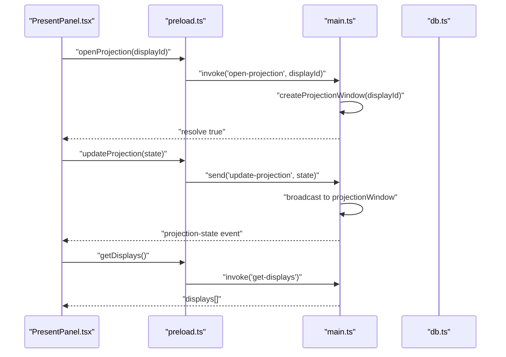
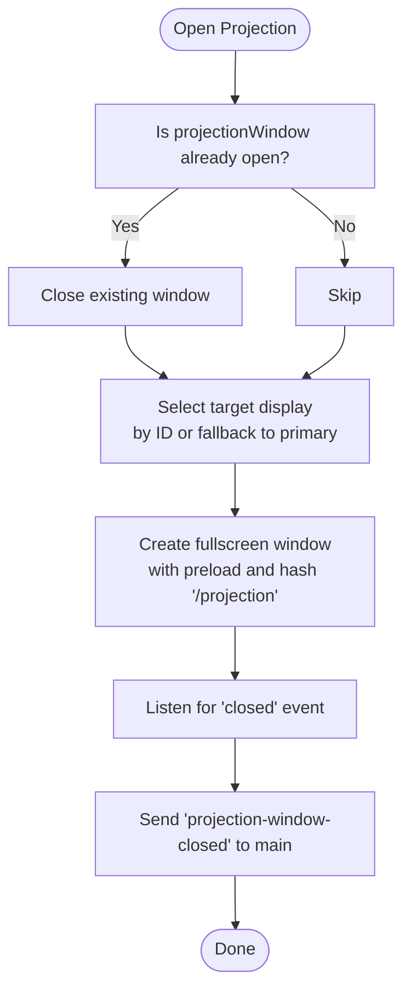
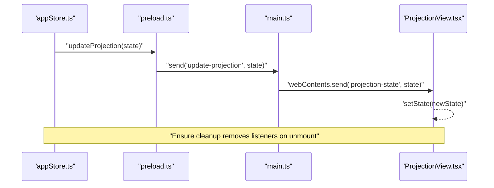
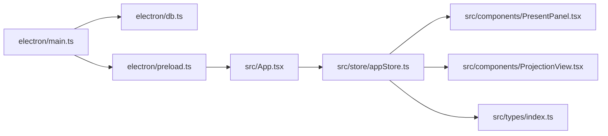

# Troubleshooting and FAQ

<cite>
**Referenced Files in This Document**
- [README.md](file://README.md)
- [package.json](file://package.json)
- [forge.config.js](file://forge.config.js)
- [electron/main.ts](file://electron/main.ts)
- [electron/preload.ts](file://electron/preload.ts)
- [electron/db.ts](file://electron/db.ts)
- [src/App.tsx](file://src/App.tsx)
- [src/store/appStore.ts](file://src/store/appStore.ts)
- [src/components/ProjectionView.tsx](file://src/components/ProjectionView.tsx)
- [src/components/PresentPanel.tsx](file://src/components/PresentPanel.tsx)
- [src/types/index.ts](file://src/types/index.ts)
- [src/utils/seedData.ts](file://src/utils/seedData.ts)
</cite>

## Table of Contents
1. [Introduction](#introduction)
2. [Project Structure](#project-structure)
3. [Core Components](#core-components)
4. [Architecture Overview](#architecture-overview)
5. [Detailed Component Analysis](#detailed-component-analysis)
6. [Dependency Analysis](#dependency-analysis)
7. [Performance Considerations](#performance-considerations)
8. [Troubleshooting Guide](#troubleshooting-guide)
9. [Conclusion](#conclusion)
10. [Appendices](#appendices)

## Introduction
This document provides comprehensive troubleshooting and frequently asked questions for LyricDeck. It covers installation and build issues, runtime errors, performance tuning, platform-specific concerns for Windows and macOS, debugging techniques for Electron and React, diagnostics for projection windows and multi-monitor setups, IPC communication failures, data corruption and recovery, and escalation procedures.

## Project Structure
LyricDeck is an Electron + React + TypeScript application with a clear separation between the Electron main process (IPC, file I/O, projection windows), preload bridge, renderer React UI, and Zustand-based state management. Data is persisted locally via JSON files and an embedded SQLite database.

```mermaid
graph TB
subgraph "Electron Main Process"
M["electron/main.ts"]
D["electron/db.ts"]
P["electron/preload.ts"]
end
subgraph "Renderer (React)"
A["src/App.tsx"]
S["src/store/appStore.ts"]
PV["src/components/ProjectionView.tsx"]
PP["src/components/PresentPanel.tsx"]
T["src/types/index.ts"]
end
M --> D
M <- --> P
P --> A
A --> S
S --> PP
S --> PV
S --> M
A --> M
PP --> M
PV --> P
```

**Diagram sources**
- [electron/main.ts:1-390](file://electron/main.ts#L1-L390)
- [electron/db.ts:1-214](file://electron/db.ts#L1-L214)
- [electron/preload.ts:1-43](file://electron/preload.ts#L1-L43)
- [src/App.tsx:1-102](file://src/App.tsx#L1-L102)
- [src/store/appStore.ts:1-385](file://src/store/appStore.ts#L1-L385)
- [src/components/ProjectionView.tsx:1-134](file://src/components/ProjectionView.tsx#L1-L134)
- [src/components/PresentPanel.tsx:1-365](file://src/components/PresentPanel.tsx#L1-L365)
- [src/types/index.ts:1-89](file://src/types/index.ts#L1-L89)

**Section sources**
- [README.md:1-111](file://README.md#L1-L111)
- [package.json:1-97](file://package.json#L1-L97)
- [forge.config.js:1-45](file://forge.config.js#L1-L45)

## Core Components
- Electron main process orchestrates windows, IPC, file system access, and image storage via sql.js.
- Preload exposes a typed API surface to the renderer.
- Renderer app renders panels, manages state with Zustand, and communicates with the main process.
- Projection window renders live lyrics and backgrounds on a selected display.

Key responsibilities:
- Multi-monitor detection and selection.
- Fullscreen projection window creation and lifecycle.
- Local data persistence (songs, settings, preparation list) and image gallery.
- Import/export of application data.

**Section sources**
- [electron/main.ts:111-190](file://electron/main.ts#L111-L190)
- [electron/preload.ts:3-42](file://electron/preload.ts#L3-L42)
- [src/store/appStore.ts:361-384](file://src/store/appStore.ts#L361-L384)
- [src/components/ProjectionView.tsx:4-134](file://src/components/ProjectionView.tsx#L4-L134)

## Architecture Overview
The application uses Electron’s contextBridge to expose a typed API to the renderer. IPC channels are used for:
- Display enumeration and projection window control.
- Data persistence (songs, settings, preparation list).
- Image selection, gallery management, and serving images via a custom protocol.



**Diagram sources**
- [src/components/PresentPanel.tsx:109-129](file://src/components/PresentPanel.tsx#L109-L129)
- [electron/preload.ts:5-8](file://electron/preload.ts#L5-L8)
- [electron/main.ts:166-190](file://electron/main.ts#L166-L190)
- [electron/db.ts:70-87](file://electron/db.ts#L70-L87)

## Detailed Component Analysis

### Projection Window Lifecycle and Multi-Monitor Detection
Common issues:
- Projection window does not open on the intended monitor.
- Projection window closes unexpectedly.
- No displays detected.

Resolution steps:
- Verify display enumeration returns multiple entries and the correct primary/secondary assignment.
- Ensure a valid display ID is passed when opening the projection window.
- Confirm the projection window is not destroyed and that the main window receives the closed event.



**Diagram sources**
- [electron/main.ts:111-152](file://electron/main.ts#L111-L152)
- [electron/main.ts:166-184](file://electron/main.ts#L166-L184)
- [src/components/PresentPanel.tsx:26-36](file://src/components/PresentPanel.tsx#L26-L36)

**Section sources**
- [electron/main.ts:111-190](file://electron/main.ts#L111-L190)
- [src/components/PresentPanel.tsx:26-36](file://src/components/PresentPanel.tsx#L26-L36)

### IPC Communication Failures
Symptoms:
- Projection state not updating in the projection window.
- Display list not loading.
- Save/load operations silently fail.

Diagnostic checklist:
- Confirm preload exposes the expected channel names and signatures.
- Verify main registers handlers for invoke/send and sends events to the projection window.
- Check that the projection window listens for state updates and cleans up listeners on unmount.



**Diagram sources**
- [src/store/appStore.ts:242-249](file://src/store/appStore.ts#L242-L249)
- [electron/preload.ts:11-16](file://electron/preload.ts#L11-L16)
- [electron/main.ts:186-190](file://electron/main.ts#L186-L190)
- [src/components/ProjectionView.tsx:22-29](file://src/components/ProjectionView.tsx#L22-L29)

**Section sources**
- [electron/preload.ts:3-42](file://electron/preload.ts#L3-L42)
- [electron/main.ts:154-190](file://electron/main.ts#L154-L190)
- [src/store/appStore.ts:242-249](file://src/store/appStore.ts#L242-L249)
- [src/components/ProjectionView.tsx:22-29](file://src/components/ProjectionView.tsx#L22-L29)

### Data Persistence and Corruption Recovery
Data locations:
- Songs, settings, preparation list: JSON files under the OS-specific app data directory.
- Images: Embedded in an sqlite database file under the same directory.

Failure modes:
- JSON parse errors during import.
- Empty or malformed export files.
- Database initialization or schema issues.

Recommended procedures:
- Backup data directory before importing.
- Validate export file integrity and version compatibility.
- On corruption, restore from the last known good backup and re-import selectively.
- For database corruption, remove the sqlite file to regenerate a fresh one (images will be lost; re-add from gallery).

**Section sources**
- [README.md:102-111](file://README.md#L102-L111)
- [electron/main.ts:356-383](file://electron/main.ts#L356-L383)
- [electron/db.ts:26-48](file://electron/db.ts#L26-L48)
- [electron/main.ts:267-354](file://electron/main.ts#L267-L354)

### Image Gallery and Background Management
Issues:
- Selected images not appearing in the gallery.
- Deleting images fails silently.
- Serving images via custom protocol returns 404.

Resolutions:
- Ensure image MIME types are recognized and inserted with correct metadata.
- Confirm the custom protocol handler is registered before app ready.
- Validate image URLs match the expected pattern and IDs exist in the database.

**Section sources**
- [electron/main.ts:220-264](file://electron/main.ts#L220-L264)
- [electron/db.ts:70-131](file://electron/db.ts#L70-L131)
- [electron/main.ts:361-374](file://electron/main.ts#L361-L374)

## Dependency Analysis
- Electron main process depends on:
  - Electron APIs for windows, screens, protocols, dialogs, and filesystem.
  - sql.js for embedded image storage.
  - Migration utilities for schema upgrades.
- Renderer depends on:
  - Preload-exposed IPC channels.
  - Zustand store for state.
  - Types for strict data modeling.



**Diagram sources**
- [electron/main.ts:1-390](file://electron/main.ts#L1-L390)
- [electron/db.ts:1-214](file://electron/db.ts#L1-L214)
- [electron/preload.ts:1-43](file://electron/preload.ts#L1-L43)
- [src/App.tsx:1-102](file://src/App.tsx#L1-L102)
- [src/store/appStore.ts:1-385](file://src/store/appStore.ts#L1-L385)
- [src/components/PresentPanel.tsx:1-365](file://src/components/PresentPanel.tsx#L1-L365)
- [src/components/ProjectionView.tsx:1-134](file://src/components/ProjectionView.tsx#L1-L134)
- [src/types/index.ts:1-89](file://src/types/index.ts#L1-L89)

**Section sources**
- [package.json:85-96](file://package.json#L85-L96)
- [forge.config.js:1-45](file://forge.config.js#L1-L45)

## Performance Considerations
- Rendering:
  - Minimize heavy DOM reflows by avoiding frequent style recalculations in loops.
  - Prefer CSS transforms for animations (already used for line offset transitions).
- State management:
  - Keep the projection state minimal and avoid unnecessary deep updates.
  - Debounce rapid UI-triggered updates to the projection window.
- Memory:
  - Avoid retaining references to deleted images or large buffers.
  - Periodically clear unused caches and listeners.
- Disk I/O:
  - Batch writes to JSON files and debounce persistence operations.
  - Use incremental saves after major edits.

[No sources needed since this section provides general guidance]

## Troubleshooting Guide

### Installation and Build Failures
Symptoms:
- npm install fails due to missing native modules or incompatible Node.js/npm versions.
- Build scripts fail with missing dependencies or bundling errors.

Checklist:
- Ensure Node.js 18+ and npm 9+ are installed.
- Clear node_modules and package-lock, then reinstall.
- Verify Vite and Electron packages are present.
- Confirm Electron Forge and asar packaging are configured.

**Section sources**
- [README.md:29-58](file://README.md#L29-L58)
- [package.json:6-16](file://package.json#L6-L16)
- [forge.config.js:1-45](file://forge.config.js#L1-L45)

### Runtime Errors
Common categories:
- Projection window not responding:
  - Verify display ID selection and that the window is not destroyed.
  - Ensure the preload exposes the correct channels and the projection window listens for state updates.
- Data not saving:
  - Confirm JSON files exist in the app data directory and are writable.
  - Check for exceptions during save operations and retry.
- Image gallery issues:
  - Validate MIME types and that the custom protocol handler is registered.

**Section sources**
- [electron/main.ts:111-190](file://electron/main.ts#L111-L190)
- [electron/preload.ts:3-42](file://electron/preload.ts#L3-L42)
- [electron/db.ts:26-48](file://electron/db.ts#L26-L48)

### Platform-Specific Issues

#### Windows
- Permission issues:
  - Run as administrator if encountering write failures to protected directories.
  - Ensure the app data directory path resolves correctly under %APPDATA%.
- File system access:
  - Confirm the data directory exists and is created if missing.
- Display detection:
  - If multi-monitor detection fails, verify hardware drivers and Windows display settings.

**Section sources**
- [README.md:104-106](file://README.md#L104-L106)
- [electron/main.ts:18-37](file://electron/main.ts#L18-L37)

#### macOS
- Permission issues:
  - Ensure the app has access to ~/Library/Application Support/ for data storage.
- File system access:
  - Confirm the directory is created and writable.
- Display detection:
  - If external displays are not detected, check System Preferences > Displays and mirroring settings.

**Section sources**
- [README.md:105-106](file://README.md#L105-L106)
- [electron/main.ts:18-37](file://electron/main.ts#L18-L37)

### Debugging Techniques

#### Electron Application Debugging
- Enable devtools:
  - Use the development URL in dev mode to access DevTools.
- Console logging:
  - Add logs around IPC handlers and window lifecycle events.
- Protocol debugging:
  - Verify the custom protocol registration and handler responses.

**Section sources**
- [electron/main.ts:96-100](file://electron/main.ts#L96-L100)
- [electron/main.ts:361-374](file://electron/main.ts#L361-L374)

#### React Component Issues
- ProjectionView rendering:
  - Verify state updates propagate and that the component cleans up listeners.
- PresentPanel controls:
  - Ensure keyboard shortcuts are attached and not triggered inside inputs.
- Zustand store:
  - Confirm actions dispatch and that persistence calls succeed.

**Section sources**
- [src/components/ProjectionView.tsx:22-29](file://src/components/ProjectionView.tsx#L22-L29)
- [src/components/PresentPanel.tsx:38-84](file://src/components/PresentPanel.tsx#L38-L84)
- [src/store/appStore.ts:361-384](file://src/store/appStore.ts#L361-L384)

#### State Management Problems
- Symptom: Changes not reflected in projection window.
- Steps:
  - Confirm setProjectionState updates the local state and calls updateProjection.
  - Verify preload forwards the message and the projection window receives it.

**Section sources**
- [src/store/appStore.ts:242-249](file://src/store/appStore.ts#L242-L249)
- [electron/preload.ts:11-16](file://electron/preload.ts#L11-L16)
- [src/components/ProjectionView.tsx:22-29](file://src/components/ProjectionView.tsx#L22-L29)

### Diagnostic Procedures

#### Projection Window Issues
- Confirm display enumeration returns expected results.
- Attempt opening the projection window on a different display ID.
- Check for “projection-window-closed” event propagation.

**Section sources**
- [electron/main.ts:155-164](file://electron/main.ts#L155-L164)
- [src/App.tsx:34-42](file://src/App.tsx#L34-L42)

#### Multi-Monitor Detection
- Use the display selector in PresentPanel to choose a target monitor.
- If no secondary display is found, the app defaults to the primary.

**Section sources**
- [src/components/PresentPanel.tsx:26-36](file://src/components/PresentPanel.tsx#L26-L36)

#### IPC Communication Failures
- Validate channel names and handler registration.
- Ensure the projection window subscribes to state updates and unsubscribes on unmount.

**Section sources**
- [electron/preload.ts:3-42](file://electron/preload.ts#L3-L42)
- [electron/main.ts:186-190](file://electron/main.ts#L186-L190)
- [src/components/ProjectionView.tsx:22-29](file://src/components/ProjectionView.tsx#L22-L29)

### Data Corruption, Backup, and Recovery
- Backup strategy:
  - Copy the entire app data directory before performing imports.
- Import validation:
  - Verify the export file has a valid version and required fields.
- Recovery steps:
  - If JSON files are corrupted, restore from backup.
  - If the database is corrupted, remove the sqlite file to reset image storage; re-add images afterward.

**Section sources**
- [README.md:102-111](file://README.md#L102-L111)
- [electron/main.ts:292-354](file://electron/main.ts#L292-L354)
- [electron/db.ts:26-48](file://electron/db.ts#L26-L48)

### Performance Optimization Tips
- Minimize DOM churn in ProjectionView.
- Debounce rapid state updates to the projection window.
- Persist data in batches rather than per keystroke.
- Monitor memory usage and avoid retaining large buffers.

[No sources needed since this section provides general guidance]

### Frequently Asked Questions

- Supported file formats:
  - Background images: jpg, jpeg, png, gif, webp, bmp.
  - Export format: lyricdeck (custom JSON with version field).

- System requirements:
  - Node.js 18+, npm 9+.
  - Electron runtime with asar packaging enabled.

- Data storage location:
  - Windows: %APPDATA%/lyricdeck/data/
  - macOS: ~/Library/Application Support/lyricdeck/data/

- Why does the projection window not open?
  - Ensure a display is selected and the window is not already open or destroyed.

- How do I reset or recover corrupted data?
  - Restore from backups of the data directory or remove the sqlite file to reset image storage.

**Section sources**
- [README.md:102-111](file://README.md#L102-L111)
- [README.md:104-106](file://README.md#L104-L106)
- [electron/main.ts:220-264](file://electron/main.ts#L220-L264)
- [electron/main.ts:267-354](file://electron/main.ts#L267-L354)

### Escalation Procedures and Community Support
- Gather logs:
  - Capture renderer and main process logs during reproduction.
  - Include OS version, Electron version, and steps to reproduce.
- Prepare a minimal repro:
  - Provide a small dataset and steps to trigger the issue.
- Submit issues:
  - Use the repository’s issue tracker with the above information.

[No sources needed since this section summarizes without analyzing specific files]

## Conclusion
This guide consolidates troubleshooting workflows for LyricDeck across installation, runtime, platform-specific environments, Electron/React debugging, projection diagnostics, IPC, data integrity, and performance. Use the diagnostic procedures and escalation steps to efficiently resolve issues and maintain a smooth user experience.

## Appendices

### Quick Reference: Data Paths and Channels
- Data directory:
  - Windows: %APPDATA%/lyricdeck/data/
  - macOS: ~/Library/Application Support/lyricdeck/data/
- IPC channels:
  - Displays: get-displays
  - Projection: open-projection, close-projection, is-projection-open, update-projection
  - Persistence: load-songs, save-songs, load-settings, save-settings, load-preparation-list, save-preparation-list
  - Images: select-image, add-background-image, list-background-images, delete-background-image
  - Import/Export: export-data, import-data

**Section sources**
- [README.md:104-106](file://README.md#L104-L106)
- [electron/preload.ts:3-42](file://electron/preload.ts#L3-L42)
- [electron/main.ts:155-354](file://electron/main.ts#L155-L354)