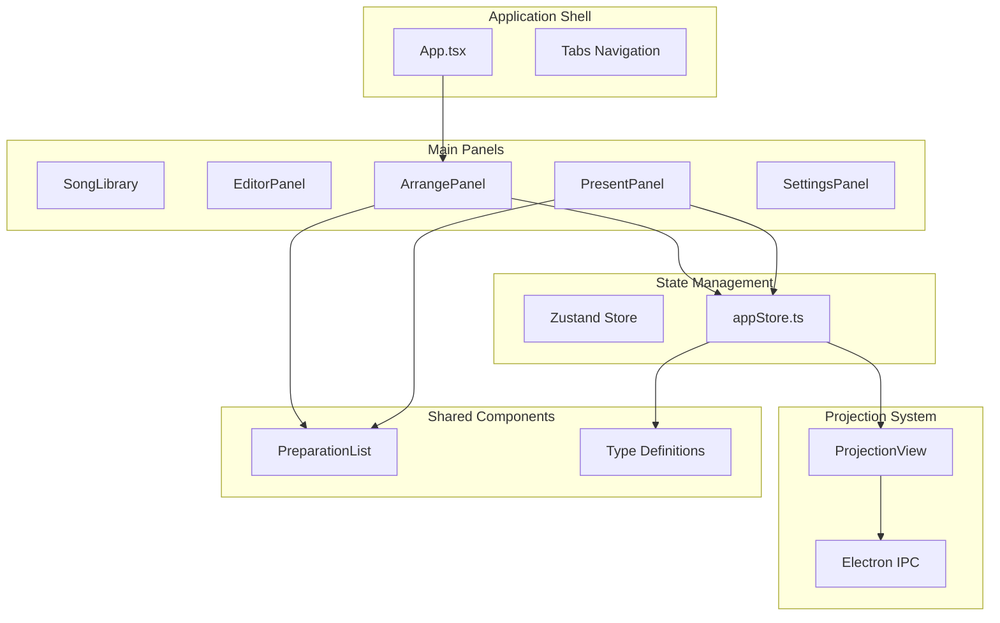
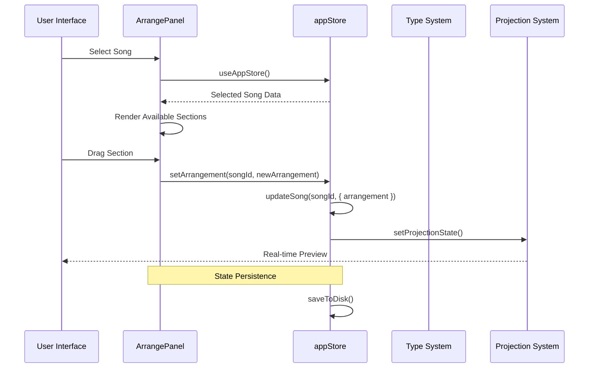
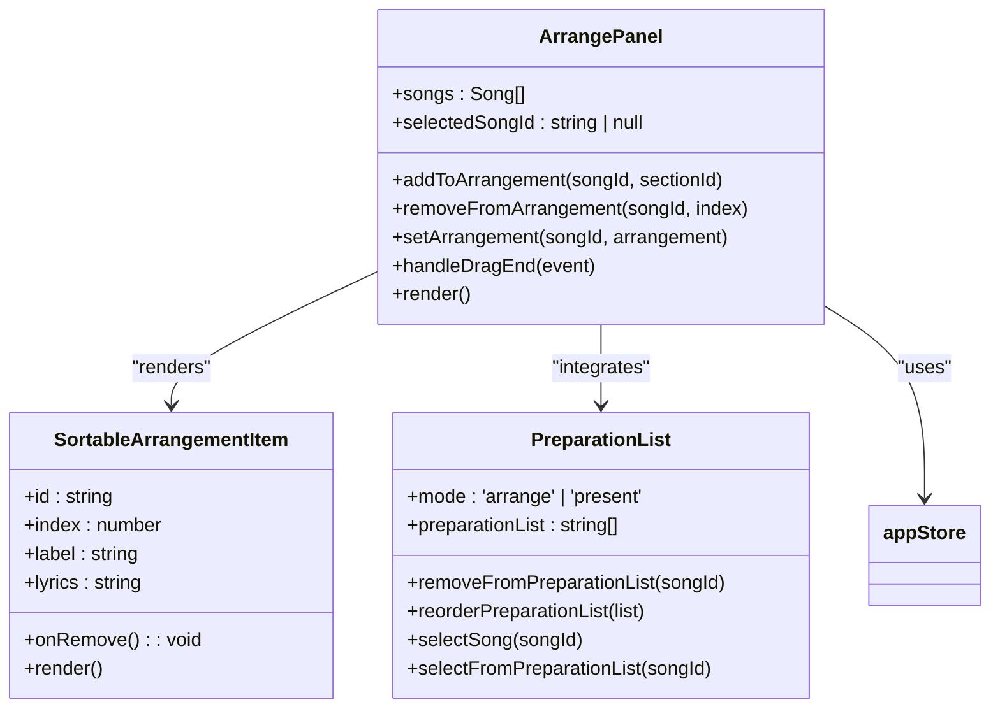
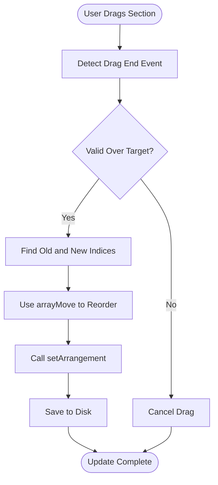
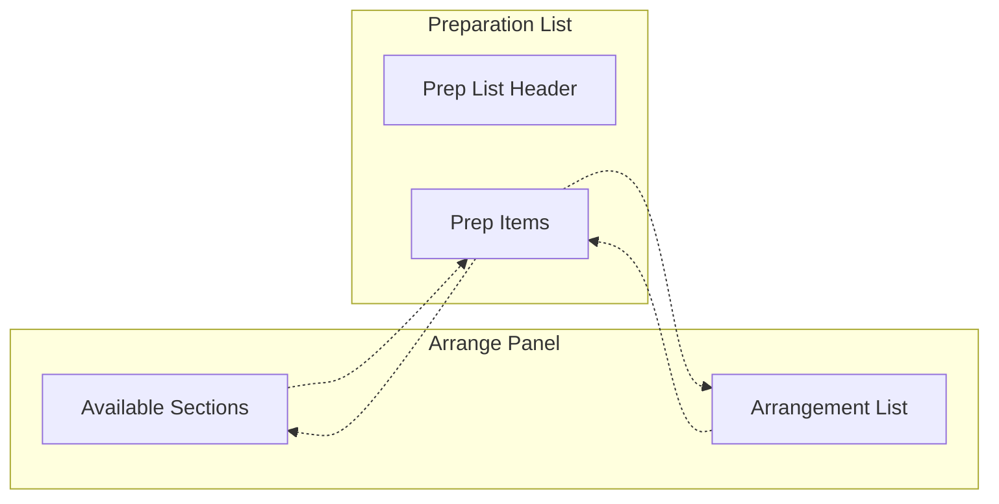
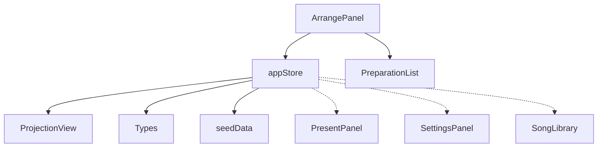

# Arrange Panel Component

<cite>
**Referenced Files in This Document**
- [ArrangePanel.tsx](file://src/components/ArrangePanel.tsx)
- [appStore.ts](file://src/store/appStore.ts)
- [index.ts](file://src/types/index.ts)
- [PreparationList.tsx](file://src/components/PreparationList.tsx)
- [PresentPanel.tsx](file://src/components/PresentPanel.tsx)
- [ProjectionView.tsx](file://src/components/ProjectionView.tsx)
- [en.ts](file://src/i18n/en.ts)
- [seedData.ts](file://src/utils/seedData.ts)
- [App.tsx](file://src/App.tsx)
- [package.json](file://package.json)
</cite>

## Table of Contents
1. [Introduction](#introduction)
2. [Project Structure](#project-structure)
3. [Core Components](#core-components)
4. [Architecture Overview](#architecture-overview)
5. [Detailed Component Analysis](#detailed-component-analysis)
6. [Dependency Analysis](#dependency-analysis)
7. [Performance Considerations](#performance-considerations)
8. [Troubleshooting Guide](#troubleshooting-guide)
9. [Conclusion](#conclusion)

## Introduction
The Arrange Panel component enables users to build custom presentation sequences by combining sections from different songs. It provides a drag-and-drop interface for creating arrangement flows, supports real-time preview of presentation order, and integrates with the global state store for persistence. The component coordinates with the projection system to deliver seamless live presentation experiences.

## Project Structure
The Arrange Panel is part of a larger presentation management system built with Electron, React, and TypeScript. The component follows a modular architecture with clear separation between UI components, state management, and data models.



**Diagram sources**
- [App.tsx:48-98](file://src/App.tsx#L48-L98)
- [ArrangePanel.tsx:22-134](file://src/components/ArrangePanel.tsx#L22-L134)
- [appStore.ts:98-385](file://src/store/appStore.ts#L98-L385)

**Section sources**
- [App.tsx:12-102](file://src/App.tsx#L12-L102)
- [package.json:98-108](file://package.json#L98-L108)

## Core Components
The Arrange Panel consists of several interconnected components that work together to provide a comprehensive arrangement building experience:

### Primary Components
- **ArrangePanel**: Main container and orchestrator for arrangement building
- **SortableArrangementItem**: Individual draggable arrangement items
- **PreparationList**: Shared preparation list integration
- **appStore**: Global state management with persistence

### Key Features
- Drag-and-drop arrangement building using @dnd-kit
- Real-time arrangement preview and validation
- Section combination from multiple songs
- Undo/redo capabilities through state persistence
- Responsive design with Tailwind CSS

**Section sources**
- [ArrangePanel.tsx:136-187](file://src/components/ArrangePanel.tsx#L136-L187)
- [appStore.ts:66-70](file://src/store/appStore.ts#L66-L70)

## Architecture Overview
The Arrange Panel implements a unidirectional data flow pattern with centralized state management:



**Diagram sources**
- [ArrangePanel.tsx:54-63](file://src/components/ArrangePanel.tsx#L54-L63)
- [appStore.ts:223-239](file://src/store/appStore.ts#L223-L239)
- [appStore.ts:242-274](file://src/store/appStore.ts#L242-L274)

The architecture ensures that all arrangement changes are immediately reflected in the projection system, providing real-time feedback during the arrangement building process.

**Section sources**
- [ArrangePanel.tsx:22-42](file://src/components/ArrangePanel.tsx#L22-L42)
- [appStore.ts:362-384](file://src/store/appStore.ts#L362-L384)

## Detailed Component Analysis

### ArrangePanel Component
The ArrangePanel serves as the primary interface for building presentation arrangements. It manages the drag-and-drop functionality and provides real-time feedback on arrangement changes.

#### Component Structure


**Diagram sources**
- [ArrangePanel.tsx:22-134](file://src/components/ArrangePanel.tsx#L22-L134)
- [ArrangePanel.tsx:136-187](file://src/components/ArrangePanel.tsx#L136-L187)
- [PreparationList.tsx:25-123](file://src/components/PreparationList.tsx#L25-L123)

#### Drag-and-Drop Implementation
The component uses @dnd-kit for robust drag-and-drop functionality:



**Diagram sources**
- [ArrangePanel.tsx:54-63](file://src/components/ArrangePanel.tsx#L54-L63)
- [appStore.ts:223-225](file://src/store/appStore.ts#L223-L225)

#### State Management Integration
The component integrates deeply with the global state store for comprehensive arrangement management:

**Section sources**
- [ArrangePanel.tsx:22-134](file://src/components/ArrangePanel.tsx#L22-L134)
- [appStore.ts:222-239](file://src/store/appStore.ts#L222-L239)

### SortableArrangementItem Component
Each arrangement item provides individual draggable functionality with visual feedback:

#### Item Properties
- **Drag Handle**: Three horizontal bars indicating draggable sections
- **Index Display**: Shows position in arrangement sequence
- **Section Information**: Label and first line of lyrics preview
- **Remove Button**: Hover-triggered removal functionality

#### Visual Feedback System
The component provides immediate visual feedback during drag operations:
- Reduced opacity during dragging
- Smooth transitions for position changes
- Hover states for interactive elements

**Section sources**
- [ArrangePanel.tsx:136-187](file://src/components/ArrangePanel.tsx#L136-L187)
- [ArrangePanel.tsx:150-156](file://src/components/ArrangePanel.tsx#L150-L156)

### Preparation List Integration
The Arrange Panel shares a preparation list with other components, enabling cross-component functionality:



**Diagram sources**
- [ArrangePanel.tsx:39-40](file://src/components/ArrangePanel.tsx#L39-L40)
- [PreparationList.tsx:71-122](file://src/components/PreparationList.tsx#L71-L122)

**Section sources**
- [PreparationList.tsx:25-123](file://src/components/PreparationList.tsx#L25-L123)

## Dependency Analysis

### External Dependencies
The Arrange Panel relies on several key external libraries:

```mermaid
graph TB
subgraph "UI Framework"
React[React 18]
TailwindCSS[Tailwind CSS]
end
subgraph "Drag & Drop"
DnDKit[@dnd-kit/core]
DnDSortable[@dnd-kit/sortable]
DnDUtilities[@dnd-kit/utilities]
end
subgraph "State Management"
Zustand[Zustand]
UUID[UUID]
end
subgraph "Electron Integration"
ElectronAPI[Electron IPC]
end
ArrangePanel --> React
ArrangePanel --> TailwindCSS
ArrangePanel --> DnDKit
ArrangePanel --> DnDSortable
ArrangePanel --> DnDUtilities
ArrangePanel --> Zustand
ArrangePanel --> UUID
ArrangePanel --> ElectronAPI
```

**Diagram sources**
- [package.json:98-108](file://package.json#L98-L108)
- [ArrangePanel.tsx:1-21](file://src/components/ArrangePanel.tsx#L1-L21)

### Internal Dependencies
The component maintains loose coupling with other system components:



**Diagram sources**
- [ArrangePanel.tsx:1-21](file://src/components/ArrangePanel.tsx#L1-L21)
- [appStore.ts:98-385](file://src/store/appStore.ts#L98-L385)

**Section sources**
- [package.json:98-108](file://package.json#L98-L108)
- [ArrangePanel.tsx:1-21](file://src/components/ArrangePanel.tsx#L1-L21)

## Performance Considerations
The Arrange Panel is designed for optimal performance in interactive scenarios:

### Rendering Optimizations
- **Virtual Scrolling**: Long arrangement lists benefit from virtualized rendering
- **Conditional Rendering**: Empty states and loading states minimize DOM updates
- **Efficient State Updates**: Batched updates prevent unnecessary re-renders

### Memory Management
- **Weak References**: Avoid circular references in drag-and-drop handlers
- **Cleanup Functions**: Proper event listener cleanup prevents memory leaks
- **Immutable Updates**: State updates use immutable patterns for efficient diffing

### Network and Persistence
- **Debounced Saves**: Frequent arrangement changes are batched for disk I/O efficiency
- **Incremental Updates**: Only changed sections are persisted to disk
- **Offline First**: Local storage ensures immediate responsiveness

## Troubleshooting Guide

### Common Issues and Solutions

#### Drag-and-Drop Not Working
**Symptoms**: Items cannot be dragged or dropped
**Causes**: 
- Missing DnD context providers
- Incorrect item IDs
- Sensor configuration issues

**Solutions**:
- Verify DndContext wrapping around arrangement list
- Ensure unique item IDs for each arrangement slot
- Check sensor configuration matches component requirements

#### Arrangement Not Persisting
**Symptoms**: Changes reset after refresh
**Causes**:
- Save function not triggered
- Disk write permissions issue
- State synchronization problems

**Solutions**:
- Confirm saveToDisk() is called after state changes
- Verify Electron IPC communication is established
- Check for error handling in persistence operations

#### Projection Preview Not Updating
**Symptoms**: Live preview shows old arrangement
**Causes**:
- Projection state not updated
- Electron IPC connection failure
- State synchronization delays

**Solutions**:
- Verify setProjectionState() is called after arrangement changes
- Check ElectronAPI.onProjectionState() event listeners
- Ensure state updates propagate to projection window

**Section sources**
- [appStore.ts:242-249](file://src/store/appStore.ts#L242-L249)
- [appStore.ts:379-383](file://src/store/appStore.ts#L379-L383)

## Conclusion
The Arrange Panel component provides a sophisticated solution for building custom presentation arrangements. Its integration with drag-and-drop technology, global state management, and projection systems creates a seamless workflow for creating engaging live presentations. The component's architecture supports extensibility while maintaining performance and reliability.

The implementation demonstrates best practices in modern React development, including proper state management, accessibility considerations, and responsive design patterns. The component serves as a foundation for advanced presentation workflows while remaining intuitive for users.

Future enhancements could include advanced arrangement templates, collaborative editing features, and enhanced validation for arrangement integrity. The current architecture provides a solid foundation for these potential improvements.