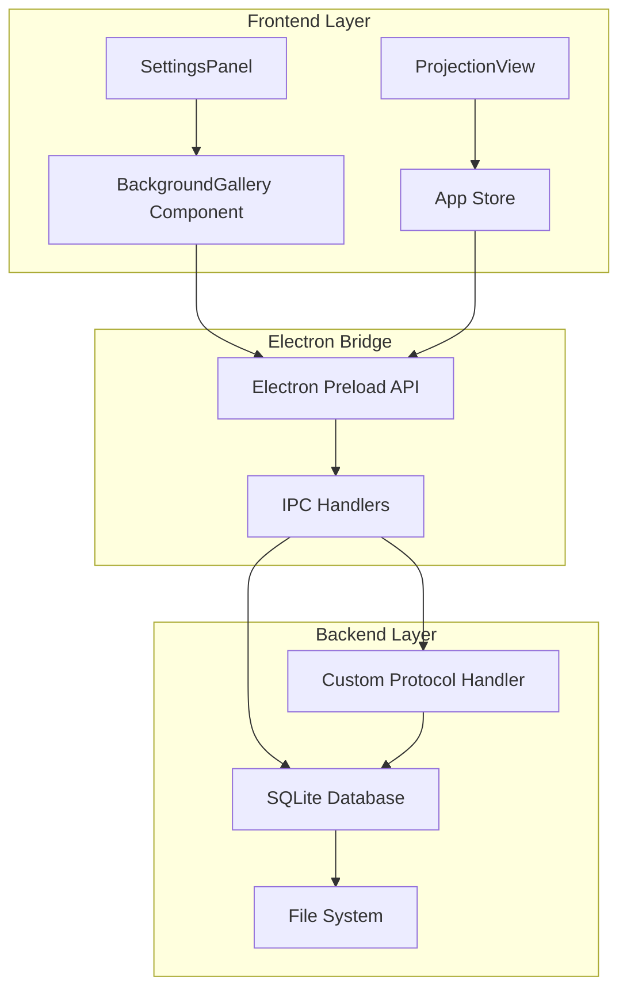
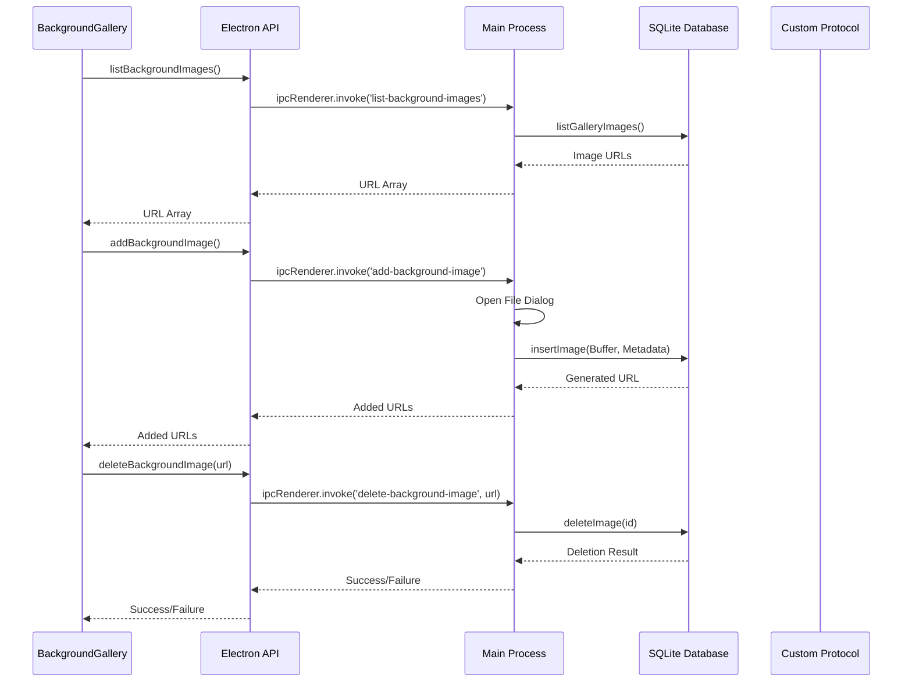
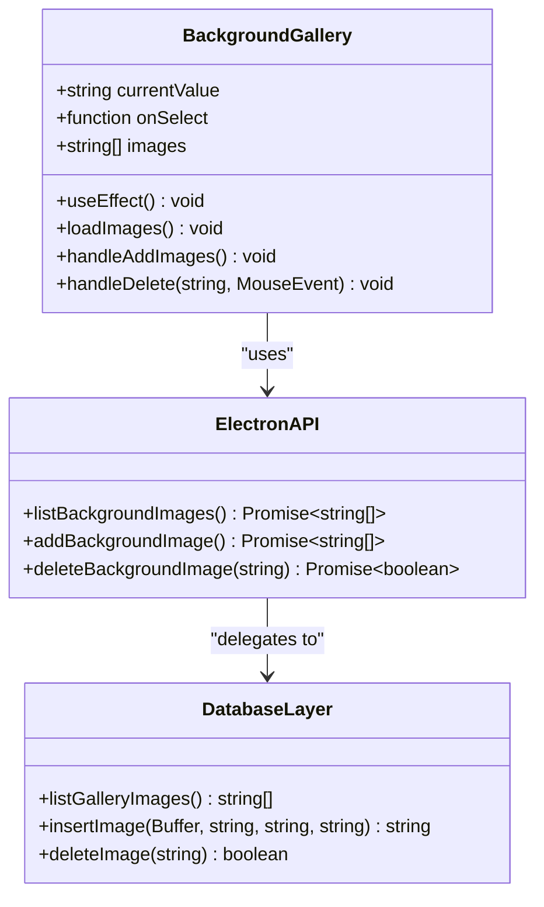
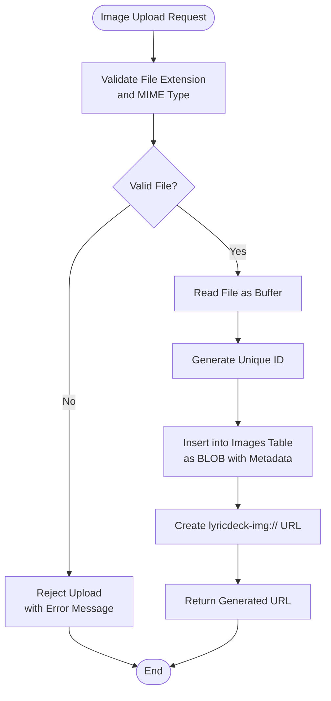
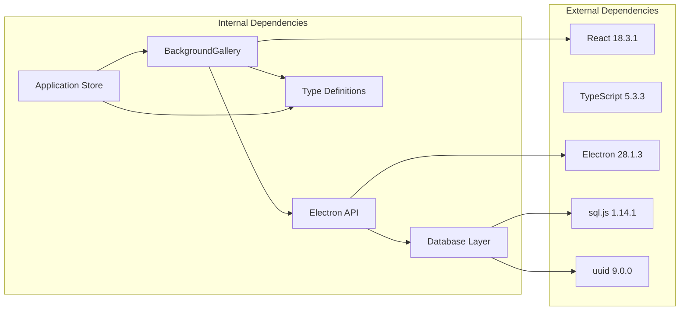

# Background Gallery Component

<cite>
**Referenced Files in This Document**
- [BackgroundGallery.tsx](file://src/components/BackgroundGallery.tsx)
- [db.ts](file://electron/db.ts)
- [main.ts](file://electron/main.ts)
- [preload.ts](file://electron/preload.ts)
- [SettingsPanel.tsx](file://src/components/SettingsPanel.tsx)
- [ProjectionView.tsx](file://src/components/ProjectionView.tsx)
- [appStore.ts](file://src/store/appStore.ts)
- [index.ts](file://src/types/index.ts)
- [en.ts](file://src/i18n/en.ts)
- [migrate.ts](file://electron/migrate.ts)
</cite>

## Table of Contents
1. [Introduction](#introduction)
2. [Project Structure](#project-structure)
3. [Core Components](#core-components)
4. [Architecture Overview](#architecture-overview)
5. [Detailed Component Analysis](#detailed-component-analysis)
6. [Dependency Analysis](#dependency-analysis)
7. [Performance Considerations](#performance-considerations)
8. [Troubleshooting Guide](#troubleshooting-guide)
9. [Conclusion](#conclusion)

## Introduction
The Background Gallery component is a specialized UI element responsible for managing background image assets and gallery operations within the LyricDeck desktop application. It provides a user-friendly interface for browsing, selecting, uploading, and organizing background images used in the projection system. The component integrates deeply with the application's database layer to persist images as SQLite BLOBs, implements a custom secure protocol for serving images, and coordinates with the settings and projection components to deliver a seamless background customization experience.

The component serves as a central hub for background image management, supporting both individual song-specific images and shared gallery images. It leverages Electron's IPC mechanisms to communicate with the main process, enabling secure file operations and database interactions. The implementation emphasizes performance through efficient caching strategies and provides robust error handling for various image-related scenarios.

## Project Structure
The Background Gallery component is part of a modular React-based frontend architecture with a complementary Electron backend. The component follows a clear separation of concerns, with the frontend handling UI logic and user interactions, while the backend manages database operations and secure image serving.

**Diagram sources**
- [BackgroundGallery.tsx:1-98](file://src/components/BackgroundGallery.tsx#L1-L98)
- [preload.ts:1-43](file://electron/preload.ts#L1-L43)
- [db.ts:1-214](file://electron/db.ts#L1-L214)
- [main.ts:1-389](file://electron/main.ts#L1-L389)

**Section sources**
- [BackgroundGallery.tsx:1-98](file://src/components/BackgroundGallery.tsx#L1-L98)
- [preload.ts:1-43](file://electron/preload.ts#L1-L43)

## Core Components
The Background Gallery component consists of several interconnected parts that work together to provide comprehensive background image management capabilities:

### Component Architecture
The component follows a React functional component pattern with TypeScript interfaces for type safety. It maintains local state for image collections and integrates with the internationalization system for dynamic UI text.

### Database Integration
The component communicates with a SQLite-based database system that stores images as BLOB data along with metadata including MIME types, filenames, and creation timestamps. The database schema supports both gallery images and song-specific images through a source field differentiation.

### Security Implementation
The system implements a custom secure protocol (`lyricdeck-img://`) that serves images directly from the database, bypassing filesystem access and providing controlled image delivery for the projection system.

**Section sources**
- [BackgroundGallery.tsx:4-7](file://src/components/BackgroundGallery.tsx#L4-L7)
- [db.ts:50-68](file://electron/db.ts#L50-L68)
- [main.ts:12-16](file://electron/main.ts#L12-L16)

## Architecture Overview
The Background Gallery component operates within a sophisticated architecture that combines frontend React components with Electron's multi-process architecture and a local SQLite database system.

**Diagram sources**
- [BackgroundGallery.tsx:17-40](file://src/components/BackgroundGallery.tsx#L17-L40)
- [preload.ts:34-37](file://electron/preload.ts#L34-L37)
- [main.ts:237-264](file://electron/main.ts#L237-L264)
- [db.ts:106-131](file://electron/db.ts#L106-L131)

The architecture ensures secure image handling through the custom protocol system, which validates requests and serves images directly from memory without exposing filesystem paths. This design prevents potential security vulnerabilities and provides consistent image delivery across different deployment scenarios.

**Section sources**
- [main.ts:361-374](file://electron/main.ts#L361-L374)
- [db.ts:89-104](file://electron/db.ts#L89-L104)

## Detailed Component Analysis

### BackgroundGallery Component
The BackgroundGallery component serves as the primary interface for background image management, providing an intuitive grid-based gallery with thumbnail previews and interactive controls.

#### Component Structure and Props
The component accepts two main props: `currentValue` for tracking the currently selected image and `onSelect` callback for handling selection events. It maintains internal state for the image collection and integrates with the internationalization system for localized UI text.

#### Image Loading and Display
The component implements lazy loading through an effect hook that fetches available images from the database upon initialization. Images are displayed in a responsive grid layout with aspect ratio preservation and hover effects for better user interaction.

#### User Interaction Patterns
The component supports multiple interaction modes including single-click selection, bulk deletion with confirmation dialogs, and batch addition of multiple images. The UI provides visual feedback through selection indicators and hover states.

**Diagram sources**
- [BackgroundGallery.tsx:9-40](file://src/components/BackgroundGallery.tsx#L9-L40)
- [preload.ts:34-37](file://electron/preload.ts#L34-L37)
- [db.ts:106-131](file://electron/db.ts#L106-L131)

**Section sources**
- [BackgroundGallery.tsx:9-97](file://src/components/BackgroundGallery.tsx#L9-L97)

### Database Storage System
The SQLite-based storage system provides robust persistence for background images with support for both gallery and song-specific images through a source differentiation mechanism.

#### Schema Design
The database schema includes an `images` table with fields for unique identifiers, filenames, MIME types, binary data storage, source categorization, and timestamps. The `meta` table supports application metadata storage for migration tracking and configuration settings.

#### BLOB Storage Implementation
Images are stored as BLOB data within the SQLite database, eliminating external file dependencies and simplifying application distribution. The storage system automatically handles MIME type detection and provides efficient retrieval mechanisms.

#### Migration Support
The system includes comprehensive migration capabilities that can convert legacy image storage formats to the current BLOB-based system, ensuring backward compatibility and smooth upgrades for existing installations.

**Diagram sources**
- [db.ts:70-87](file://electron/db.ts#L70-L87)
- [main.ts:237-255](file://electron/main.ts#L237-L255)

**Section sources**
- [db.ts:50-68](file://electron/db.ts#L50-L68)
- [db.ts:70-87](file://electron/db.ts#L70-L87)
- [migrate.ts:8-43](file://electron/migrate.ts#L8-L43)

### Custom Protocol Implementation
The custom `lyricdeck-img://` protocol provides secure and efficient image serving directly from the database, bypassing traditional file system access patterns.

#### Protocol Registration
The protocol is registered during application startup with appropriate security privileges, enabling Fetch API support and secure resource loading. The registration ensures proper isolation between the renderer and main processes.

#### Image Serving Mechanism
The protocol handler extracts image IDs from URLs, retrieves corresponding data from the database, and serves images with appropriate MIME type headers and caching directives. The implementation includes error handling for missing or corrupted images.

#### Security Benefits
By serving images through a custom protocol, the system eliminates direct file system access and provides controlled resource loading. This approach enhances security by preventing potential path traversal attacks and unauthorized file access.

**Section sources**
- [main.ts:12-16](file://electron/main.ts#L12-L16)
- [main.ts:361-374](file://electron/main.ts#L361-L374)
- [db.ts:89-104](file://electron/db.ts#L89-L104)

### Integration with Application Components
The Background Gallery component integrates seamlessly with other application components to provide a cohesive background customization experience.

#### Settings Panel Integration
The component is embedded within the Settings Panel, allowing users to manage both individual song backgrounds and shared gallery images. The integration supports switching between different background types and provides visual previews of background effects.

#### Projection System Coordination
The component works in conjunction with the Projection View to ensure real-time updates when background images change. The projection system receives updates through the application store and responds immediately to background modifications.

#### Store Integration
The component integrates with the Zustand-based application store to maintain consistent state across different views and components. Changes made in the gallery are reflected throughout the application immediately.

**Section sources**
- [SettingsPanel.tsx:181-186](file://src/components/SettingsPanel.tsx#L181-L186)
- [ProjectionView.tsx:22-29](file://src/components/ProjectionView.tsx#L22-L29)
- [appStore.ts:242-249](file://src/store/appStore.ts#L242-L249)

## Dependency Analysis
The Background Gallery component exhibits well-managed dependencies that promote maintainability and testability while ensuring loose coupling between components.

**Diagram sources**
- [package.json:98-108](file://package.json#L98-L108)
- [BackgroundGallery.tsx:1](file://src/components/BackgroundGallery.tsx#L1)
- [db.ts:1](file://electron/db.ts#L1)

The dependency graph reveals a clean separation of concerns with minimal circular dependencies. The component depends on React for UI rendering, Electron for native functionality, and sql.js for database operations, while maintaining loose coupling through well-defined interfaces.

**Section sources**
- [package.json:98-108](file://package.json#L98-L108)
- [BackgroundGallery.tsx:1-2](file://src/components/BackgroundGallery.tsx#L1-L2)

## Performance Considerations
The Background Gallery component implements several performance optimization strategies to ensure responsive user interactions and efficient resource utilization.

### Memory Management
Images are stored as BLOB data within the SQLite database, eliminating the need for separate file system operations and reducing memory overhead. The database connection is managed efficiently to minimize resource consumption.

### Caching Strategies
The custom protocol implementation includes appropriate cache headers that enable browser-level caching of frequently accessed images. This reduces database load and improves response times for repeated requests.

### Batch Operations
The component supports batch image uploads through multi-selection file dialogs, allowing users to add multiple images in a single operation. The backend processes these operations efficiently and returns results asynchronously.

### Responsive Design
The grid-based layout adapts to different screen sizes and maintains optimal thumbnail sizing. The implementation uses CSS Grid for efficient rendering and includes scrollable containers for large image collections.

## Troubleshooting Guide

### Common Image Upload Issues
**Problem**: Images fail to upload or display after selection
- Verify file format compatibility (JPG, PNG, GIF, WebP, BMP)
- Check file size limitations and available disk space
- Ensure proper MIME type detection for supported formats
- Confirm database connectivity and write permissions

**Problem**: Corrupted or incomplete image files
- Implement file validation before database insertion
- Add checksum verification for image integrity
- Handle partial file transfers gracefully
- Provide user feedback for failed uploads

### Database Connection Problems
**Problem**: Unable to connect to or initialize the SQLite database
- Verify database file permissions and accessibility
- Check for concurrent access conflicts
- Ensure proper database schema initialization
- Monitor database file corruption and recovery options

**Problem**: Slow image loading or retrieval performance
- Optimize database queries with proper indexing
- Implement connection pooling for multiple concurrent operations
- Consider database compaction for large datasets
- Monitor memory usage and garbage collection

### Protocol and Security Issues
**Problem**: Custom protocol handler fails or returns errors
- Verify protocol registration during application startup
- Check URL format validation and ID extraction
- Ensure proper MIME type detection and header setting
- Validate security privileges and context isolation

**Problem**: Image serving failures or access denied errors
- Confirm URL format matches expected pattern
- Verify database record existence and accessibility
- Check for concurrent modification conflicts
- Validate cache control headers and expiration

### User Interface and Experience
**Problem**: Gallery not updating after image operations
- Implement proper state synchronization and re-rendering
- Add loading states and progress indicators
- Handle user confirmation dialogs appropriately
- Provide clear error messages and recovery options

**Problem**: Performance degradation with large image collections
- Implement virtual scrolling for large galleries
- Add pagination or infinite scrolling support
- Optimize thumbnail generation and caching
- Consider lazy loading for off-screen images

**Section sources**
- [db.ts:120-131](file://electron/db.ts#L120-L131)
- [main.ts:361-374](file://electron/main.ts#L361-L374)
- [BackgroundGallery.tsx:33-40](file://src/components/BackgroundGallery.tsx#L33-L40)

## Conclusion
The Background Gallery component represents a sophisticated solution for background image management within the LyricDeck application. Its architecture demonstrates excellent separation of concerns, with clear boundaries between frontend UI logic, Electron IPC communication, and backend database operations.

The component successfully addresses the core requirements of image upload and storage using SQLite BLOB storage, implements a secure custom protocol for image serving, and provides comprehensive gallery organization features. The integration with the database layer ensures reliable persistence, while the real-time update mechanisms keep the user interface responsive and consistent.

Through careful consideration of performance optimization, security implementation, and user experience design, the component delivers a robust foundation for background customization within the broader LyricDeck ecosystem. The modular architecture and well-defined interfaces facilitate future enhancements and maintenance while providing a solid user experience for managing background imagery.

The component's role in the overall system extends beyond simple image display, serving as a central coordination point for background management workflows that integrate seamlessly with the settings and projection components. This holistic approach ensures that background customization becomes an integral part of the application's presentation capabilities.