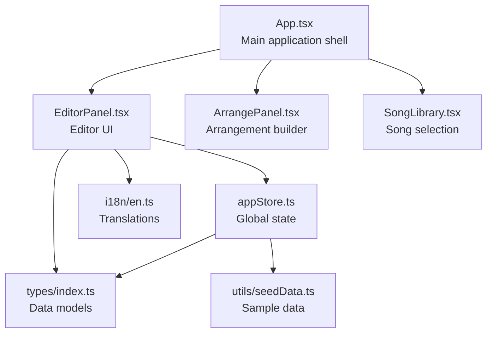
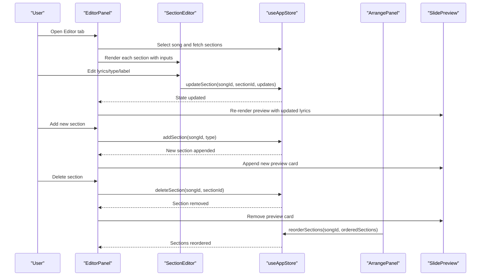
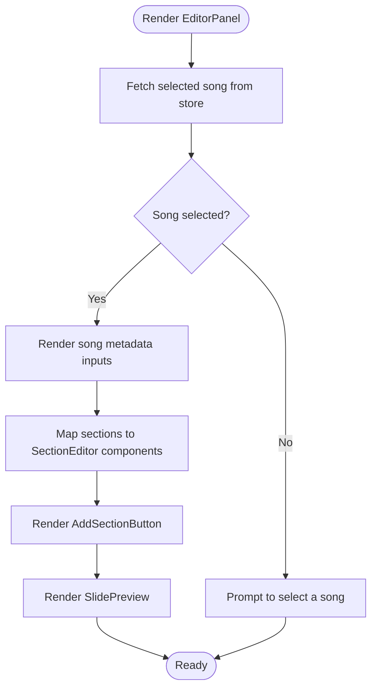
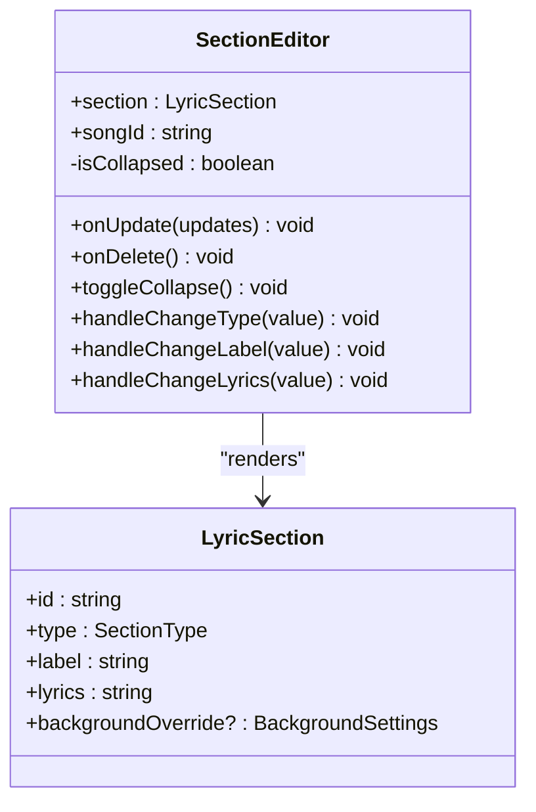
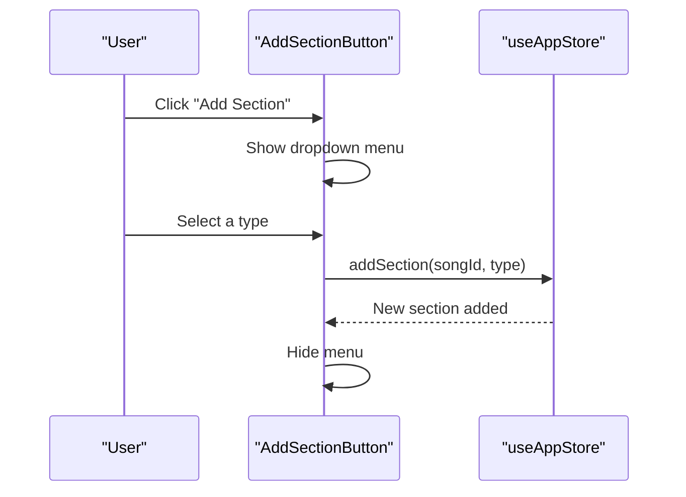
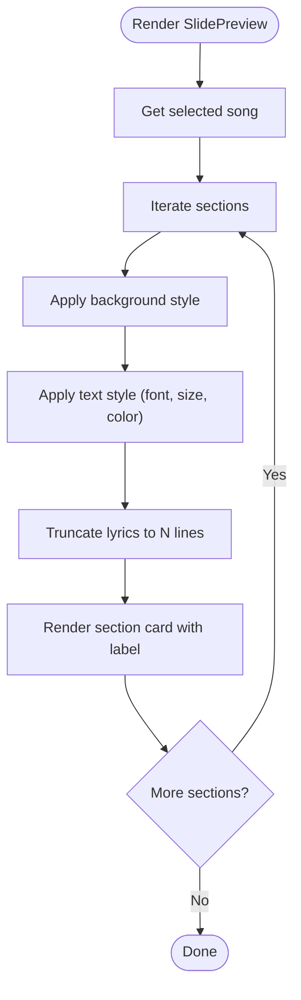
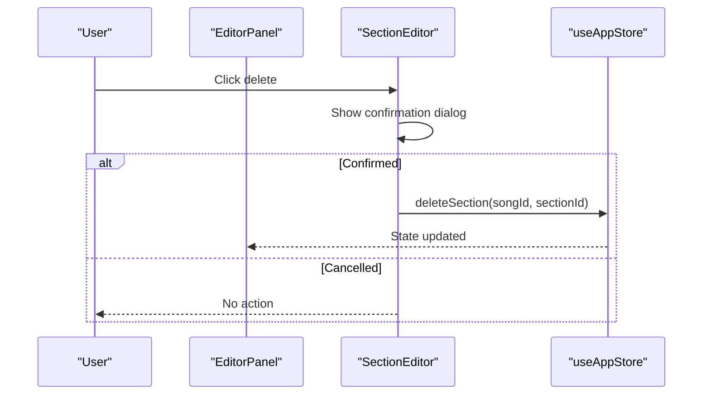
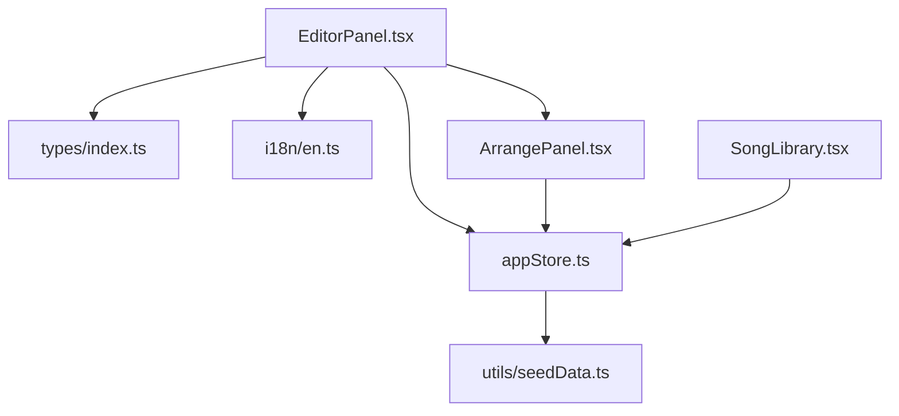

# Editor Panel Component

<cite>
**Referenced Files in This Document**
- [EditorPanel.tsx](file://src/components/EditorPanel.tsx)
- [appStore.ts](file://src/store/appStore.ts)
- [index.ts](file://src/types/index.ts)
- [App.tsx](file://src/App.tsx)
- [ArrangePanel.tsx](file://src/components/ArrangePanel.tsx)
- [SongLibrary.tsx](file://src/components/SongLibrary.tsx)
- [en.ts](file://src/i18n/en.ts)
- [index.ts](file://src/i18n/index.ts)
- [seedData.ts](file://src/utils/seedData.ts)
- [package.json](file://package.json)
- [README.md](file://README.md)
</cite>

## Table of Contents
1. [Introduction](#introduction)
2. [Project Structure](#project-structure)
3. [Core Components](#core-components)
4. [Architecture Overview](#architecture-overview)
5. [Detailed Component Analysis](#detailed-component-analysis)
6. [Dependency Analysis](#dependency-analysis)
7. [Performance Considerations](#performance-considerations)
8. [Troubleshooting Guide](#troubleshooting-guide)
9. [Conclusion](#conclusion)
10. [Appendices](#appendices)

## Introduction
The Editor Panel is the primary interface for creating and editing lyric sections within a song. It provides a rich text editing experience, supports multiple section types (verse, chorus, bridge, intro, outro, instrumental, and custom), and offers real-time preview capabilities. The component integrates tightly with the global state store for persistence and synchronization across the application, and it participates in the broader song creation pipeline alongside the Arrange Panel and Presentation features.

## Project Structure
The Editor Panel resides in the components directory and is integrated into the main application shell. It relies on the global Zustand store for data management and uses internationalization for UI text. The component’s responsibilities include rendering song metadata, managing section lists, enabling section creation and deletion, and providing a live preview of the presentation output.

**Diagram sources**
- [App.tsx:12-99](file://src/App.tsx#L12-L99)
- [EditorPanel.tsx:17-118](file://src/components/EditorPanel.tsx#L17-L118)
- [ArrangePanel.tsx:22-134](file://src/components/ArrangePanel.tsx#L22-L134)
- [SongLibrary.tsx:8-95](file://src/components/SongLibrary.tsx#L8-L95)
- [appStore.ts:98-385](file://src/store/appStore.ts#L98-L385)
- [index.ts:1-89](file://src/types/index.ts#L1-L89)
- [en.ts:1-180](file://src/i18n/en.ts#L1-L180)
- [seedData.ts:1-165](file://src/utils/seedData.ts#L1-L165)

**Section sources**
- [App.tsx:12-99](file://src/App.tsx#L12-L99)
- [EditorPanel.tsx:17-118](file://src/components/EditorPanel.tsx#L17-L118)
- [appStore.ts:98-385](file://src/store/appStore.ts#L98-L385)
- [index.ts:1-89](file://src/types/index.ts#L1-L89)
- [en.ts:1-180](file://src/i18n/en.ts#L1-L180)
- [seedData.ts:1-165](file://src/utils/seedData.ts#L1-L165)

## Core Components
- EditorPanel: Orchestrates the editor UI, renders song metadata, manages section lists, and provides a real-time preview.
- SectionEditor: Individual section editor with collapsible content, type selector, label input, and lyrics textarea.
- AddSectionButton: Dropdown menu for adding new sections with predefined types.
- SlidePreview: Real-time preview of how sections appear during projection, reflecting presentation settings.

Key responsibilities:
- Rich text editing for lyrics with monospace font and resizable textarea.
- Section type management with localized labels.
- Dynamic creation and deletion of sections with confirmation prompts.
- Real-time preview synchronized with presentation settings.
- Integration with global state for persistence and cross-component updates.

**Section sources**
- [EditorPanel.tsx:17-118](file://src/components/EditorPanel.tsx#L17-L118)
- [EditorPanel.tsx:120-176](file://src/components/EditorPanel.tsx#L120-L176)
- [EditorPanel.tsx:178-208](file://src/components/EditorPanel.tsx#L178-L208)
- [EditorPanel.tsx:210-246](file://src/components/EditorPanel.tsx#L210-L246)

## Architecture Overview
The Editor Panel is part of a multi-panel application. It collaborates with the Arrange Panel for ordering sections and the Presentation features for live projection. The global state store centralizes data and actions, ensuring consistency across panels.

**Diagram sources**
- [EditorPanel.tsx:17-118](file://src/components/EditorPanel.tsx#L17-L118)
- [appStore.ts:185-221](file://src/store/appStore.ts#L185-L221)
- [ArrangePanel.tsx:54-63](file://src/components/ArrangePanel.tsx#L54-L63)

## Detailed Component Analysis

### EditorPanel
The Editor Panel serves as the central hub for lyric section editing. It renders song metadata fields (title, song ID, artist) and presents a scrollable list of sections. Each section is editable via the SectionEditor component, and the AddSectionButton allows quick insertion of new sections. A right-side preview panel displays how sections will appear during projection.

Highlights:
- Song metadata editing with immediate persistence via the store.
- Section list rendering with individual editors and delete confirmation.
- Real-time preview synchronized with presentation settings.
- Responsive layout with a main editor area and a fixed-width preview panel.

**Diagram sources**
- [EditorPanel.tsx:17-118](file://src/components/EditorPanel.tsx#L17-L118)

**Section sources**
- [EditorPanel.tsx:17-118](file://src/components/EditorPanel.tsx#L17-L118)

### SectionEditor
Each lyric section is rendered by the SectionEditor component. It supports:
- Collapsible content to reduce clutter.
- Type selection dropdown with localized labels.
- Label input for human-friendly section identification.
- Rich text area for lyrics with monospace font and adjustable rows.

Behavior:
- Toggling collapse expands or hides the lyrics editor.
- Changing type updates the section’s type in the store.
- Updating label or lyrics triggers updateSection with partial updates.
- Delete button opens a confirmation dialog before removing the section.

**Diagram sources**
- [EditorPanel.tsx:120-176](file://src/components/EditorPanel.tsx#L120-L176)
- [index.ts:13-19](file://src/types/index.ts#L13-L19)

**Section sources**
- [EditorPanel.tsx:120-176](file://src/components/EditorPanel.tsx#L120-L176)
- [index.ts:3-11](file://src/types/index.ts#L3-L11)

### AddSectionButton
The AddSectionButton provides a dropdown menu of section types. When a type is selected, it triggers addSection in the store, which creates a new section with an auto-generated label based on existing sections of the same type.

**Diagram sources**
- [EditorPanel.tsx:178-208](file://src/components/EditorPanel.tsx#L178-L208)
- [appStore.ts:185-199](file://src/store/appStore.ts#L185-L199)

**Section sources**
- [EditorPanel.tsx:178-208](file://src/components/EditorPanel.tsx#L178-L208)
- [appStore.ts:185-199](file://src/store/appStore.ts#L185-L199)

### SlidePreview
The SlidePreview component renders a series of cards representing each section. It applies presentation settings such as background, font family, size, weight, and color. The preview truncates lyrics to a limited number of lines for readability.

**Diagram sources**
- [EditorPanel.tsx:210-246](file://src/components/EditorPanel.tsx#L210-L246)
- [EditorPanel.tsx:248-263](file://src/components/EditorPanel.tsx#L248-L263)

**Section sources**
- [EditorPanel.tsx:210-246](file://src/components/EditorPanel.tsx#L210-L246)
- [EditorPanel.tsx:248-263](file://src/components/EditorPanel.tsx#L248-L263)

### Section Type Management
The Editor Panel defines a fixed set of section types and localizes their labels. The store’s addSection action automatically assigns labels based on existing sections of the same type.

Supported section types:
- Intro, Verse, Pre-Chorus, Chorus, Bridge, Instrumental, Outro, Custom

Validation and labeling:
- When adding a new section, the store counts existing sections of the same type and generates a label like “Type 1”, “Type 2”, etc.
- The type selector dropdown uses localized labels from the translation resources.

**Section sources**
- [EditorPanel.tsx:6-15](file://src/components/EditorPanel.tsx#L6-L15)
- [appStore.ts:185-199](file://src/store/appStore.ts#L185-L199)
- [en.ts:53-62](file://src/i18n/en.ts#L53-L62)

### Dynamic Section Creation and Deletion
Creation:
- The AddSectionButton invokes addSection with a chosen type.
- The store appends a new section to the song’s sections array and persists the change.

Deletion:
- The SectionEditor’s delete button triggers deleteSection.
- The store removes the section from the sections array and from the arrangement if present.
- Confirmation prompts ensure accidental deletions are prevented.

**Diagram sources**
- [EditorPanel.tsx:98-102](file://src/components/EditorPanel.tsx#L98-L102)
- [appStore.ts:210-216](file://src/store/appStore.ts#L210-L216)

**Section sources**
- [EditorPanel.tsx:98-102](file://src/components/EditorPanel.tsx#L98-L102)
- [appStore.ts:210-216](file://src/store/appStore.ts#L210-L216)

### Drag-and-Drop Reordering System
While the Editor Panel itself does not implement drag-and-drop reordering, the Arrange Panel uses @dnd-kit to reorder sections in the presentation arrangement. The Editor Panel’s section list is ordered by the song’s sections array, which is managed by the store’s reorderSections action.

Integration points:
- The Arrange Panel’s DndContext and SortableContext manage drag-and drop.
- On drag end, the Arrange Panel computes a new arrangement order and calls setArrangement.
- The store’s reorderSections updates the sections array to reflect the new order.

Note: The Editor Panel does not expose a drag-and-drop mechanism for reordering sections within the editor; the Arrange Panel is the designated place for arranging sections for presentation.

**Section sources**
- [ArrangePanel.tsx:54-63](file://src/components/ArrangePanel.tsx#L54-L63)
- [appStore.ts:218-220](file://src/store/appStore.ts#L218-L220)

### Section Duplication Functionality
The Song Library provides duplication of entire songs, which includes duplicating all sections. This is useful for creating variations or drafts of a song without manually copying each section.

Workflow:
- The SongLibrary’s duplicateSong action clones a song, remaps section IDs, and updates the arrangement accordingly.
- The new song is persisted to the store and selected.

**Section sources**
- [SongLibrary.tsx:10-12](file://src/components/SongLibrary.tsx#L10-L12)
- [appStore.ts:151-172](file://src/store/appStore.ts#L151-L172)

### Real-Time Preview Capabilities
The SlidePreview component updates immediately when section content changes because:
- The store’s updateSection action modifies the sections array.
- The Editor Panel re-renders the preview panel whenever the store updates.
- The preview reads the current song’s sections and presentation settings.

Formatting options reflected in the preview:
- Background type and value (color, gradient, image).
- Text style including font family, size, weight, color, and shadow.
- Section label overlay.

**Section sources**
- [EditorPanel.tsx:210-246](file://src/components/EditorPanel.tsx#L210-L246)
- [appStore.ts:242-274](file://src/store/appStore.ts#L242-L274)

### Integration with Global State Store
The Editor Panel relies on the global Zustand store for:
- Fetching and updating song data.
- Adding, updating, and deleting sections.
- Persisting changes to disk via saveToDisk.
- Providing localized text via the i18n store.

Key store actions used:
- updateSong, addSection, updateSection, deleteSection, reorderSections.
- setProjectionState and goToSlide for presentation integration.

**Section sources**
- [EditorPanel.tsx:18-18](file://src/components/EditorPanel.tsx#L18-L18)
- [appStore.ts:174-180](file://src/store/appStore.ts#L174-L180)
- [appStore.ts:185-221](file://src/store/appStore.ts#L185-L221)
- [appStore.ts:379-383](file://src/store/appStore.ts#L379-L383)

### Validation Rules for Section Content
The Editor Panel does not enforce strict validation rules for section content. It focuses on providing a straightforward editing experience:
- Lyrics are free-form text with no enforced structure.
- Labels are user-defined and can be edited freely.
- Type selection is constrained to the predefined set of section types.

Validation considerations:
- Empty lyrics are allowed; the preview shows a placeholder message when empty.
- Deleting a section requires confirmation to prevent accidental loss.
- The store ensures section IDs remain unique and arranges sections consistently.

**Section sources**
- [EditorPanel.tsx:166-172](file://src/components/EditorPanel.tsx#L166-L172)
- [EditorPanel.tsx:99-101](file://src/components/EditorPanel.tsx#L99-L101)
- [en.ts:49-49](file://src/i18n/en.ts#L49-L49)

### Formatting Options
Formatting is primarily handled by the Settings Panel and applied to the SlidePreview:
- Background: color, gradient, or image.
- Text style: font family, size, weight, italic, color, alignment, vertical position, line height, margins, shadow, outline.
- Copyright display toggles whether to show copyright information on slides.

These settings influence the SlidePreview rendering and are persisted via the store.

**Section sources**
- [index.ts:21-48](file://src/types/index.ts#L21-L48)
- [EditorPanel.tsx:224-234](file://src/components/EditorPanel.tsx#L224-L234)

### Examples of Section Manipulation Workflows
- Add a new section:
  - Click “Add Section” in the Editor Panel.
  - Choose a type from the dropdown.
  - The store appends a new section with an auto-generated label.
- Edit a section:
  - Expand the section editor (toggle arrow).
  - Modify type, label, or lyrics.
  - Changes persist immediately.
- Delete a section:
  - Click the delete button in the section editor.
  - Confirm the deletion in the prompt.
  - The store removes the section and updates previews.
- Duplicate a song:
  - Use the duplicate action in the Song Library.
  - Creates a copy with remapped section IDs and arrangement.

**Section sources**
- [EditorPanel.tsx:178-208](file://src/components/EditorPanel.tsx#L178-L208)
- [EditorPanel.tsx:120-176](file://src/components/EditorPanel.tsx#L120-L176)
- [SongLibrary.tsx:10-12](file://src/components/SongLibrary.tsx#L10-L12)

### Keyboard Shortcuts for Common Operations
While the Editor Panel does not define dedicated shortcuts, the overall application provides keyboard shortcuts for presentation navigation:
- Space / Arrow Right: Next slide
- Arrow Left: Previous slide
- B: Toggle black screen
- C: Toggle clear (hide lyrics, keep background)
- Escape: Return to live mode

These shortcuts apply when the presentation window is active, complementing the Editor Panel’s editing workflow.

**Section sources**
- [README.md:106-115](file://README.md#L106-L115)

### Responsive Layout Adaptations
The Editor Panel adapts to different screen sizes:
- Main editor area grows to fill available space.
- Preview panel has a fixed width and scrolls independently.
- Inputs and buttons are sized for comfortable editing on desktop devices.

**Section sources**
- [EditorPanel.tsx:30-117](file://src/components/EditorPanel.tsx#L30-L117)

## Dependency Analysis
The Editor Panel depends on:
- Global state store for data and actions.
- Translation resources for UI labels.
- Types for data model definitions.
- Other panels for complementary workflows (Arrange Panel for ordering, Song Library for selection).

**Diagram sources**
- [EditorPanel.tsx:17-118](file://src/components/EditorPanel.tsx#L17-L118)
- [appStore.ts:98-385](file://src/store/appStore.ts#L98-L385)
- [ArrangePanel.tsx:22-134](file://src/components/ArrangePanel.tsx#L22-L134)
- [SongLibrary.tsx:8-95](file://src/components/SongLibrary.tsx#L8-L95)
- [seedData.ts:1-165](file://src/utils/seedData.ts#L1-L165)

**Section sources**
- [EditorPanel.tsx:17-118](file://src/components/EditorPanel.tsx#L17-L118)
- [appStore.ts:98-385](file://src/store/appStore.ts#L98-L385)
- [ArrangePanel.tsx:22-134](file://src/components/ArrangePanel.tsx#L22-L134)
- [SongLibrary.tsx:8-95](file://src/components/SongLibrary.tsx#L8-L95)
- [seedData.ts:1-165](file://src/utils/seedData.ts#L1-L165)

## Performance Considerations
- Efficient re-rendering: Updates to a single section trigger minimal re-renders due to targeted state updates.
- Preview optimization: SlidePreview renders only visible sections and applies styles dynamically without heavy computations.
- Store persistence: Changes are batched and persisted asynchronously to avoid blocking the UI.

[No sources needed since this section provides general guidance]

## Troubleshooting Guide
Common issues and resolutions:
- No song selected: The Editor Panel displays a prompt to select a song from the library. Switch to the Song Library panel and select a song.
- Section not appearing: Ensure the section has a valid label and lyrics. Verify that the section is not accidentally deleted.
- Preview not updating: Confirm that the store is persisting changes. If not, check for errors in the store’s saveToDisk action.
- Drag-and-drop not working in the Editor Panel: The Editor Panel does not support drag-and-drop reordering. Use the Arrange Panel instead.

**Section sources**
- [EditorPanel.tsx:22-28](file://src/components/EditorPanel.tsx#L22-L28)
- [ArrangePanel.tsx:54-63](file://src/components/ArrangePanel.tsx#L54-L63)

## Conclusion
The Editor Panel provides a focused, efficient interface for lyric section editing within the LyricDeck application. Its tight integration with the global state store ensures data consistency and enables seamless collaboration with other panels. While it does not implement drag-and-drop reordering, it offers robust section creation, editing, and real-time preview capabilities essential for the song creation pipeline.

[No sources needed since this section summarizes without analyzing specific files]

## Appendices

### Appendix A: Data Model Overview
The Editor Panel works with the following data models:
- Song: Contains metadata, sections, arrangement, and presentation settings.
- LyricSection: Represents a single section with type, label, lyrics, and optional background override.
- PresentationSettings: Defines background and text style for projection.

**Section sources**
- [index.ts:50-67](file://src/types/index.ts#L50-L67)
- [index.ts:13-19](file://src/types/index.ts#L13-L19)
- [index.ts:44-48](file://src/types/index.ts#L44-L48)

### Appendix B: Internationalization
The Editor Panel uses the i18n store to render localized text for placeholders, buttons, and messages. Ensure the locale is set appropriately for consistent user experience.

**Section sources**
- [en.ts:35-50](file://src/i18n/en.ts#L35-L50)
- [index.ts:35-43](file://src/i18n/index.ts#L35-L43)

### Appendix C: Sample Data
The application includes seed data to demonstrate typical song structures with various section types and lyrics.

**Section sources**
- [seedData.ts:51-165](file://src/utils/seedData.ts#L51-L165)