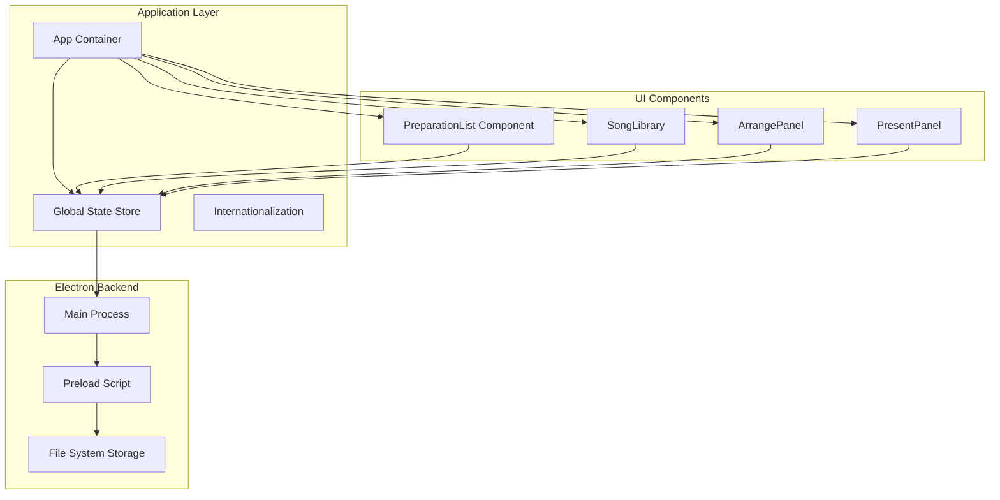
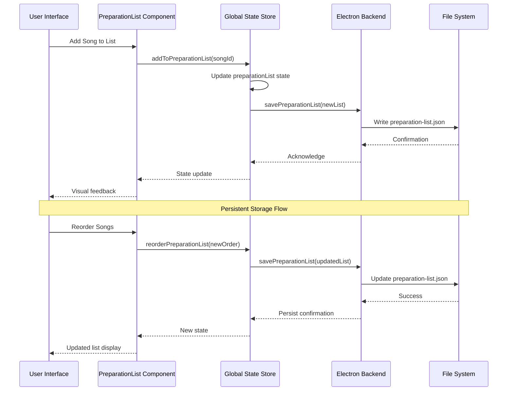
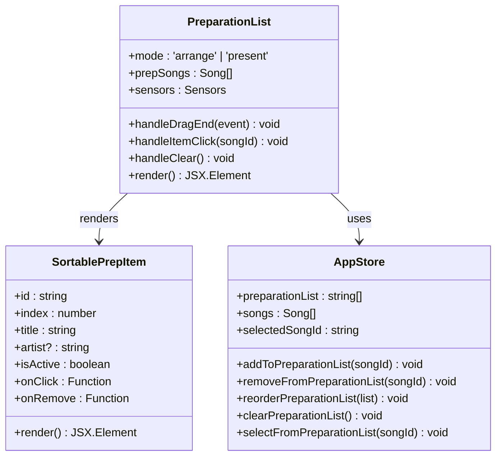
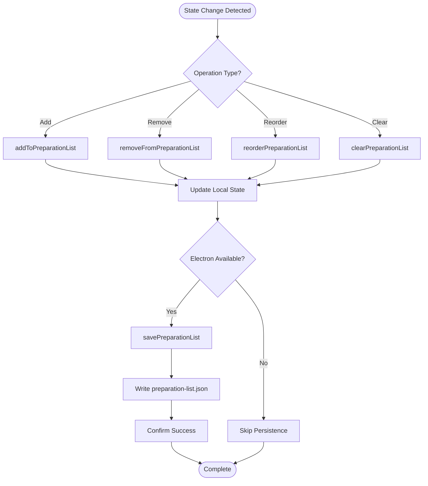

# Preparation List Component

<cite>
**Referenced Files in This Document**
- [PreparationList.tsx](file://src/components/PreparationList.tsx)
- [appStore.ts](file://src/store/appStore.ts)
- [SongLibrary.tsx](file://src/components/SongLibrary.tsx)
- [ArrangePanel.tsx](file://src/components/ArrangePanel.tsx)
- [PresentPanel.tsx](file://src/components/PresentPanel.tsx)
- [en.ts](file://src/i18n/en.ts)
- [main.ts](file://electron/main.ts)
- [preload.ts](file://electron/preload.ts)
- [seedData.ts](file://src/utils/seedData.ts)
</cite>

## Table of Contents
1. [Introduction](#introduction)
2. [Project Structure](#project-structure)
3. [Core Components](#core-components)
4. [Architecture Overview](#architecture-overview)
5. [Detailed Component Analysis](#detailed-component-analysis)
6. [Dependency Analysis](#dependency-analysis)
7. [Performance Considerations](#performance-considerations)
8. [Troubleshooting Guide](#troubleshooting-guide)
9. [Conclusion](#conclusion)
10. [Appendices](#appendices)

## Introduction
The Preparation List component provides quick access to frequently used songs for upcoming presentations. It serves as a centralized queue that streamlines the presentation preparation workflow by offering:
- Drag-and-drop reordering of preparation items
- Persistent storage of preparation lists across application sessions
- Real-time updates when songs are added or removed from the main library
- Integration with the global state store for preparation list persistence
- Keyboard navigation support for efficient workflow management
- Seamless integration with the arrangement and presentation systems

The component enhances presentation efficiency by allowing users to quickly organize their upcoming songs, maintain optimal order, and access them during both arrangement and presentation modes.

## Project Structure
The Preparation List component is part of a modular React application built with TypeScript and integrated with an Electron backend for persistence. The component follows a component-based architecture with clear separation of concerns.



**Diagram sources**
- [PreparationList.tsx:1-188](file://src/components/PreparationList.tsx#L1-L188)
- [appStore.ts:1-385](file://src/store/appStore.ts#L1-L385)
- [main.ts:1-390](file://electron/main.ts#L1-L390)

**Section sources**
- [PreparationList.tsx:1-188](file://src/components/PreparationList.tsx#L1-L188)
- [appStore.ts:1-385](file://src/store/appStore.ts#L1-L385)

## Core Components
The Preparation List component consists of several key elements that work together to provide a seamless preparation workflow:

### Component Architecture
The component is structured as a container component that manages state and delegates rendering to specialized child components. It utilizes the `@dnd-kit` library for drag-and-drop functionality and integrates with the global Zustand store for state management.

### State Management Integration
The component integrates with the global application state through the `useAppStore` hook, which provides access to:
- Preparation list data and manipulation functions
- Selected song identification
- Global song library access
- Persistence mechanisms

### Drag-and-Drop Implementation
The component implements a sophisticated drag-and-drop system using the `@dnd-kit` library, providing:
- Pointer-based dragging for mouse users
- Keyboard navigation support for accessibility
- Smooth animations and visual feedback
- Collision detection for precise placement

**Section sources**
- [PreparationList.tsx:25-123](file://src/components/PreparationList.tsx#L25-L123)
- [appStore.ts:316-359](file://src/store/appStore.ts#L316-L359)

## Architecture Overview
The Preparation List component operates within a layered architecture that separates concerns between UI presentation, state management, and data persistence.



**Diagram sources**
- [PreparationList.tsx:47-55](file://src/components/PreparationList.tsx#L47-L55)
- [appStore.ts:317-340](file://src/store/appStore.ts#L317-L340)
- [main.ts:211-218](file://electron/main.ts#L211-L218)

The architecture ensures that all state changes are immediately reflected in the UI while maintaining persistent storage through the Electron backend. The component handles both user interactions and system events, providing a responsive and reliable preparation workflow.

**Section sources**
- [PreparationList.tsx:101-118](file://src/components/PreparationList.tsx#L101-L118)
- [appStore.ts:362-377](file://src/store/appStore.ts#L362-L377)

## Detailed Component Analysis

### PreparationList Component Structure
The main component implements a clean separation of concerns with dedicated functions for different aspects of the preparation workflow.



**Diagram sources**
- [PreparationList.tsx:25-123](file://src/components/PreparationList.tsx#L25-L123)
- [PreparationList.tsx:125-187](file://src/components/PreparationList.tsx#L125-L187)
- [appStore.ts:316-359](file://src/store/appStore.ts#L316-L359)

### Drag-and-Drop Ordering System
The drag-and-drop implementation provides a smooth and intuitive way to reorder preparation items. The system uses the `@dnd-kit` library with specific configurations for optimal user experience.

#### Sensor Configuration
The component sets up dual sensor support:
- PointerSensor for mouse and touch interactions
- KeyboardSensor with sortableKeyboardCoordinates for accessibility

#### Collision Detection and Movement
The drag system implements intelligent collision detection using `closestCenter` to ensure precise placement during drag operations. The movement algorithm calculates the new position based on the dragged item's original and target positions.

#### Visual Feedback
The system provides comprehensive visual feedback during drag operations:
- Items fade to 50% opacity during dragging
- Smooth transitions for all state changes
- Hover effects for interactive elements

**Section sources**
- [PreparationList.tsx:38-41](file://src/components/PreparationList.tsx#L38-L41)
- [PreparationList.tsx:47-55](file://src/components/PreparationList.tsx#L47-L55)
- [PreparationList.tsx:142-148](file://src/components/PreparationList.tsx#L142-L148)

### Persistent Storage Implementation
The component maintains persistent storage through a sophisticated Electron-based backend that handles file I/O operations reliably.



**Diagram sources**
- [appStore.ts:317-347](file://src/store/appStore.ts#L317-L347)
- [main.ts:67-79](file://electron/main.ts#L67-L79)
- [preload.ts:28-29](file://electron/preload.ts#L28-L29)

#### File Storage Format
The preparation list is stored as a JSON array containing song IDs in the preferred order. The file format is designed for simplicity and reliability:
- Single array of string identifiers
- No nested structures for easy parsing
- Consistent ordering maintained across sessions

#### Load and Initialization
The component participates in the application's initialization process:
- Loads preparation list from disk on startup
- Merges with existing state if present
- Provides fallback behavior when no data exists

**Section sources**
- [appStore.ts:362-377](file://src/store/appStore.ts#L362-L377)
- [main.ts:35-37](file://electron/main.ts#L35-L37)
- [preload.ts:28-29](file://electron/preload.ts#L28-L29)

### Integration with Main Song Library
The Preparation List component maintains a bidirectional relationship with the main song library, ensuring data consistency and real-time updates.

#### Real-Time Synchronization
The component automatically updates when:
- Songs are added to the library
- Songs are removed from the library
- Song metadata changes
- Global search queries modify the visible song set

#### Conflict Resolution
The system handles potential conflicts gracefully:
- Missing songs in preparation list are filtered out
- Duplicate entries are prevented
- Invalid song IDs are ignored
- State remains consistent across all components

**Section sources**
- [PreparationList.tsx:43-45](file://src/components/PreparationList.tsx#L43-L45)
- [SongLibrary.tsx:72](file://src/components/SongLibrary.tsx#L72)

### Mode-Specific Behavior
The component adapts its behavior based on the current application mode, providing context-appropriate functionality.

#### Arrange Mode Features
In arrange mode, the component focuses on preparation list management:
- Full drag-and-drop reordering capabilities
- Preparation list as primary navigation tool
- Integration with arrangement building workflow

#### Present Mode Features
In present mode, the component becomes a quick-access selector:
- Direct selection of songs for immediate presentation
- Automatic navigation to first slide upon selection
- Streamlined access to prepared songs

**Section sources**
- [PreparationList.tsx:57-63](file://src/components/PreparationList.tsx#L57-L63)
- [PresentPanel.tsx:343](file://src/components/PresentPanel.tsx#L343)

## Dependency Analysis
The Preparation List component has well-defined dependencies that contribute to its modularity and maintainability.

```mermaid
graph LR
subgraph "External Dependencies"
DnDKit[@dnd-kit/core]
SortableKit[@dnd-kit/sortable]
Zustand[zustand]
UUID[uuid]
end
subgraph "Internal Dependencies"
AppStore[appStore.ts]
SongLibrary[SongLibrary.tsx]
ArrangePanel[ArrangePanel.tsx]
PresentPanel[PresentPanel.tsx]
ElectronMain[electron/main.ts]
ElectronPreload[electron/preload.ts]
end
PreparationList --> DnDKit
PreparationList --> SortableKit
PreparationList --> AppStore
PreparationList --> ElectronMain
PreparationList --> ElectronPreload
AppStore --> Zustand
AppStore --> UUID
PreparationList -.-> SongLibrary
PreparationList -.-> ArrangePanel
PreparationList -.-> PresentPanel
```

**Diagram sources**
- [PreparationList.tsx:1-19](file://src/components/PreparationList.tsx#L1-L19)
- [appStore.ts:1-3](file://src/store/appStore.ts#L1-L3)

### Coupling and Cohesion
The component demonstrates excellent design principles:
- Low coupling through dependency injection via hooks
- High cohesion within preparation list management
- Clear separation between UI and state management
- Minimal external dependencies

### Circular Dependency Prevention
The architecture prevents circular dependencies through:
- Centralized state management in the store
- Unidirectional data flow
- Event-driven communication patterns
- Clear component boundaries

**Section sources**
- [PreparationList.tsx:1-19](file://src/components/PreparationList.tsx#L1-L19)
- [appStore.ts:1-3](file://src/store/appStore.ts#L1-L3)

## Performance Considerations
The component is designed with performance optimization in mind, particularly for scenarios involving frequent state updates and large song libraries.

### Rendering Optimization
The component implements several optimization strategies:
- Efficient filtering of preparation list items
- Memoized song resolution from IDs
- Conditional rendering for empty states
- Optimized drag-and-drop event handling

### Memory Management
The system handles memory efficiently:
- Lightweight song object references
- Minimal DOM manipulation during drag operations
- Proper cleanup of event listeners
- Efficient state updates

### Scalability Factors
The component scales well with:
- Large preparation lists (thousands of songs)
- Frequent reordering operations
- Concurrent user interactions
- Multi-tab application usage

## Troubleshooting Guide

### Common Issues and Solutions

#### Preparation List Not Persisting
**Symptoms**: Preparation list resets after application restart
**Causes**: 
- Electron API not available
- File system write permissions
- JSON parsing errors

**Solutions**:
- Verify Electron backend is initialized
- Check file system permissions
- Validate JSON format in preparation-list.json

#### Drag-and-Drop Not Working
**Symptoms**: Items cannot be reordered
**Causes**:
- Missing pointer or keyboard sensors
- Conflicting event handlers
- CSS positioning issues

**Solutions**:
- Ensure sensor configuration is correct
- Check for event propagation conflicts
- Verify CSS transform properties

#### Songs Disappear from List
**Symptoms**: Songs suddenly missing from preparation list
**Causes**:
- Deleted songs from library
- Corrupted preparation-list.json
- ID mismatch issues

**Solutions**:
- Verify song still exists in library
- Check file integrity
- Recreate preparation list if necessary

#### Performance Issues
**Symptoms**: Slow response during reordering
**Causes**:
- Large song library
- Complex drag operations
- Memory leaks

**Solutions**:
- Optimize song library size
- Limit simultaneous drag operations
- Monitor memory usage

### Validation and Integrity Checks
The system includes built-in validation mechanisms:
- Duplicate prevention during addition
- Missing song filtering
- State consistency verification
- Error boundary handling

**Section sources**
- [appStore.ts:317-347](file://src/store/appStore.ts#L317-L347)
- [PreparationList.tsx:43-45](file://src/components/PreparationList.tsx#L43-L45)

## Conclusion
The Preparation List component represents a well-architected solution for managing frequently used songs in presentation workflows. Its design emphasizes:

- **User Experience**: Intuitive drag-and-drop interface with keyboard navigation
- **Reliability**: Persistent storage with robust error handling
- **Integration**: Seamless coordination with the broader application ecosystem
- **Performance**: Optimized rendering and state management
- **Accessibility**: Comprehensive keyboard support and visual feedback

The component successfully streamlines the presentation preparation workflow by providing quick access to curated song collections while maintaining data integrity and application responsiveness. Its modular design ensures maintainability and extensibility for future enhancements.

## Appendices

### Best Practices for Preparation List Management
- Regularly review and prune unused songs
- Maintain logical ordering for presentation flow
- Use the preparation list as a staging area for upcoming presentations
- Leverage keyboard shortcuts for efficient navigation
- Backup preparation lists before major library modifications

### Preparation Workflow Examples
1. **Daily Preparation**: Add songs to the list before morning service
2. **Service Planning**: Build temporary arrangements using preparation list
3. **Quick Access**: Maintain a separate list for recurring songs
4. **Backup Strategy**: Export preparation list before major updates

### Integration Points Reference
- Global state store: [appStore.ts](file://src/store/appStore.ts)
- Electron persistence: [main.ts](file://electron/main.ts), [preload.ts](file://electron/preload.ts)
- UI components: [PreparationList.tsx](file://src/components/PreparationList.tsx)
- Internationalization: [en.ts](file://src/i18n/en.ts)