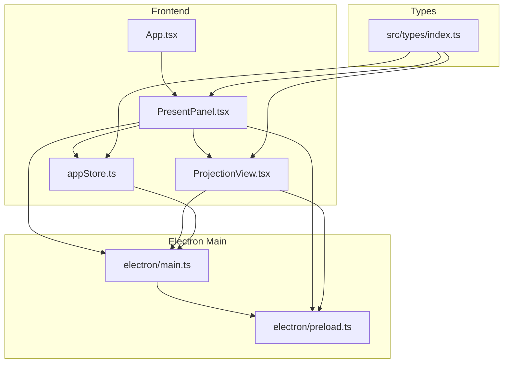
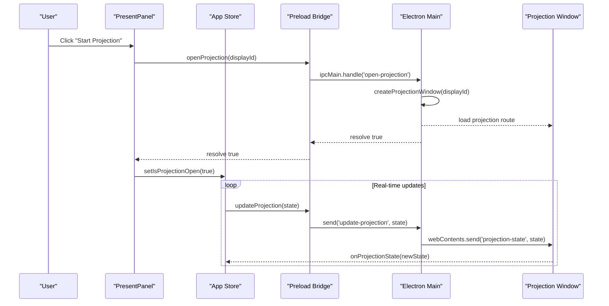
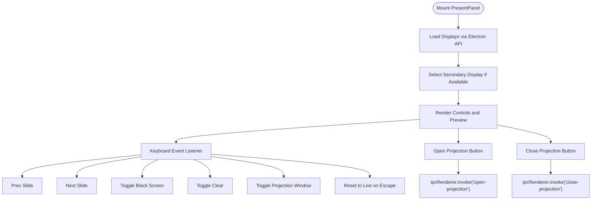
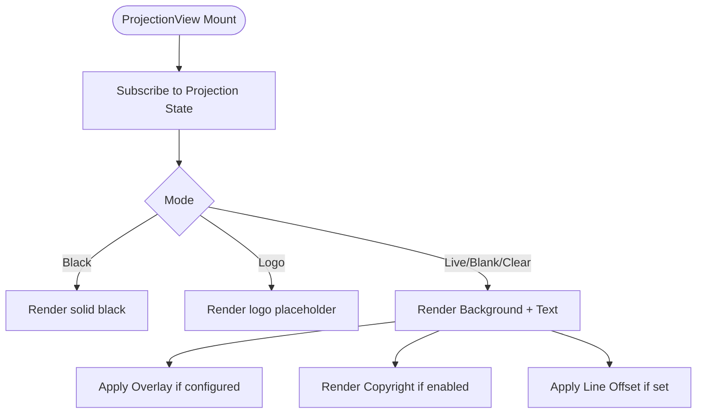
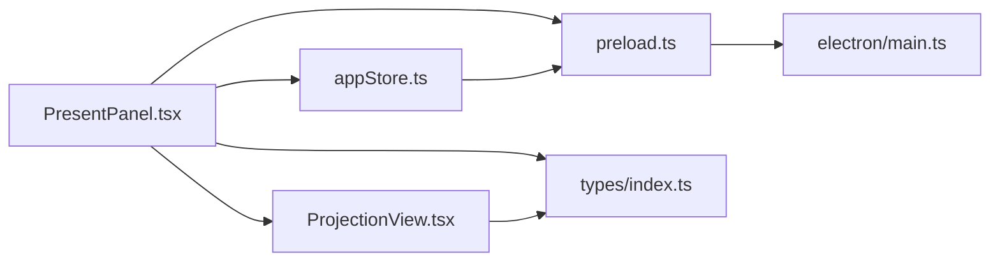

# Presentation Controls Component

<cite>
**Referenced Files in This Document**
- [PresentPanel.tsx](file://src/components/PresentPanel.tsx)
- [ProjectionView.tsx](file://src/components/ProjectionView.tsx)
- [main.ts](file://electron/main.ts)
- [preload.ts](file://electron/preload.ts)
- [appStore.ts](file://src/store/appStore.ts)
- [index.ts](file://src/types/index.ts)
- [en.ts](file://src/i18n/en.ts)
- [App.tsx](file://src/App.tsx)
- [README.md](file://README.md)
</cite>

## Table of Contents
1. [Introduction](#introduction)
2. [Project Structure](#project-structure)
3. [Core Components](#core-components)
4. [Architecture Overview](#architecture-overview)
5. [Detailed Component Analysis](#detailed-component-analysis)
6. [Dependency Analysis](#dependency-analysis)
7. [Performance Considerations](#performance-considerations)
8. [Troubleshooting Guide](#troubleshooting-guide)
9. [Conclusion](#conclusion)
10. [Appendices](#appendices)

## Introduction
This document provides comprehensive documentation for the PresentPanel component, which manages live presentation controls and keyboard shortcuts for projection windows. It explains projection window lifecycle, mode switching among live, blank, black, and logo displays, multi-monitor display selection, keyboard shortcuts, real-time state synchronization, and presentation flow control. It also covers integration with Electron’s window management APIs, display detection and selection, and projection state persistence. Practical examples of presentation workflows and troubleshooting guidance are included for live worship environments and external display systems.

## Project Structure
The PresentPanel component resides in the frontend React application and coordinates with Electron’s main process to manage a dedicated projection window. The component integrates with a global state store for presentation state and communicates with the projection window via Electron IPC.

**Diagram sources**
- [PresentPanel.tsx:1-365](file://src/components/PresentPanel.tsx#L1-L365)
- [ProjectionView.tsx:1-134](file://src/components/ProjectionView.tsx#L1-L134)
- [main.ts:1-390](file://electron/main.ts#L1-L390)
- [preload.ts:1-43](file://electron/preload.ts#L1-L43)
- [appStore.ts:1-385](file://src/store/appStore.ts#L1-L385)
- [index.ts:1-89](file://src/types/index.ts#L1-L89)
- [App.tsx:1-102](file://src/App.tsx#L1-L102)

**Section sources**
- [PresentPanel.tsx:1-365](file://src/components/PresentPanel.tsx#L1-L365)
- [ProjectionView.tsx:1-134](file://src/components/ProjectionView.tsx#L1-L134)
- [main.ts:1-390](file://electron/main.ts#L1-L390)
- [preload.ts:1-43](file://electron/preload.ts#L1-L43)
- [appStore.ts:1-385](file://src/store/appStore.ts#L1-L385)
- [index.ts:1-89](file://src/types/index.ts#L1-L89)
- [App.tsx:1-102](file://src/App.tsx#L1-L102)

## Core Components
- PresentPanel: Manages presentation controls, keyboard shortcuts, projection window opening/closing, display selection, and live preview rendering.
- ProjectionView: Renders the projection window content based on synchronized projection state.
- Electron Main: Creates and manages the projection window, handles display enumeration, and routes IPC messages.
- Preload Bridge: Exposes Electron APIs to the renderer process for display and projection operations.
- App Store: Centralizes projection state, slide navigation, and real-time updates to the projection window.
- Types: Defines projection modes, state, and settings used across components.

**Section sources**
- [PresentPanel.tsx:6-130](file://src/components/PresentPanel.tsx#L6-L130)
- [ProjectionView.tsx:4-134](file://src/components/ProjectionView.tsx#L4-L134)
- [main.ts:111-152](file://electron/main.ts#L111-L152)
- [preload.ts:3-21](file://electron/preload.ts#L3-L21)
- [appStore.ts:25-302](file://src/store/appStore.ts#L25-L302)
- [index.ts:69-81](file://src/types/index.ts#L69-L81)

## Architecture Overview
The PresentPanel orchestrates presentation flow and interacts with Electron’s main process to create a fullscreen projection window on a chosen display. The app store maintains projection state and synchronizes it to the projection window via IPC. The projection window renders the current mode and content.

**Diagram sources**
- [PresentPanel.tsx:109-129](file://src/components/PresentPanel.tsx#L109-L129)
- [appStore.ts:242-249](file://src/store/appStore.ts#L242-L249)
- [preload.ts:6-16](file://electron/preload.ts#L6-L16)
- [main.ts:166-190](file://electron/main.ts#L166-L190)
- [ProjectionView.tsx:22-29](file://src/components/ProjectionView.tsx#L22-L29)

## Detailed Component Analysis

### PresentPanel Component
Responsibilities:
- Display detection and selection for multi-monitor setups.
- Keyboard shortcuts for navigation and mode toggles.
- Opening/closing the projection window and updating UI state.
- Rendering live preview with current and next slides.
- Providing controls for blank/black/logo/clear modes and line shifting.

Key behaviors:
- Display enumeration on mount and automatic selection of a secondary display if available.
- Keyboard event handling with prevention of default browser behavior for shortcuts.
- Projection window lifecycle via Electron IPC.
- Real-time projection state synchronization through the app store.

**Diagram sources**
- [PresentPanel.tsx:26-36](file://src/components/PresentPanel.tsx#L26-L36)
- [PresentPanel.tsx:39-79](file://src/components/PresentPanel.tsx#L39-L79)
- [PresentPanel.tsx:109-129](file://src/components/PresentPanel.tsx#L109-L129)

**Section sources**
- [PresentPanel.tsx:26-36](file://src/components/PresentPanel.tsx#L26-L36)
- [PresentPanel.tsx:39-79](file://src/components/PresentPanel.tsx#L39-L79)
- [PresentPanel.tsx:109-129](file://src/components/PresentPanel.tsx#L109-L129)
- [PresentPanel.tsx:131-346](file://src/components/PresentPanel.tsx#L131-L346)

### ProjectionView Component
Responsibilities:
- Rendering the projection window content based on synchronized projection state.
- Supporting modes: black, logo, live, blank, and clear.
- Applying background styles (color, gradient, image) and text styling.
- Handling overlays and line offset adjustments.

Rendering logic:
- Mode-driven rendering with distinct layouts for black, logo, and live/blank/clear.
- Text styling computed from projection state, including alignment, shadows, and outlines.
- Optional copyright display in live mode.

**Diagram sources**
- [ProjectionView.tsx:4-29](file://src/components/ProjectionView.tsx#L4-L29)
- [ProjectionView.tsx:77-132](file://src/components/ProjectionView.tsx#L77-L132)

**Section sources**
- [ProjectionView.tsx:4-29](file://src/components/ProjectionView.tsx#L4-L29)
- [ProjectionView.tsx:77-132](file://src/components/ProjectionView.tsx#L77-L132)

### Electron Main Process Integration
Responsibilities:
- Creating the projection window on a specified or detected display.
- Enumerating displays and exposing display information to the renderer.
- Managing IPC handlers for projection lifecycle and state updates.
- Handling app lifecycle events and closing associated windows.

Key IPC handlers:
- get-displays: Returns display list with labels and primary indicator.
- open-projection/close-projection/is-projection-open: Manage projection window lifecycle.
- update-projection: Broadcasts projection state to the projection window.

Window creation:
- Uses Electron screen APIs to locate target display bounds.
- Configures fullscreen, frameless, always-on-top, and skip-taskbar flags.

**Section sources**
- [main.ts:155-190](file://electron/main.ts#L155-L190)
- [main.ts:111-152](file://electron/main.ts#L111-L152)
- [main.ts:376-383](file://electron/main.ts#L376-L383)

### App Store and State Synchronization
Responsibilities:
- Maintains projection state, current arrangement index, and slide navigation.
- Synchronizes projection state to the projection window via IPC.
- Provides actions for mode changes, slide navigation, and line offset adjustments.

State transitions:
- goToSlide updates current section, lyrics, background, and text style.
- setProjectionState merges partial state and forwards to projection window.
- Navigation actions (nextSlide/prevSlide) compute next/previous indices and delegate to goToSlide.

**Section sources**
- [appStore.ts:25-302](file://src/store/appStore.ts#L25-L302)
- [appStore.ts:242-249](file://src/store/appStore.ts#L242-L249)
- [appStore.ts:251-291](file://src/store/appStore.ts#L251-L291)

### Keyboard Shortcut System
Shortcuts:
- Space / Arrow Right: Next slide
- Arrow Left: Previous slide
- B: Toggle black screen
- C: Toggle clear (hide lyrics, keep background)
- P: Toggle projection window
- Escape: Reset to live mode

Behavior:
- Prevent default browser behavior for navigation keys.
- Ignore shortcuts while typing in inputs.
- Toggle modes based on current projection state.

**Section sources**
- [PresentPanel.tsx:39-79](file://src/components/PresentPanel.tsx#L39-L79)
- [en.ts:95](file://src/i18n/en.ts#L95)

### Display Selection for Multi-Monitor Setups
Mechanics:
- On mount, PresentPanel requests display list from Electron.
- Selects secondary display if available; otherwise falls back to primary.
- Allows manual selection via dropdown bound to selectedDisplay state.

Fallback logic:
- Electron main process selects a non-primary display if the requested display is unavailable.

**Section sources**
- [PresentPanel.tsx:26-36](file://src/components/PresentPanel.tsx#L26-L36)
- [main.ts:111-119](file://electron/main.ts#L111-L119)

### Mode Switching and Presentation Flow Control
Modes:
- live: Renders current lyrics with background and text styling.
- blank: Renders background without lyrics.
- black: Solid black screen.
- logo: Placeholder logo overlay.
- clear: Hides lyrics while keeping background.

Controls:
- Buttons in PresentPanel trigger setProjectionMode.
- Keyboard shortcuts toggle black and clear modes.
- Escape resets to live mode.

Flow:
- goToSlide computes current section and updates projection state.
- setProjectionState triggers IPC broadcast to projection window.

**Section sources**
- [PresentPanel.tsx:274-296](file://src/components/PresentPanel.tsx#L274-L296)
- [appStore.ts:293-295](file://src/store/appStore.ts#L293-L295)
- [index.ts:69](file://src/types/index.ts#L69)

### Real-Time State Synchronization
Mechanism:
- App store merges partial state updates and sends them to the projection window.
- Preload exposes onProjectionState listener to subscribe to state updates.
- ProjectionView subscribes to state changes and re-renders accordingly.

Lifecycle:
- App initializes projection state with defaults.
- Updates propagate immediately to the projection window.

**Section sources**
- [appStore.ts:242-249](file://src/store/appStore.ts#L242-L249)
- [preload.ts:12-16](file://electron/preload.ts#L12-L16)
- [ProjectionView.tsx:22-29](file://src/components/ProjectionView.tsx#L22-L29)

### Projection State Persistence
Persistence model:
- Projection state is maintained in memory within the app store.
- No explicit persistence of projection state to disk is implemented in the referenced code.
- Presentation settings (background and text style) are persisted via separate handlers.

Implications:
- Projection state does not persist across app restarts.
- Users should configure presentation settings before starting projections.

**Section sources**
- [appStore.ts:25-302](file://src/store/appStore.ts#L25-L302)
- [main.ts:193-218](file://electron/main.ts#L193-L218)

## Dependency Analysis
The PresentPanel depends on:
- App store for projection state and actions.
- Electron preload bridge for display and projection IPC.
- ProjectionView for rendering the projection window content.
- Types for projection mode and state definitions.

**Diagram sources**
- [PresentPanel.tsx:1-20](file://src/components/PresentPanel.tsx#L1-L20)
- [appStore.ts:1-96](file://src/store/appStore.ts#L1-L96)
- [preload.ts:1-43](file://electron/preload.ts#L1-L43)
- [index.ts:1-89](file://src/types/index.ts#L1-L89)
- [ProjectionView.tsx:1-3](file://src/components/ProjectionView.tsx#L1-L3)

**Section sources**
- [PresentPanel.tsx:1-20](file://src/components/PresentPanel.tsx#L1-L20)
- [appStore.ts:1-96](file://src/store/appStore.ts#L1-L96)
- [preload.ts:1-43](file://electron/preload.ts#L1-L43)
- [index.ts:1-89](file://src/types/index.ts#L1-L89)
- [ProjectionView.tsx:1-3](file://src/components/ProjectionView.tsx#L1-L3)

## Performance Considerations
- Minimize re-renders by consolidating state updates in the app store before broadcasting to the projection window.
- Avoid heavy computations in render paths; compute styles and layout once per state change.
- Use efficient background rendering (color vs. image/gradient) for smoother transitions.
- Debounce or throttle frequent keyboard events if extending shortcut handling.

## Troubleshooting Guide
Common issues and resolutions:
- Projection window fails to open:
  - Verify display selection and ensure the chosen display is connected.
  - Confirm Electron IPC handlers are registered and reachable.
- Black screen or incorrect mode:
  - Check projection state synchronization; ensure setProjectionState is invoked.
  - Verify ProjectionView subscription to onProjectionState.
- Keyboard shortcuts not working:
  - Ensure focus is not inside input fields.
  - Confirm event listeners are attached and not removed prematurely.
- Multi-monitor selection problems:
  - Re-run display enumeration; fallback to primary display if secondary is unavailable.
  - Validate display IDs passed to openProjection.

Operational checks:
- Use App.tsx effect to listen for projection window closed events and reset UI state.
- Confirm preload exposes required IPC methods and that contextBridge is initialized.

**Section sources**
- [App.tsx:34-42](file://src/App.tsx#L34-L42)
- [preload.ts:3-21](file://electron/preload.ts#L3-L21)
- [main.ts:166-190](file://electron/main.ts#L166-L190)

## Conclusion
The PresentPanel component provides a robust foundation for live presentation control, integrating seamlessly with Electron’s window management and IPC mechanisms. It supports multi-monitor setups, flexible mode switching, and real-time state synchronization to the projection window. While projection state is not persisted, the component’s design enables reliable operation in live worship environments and external display systems.

## Appendices

### Keyboard Shortcuts Reference
- Space / Arrow Right: Next slide
- Arrow Left: Previous slide
- B: Toggle black screen
- C: Toggle clear (hide lyrics, keep background)
- P: Toggle projection window
- Escape: Reset to live mode

**Section sources**
- [en.ts:95](file://src/i18n/en.ts#L95)

### Example Presentation Workflows
- Starting a service:
  - Select a song, open the projection window, and navigate to the first slide.
  - Use keyboard shortcuts to advance through the arrangement.
- Transitioning between sections:
  - Click “Next” button or press Space to move forward.
  - Use “Prev” to return to previous slides.
- Controlling visuals:
  - Press B to temporarily blank the screen for transitions.
  - Press C to hide lyrics while keeping background for branding.
  - Use Escape to return to live mode quickly.

**Section sources**
- [PresentPanel.tsx:274-296](file://src/components/PresentPanel.tsx#L274-L296)
- [en.ts:95](file://src/i18n/en.ts#L95)

### Integration Notes for Live Worship
- Use the projection window on a secondary display to keep the presenter’s workspace uncluttered.
- Configure background and text styles to match venue lighting and readability requirements.
- Utilize line offset adjustments for precise vertical alignment during live rendering.

**Section sources**
- [ProjectionView.tsx:100-131](file://src/components/ProjectionView.tsx#L100-L131)
- [README.md:106-115](file://README.md#L106-L115)