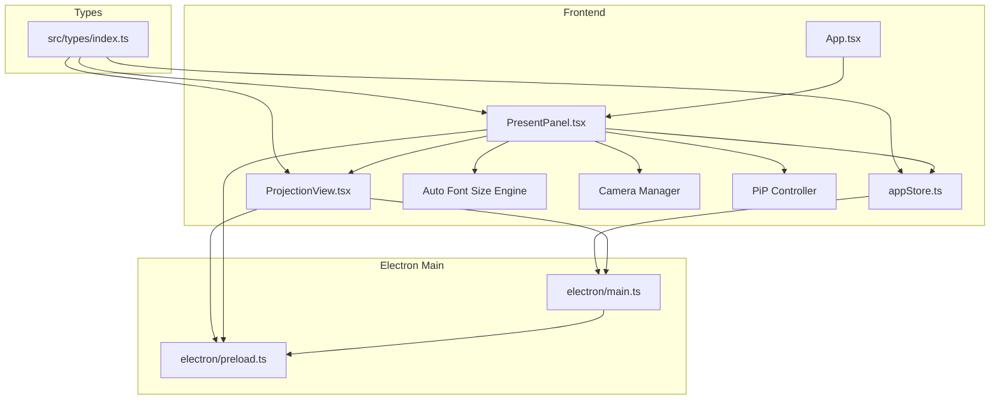
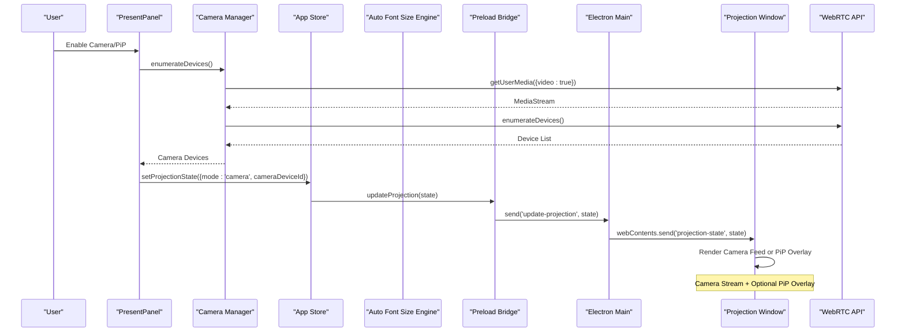
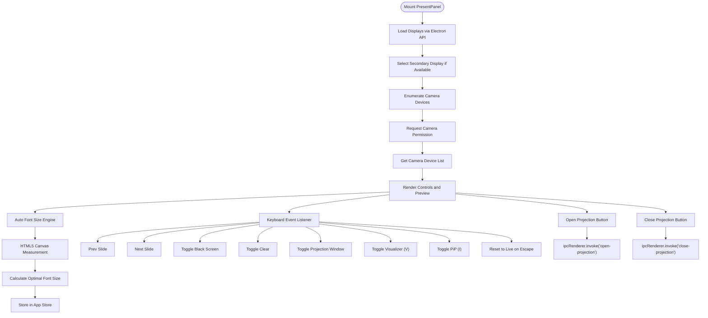
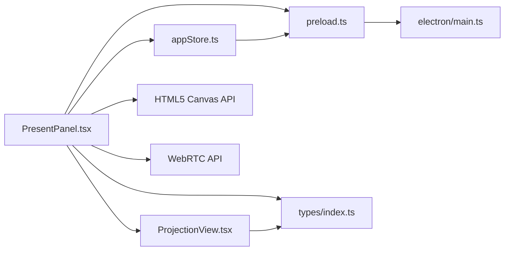

# Presentation Controls Component

<cite>
**Referenced Files in This Document**
- [PresentPanel.tsx](file://src/components/PresentPanel.tsx)
- [ProjectionView.tsx](file://src/components/ProjectionView.tsx)
- [main.ts](file://electron/main.ts)
- [preload.ts](file://electron/preload.ts)
- [appStore.ts](file://src/store/appStore.ts)
- [index.ts](file://src/types/index.ts)
- [en.ts](file://src/i18n/en.ts)
- [App.tsx](file://src/App.tsx)
- [README.md](file://README.md)
</cite>

## Update Summary
**Changes Made**
- Added comprehensive documentation for camera device enumeration and management functionality
- Updated keyboard shortcuts section to include V for visualizer and I for PiP controls
- Enhanced camera controls UI with responsive layout and device selection dropdown
- Added detailed coverage of Picture-in-Picture (PiP) functionality with position controls
- Updated projection modes to include 'camera' mode for live camera feeds
- Enhanced troubleshooting guide with camera-related issues and solutions

## Table of Contents
1. [Introduction](#introduction)
2. [Project Structure](#project-structure)
3. [Core Components](#core-components)
4. [Architecture Overview](#architecture-overview)
5. [Detailed Component Analysis](#detailed-component-analysis)
6. [Dependency Analysis](#dependency-analysis)
7. [Performance Considerations](#performance-considerations)
8. [Troubleshooting Guide](#troubleshooting-guide)
9. [Conclusion](#conclusion)
10. [Appendices](#appendices)

## Introduction
This document provides comprehensive documentation for the PresentPanel component, which manages live presentation controls and keyboard shortcuts for projection windows. It explains projection window lifecycle, mode switching among live, blank, black, logo, clear, and **camera** displays, multi-monitor display selection, keyboard shortcuts, real-time state synchronization, and presentation flow control. The component now features an intelligent Auto Font Size system that automatically adjusts text size based on display dimensions and content length using HTML5 Canvas measurement techniques. It also includes **advanced camera integration with device enumeration, Picture-in-Picture (PiP) overlay controls, and responsive camera controls layout**. The component covers integration with Electron's window management APIs, display detection and selection, projection state persistence, and **WebRTC-based camera stream management**. Practical examples of presentation workflows and troubleshooting guidance are included for live worship environments and external display systems.

## Project Structure
The PresentPanel component resides in the frontend React application and coordinates with Electron's main process to manage a dedicated projection window. The component integrates with a global state store for presentation state and communicates with the projection window via Electron IPC. The new Auto Font Size feature adds intelligent text scaling capabilities using HTML5 Canvas for precise font measurement. **Camera functionality is implemented using WebRTC APIs for device enumeration and media stream management, with Picture-in-Picture overlay support for simultaneous camera feed display.**

**Diagram sources**
- [PresentPanel.tsx:1-581](file://src/components/PresentPanel.tsx#L1-L581)
- [ProjectionView.tsx:1-229](file://src/components/ProjectionView.tsx#L1-L229)
- [main.ts:1-390](file://electron/main.ts#L1-L390)
- [preload.ts:1-43](file://electron/preload.ts#L1-L43)
- [appStore.ts:1-425](file://src/store/appStore.ts#L1-L425)
- [index.ts:1-95](file://src/types/index.ts#L1-L95)
- [App.tsx:1-102](file://src/App.tsx#L1-L102)

**Section sources**
- [PresentPanel.tsx:1-581](file://src/components/PresentPanel.tsx#L1-L581)
- [ProjectionView.tsx:1-229](file://src/components/ProjectionView.tsx#L1-L229)
- [main.ts:1-390](file://electron/main.ts#L1-L390)
- [preload.ts:1-43](file://electron/preload.ts#L1-L43)
- [appStore.ts:1-425](file://src/store/appStore.ts#L1-L425)
- [index.ts:1-95](file://src/types/index.ts#L1-L95)
- [App.tsx:1-102](file://src/App.tsx#L1-L102)

## Core Components
- PresentPanel: Manages presentation controls, keyboard shortcuts, projection window opening/closing, display selection, live preview rendering, auto font size calculation, **camera device enumeration, PiP controls, and responsive camera controls layout**.
- ProjectionView: Renders the projection window content based on synchronized projection state, **including camera feeds and PiP overlays**.
- Electron Main: Creates and manages the projection window, handles display enumeration, and routes IPC messages.
- Preload Bridge: Exposes Electron APIs to the renderer process for display and projection operations.
- App Store: Centralizes projection state, slide navigation, auto font size values, **camera device IDs, and PiP configuration**, and real-time updates to the projection window.
- Types: Defines projection modes (including 'camera'), state, settings, auto font size configurations, **and PiP position types**.

**Section sources**
- [PresentPanel.tsx:41-581](file://src/components/PresentPanel.tsx#L41-L581)
- [ProjectionView.tsx:6-229](file://src/components/ProjectionView.tsx#L6-L229)
- [main.ts:111-152](file://electron/main.ts#L111-L152)
- [preload.ts:3-21](file://electron/preload.ts#L3-L21)
- [appStore.ts:25-425](file://src/store/appStore.ts#L25-L425)
- [index.ts:69-95](file://src/types/index.ts#L69-L95)

## Architecture Overview
The PresentPanel orchestrates presentation flow and interacts with Electron's main process to create a fullscreen projection window on a chosen display. The app store maintains projection state and auto font size values, synchronizing them to the projection window via IPC. The projection window renders the current mode and content with intelligent font sizing. **Camera functionality uses WebRTC APIs for device enumeration and media stream management, while Picture-in-Picture functionality overlays camera feeds in configurable positions.**

**Diagram sources**
- [PresentPanel.tsx:69-101](file://src/components/PresentPanel.tsx#L69-L101)
- [PresentPanel.tsx:103-131](file://src/components/PresentPanel.tsx#L103-L131)
- [ProjectionView.tsx:139-228](file://src/components/ProjectionView.tsx#L139-L228)
- [appStore.ts:249-256](file://src/store/appStore.ts#L249-L256)
- [preload.ts:6-16](file://electron/preload.ts#L6-L16)
- [main.ts:166-190](file://electron/main.ts#L166-L190)

## Detailed Component Analysis

### PresentPanel Component
Responsibilities:
- Display detection and selection for multi-monitor setups.
- Keyboard shortcuts for navigation and mode toggles.
- Opening/closing the projection window and updating UI state.
- Rendering live preview with current and next slides.
- Providing controls for blank/black/logo/clear/camera modes and line shifting.
- Auto Font Size calculation using HTML5 Canvas for intelligent text scaling.
- **NEW**: Camera device enumeration and management with permission handling.
- **NEW**: Picture-in-Picture (PiP) controls with position configuration.
- **NEW**: Responsive camera controls layout with device selection dropdown.

Key behaviors:
- Display enumeration on mount and automatic selection of a secondary display if available.
- Keyboard event handling with prevention of default browser behavior for shortcuts.
- Projection window lifecycle via Electron IPC.
- Real-time projection state synchronization through the app store.
- Automatic font size optimization based on display width and content length.
- **NEW**: Camera device enumeration using WebRTC APIs with proper permission handling.
- **NEW**: Camera stream management with device switching without re-entering camera mode.
- **NEW**: PiP toggle functionality that works independently from camera mode.

**Diagram sources**
- [PresentPanel.tsx:69-101](file://src/components/PresentPanel.tsx#L69-L101)
- [PresentPanel.tsx:103-131](file://src/components/PresentPanel.tsx#L103-L131)
- [PresentPanel.tsx:177-228](file://src/components/PresentPanel.tsx#L177-L228)
- [PresentPanel.tsx:280-353](file://src/components/PresentPanel.tsx#L280-L353)

**Section sources**
- [PresentPanel.tsx:69-101](file://src/components/PresentPanel.tsx#L69-L101)
- [PresentPanel.tsx:103-131](file://src/components/PresentPanel.tsx#L103-L131)
- [PresentPanel.tsx:177-228](file://src/components/PresentPanel.tsx#L177-L228)
- [PresentPanel.tsx:280-353](file://src/components/PresentPanel.tsx#L280-L353)
- [PresentPanel.tsx:382-390](file://src/components/PresentPanel.tsx#L382-L390)

### Camera Device Enumeration and Management
**NEW**: The camera functionality uses WebRTC APIs to enumerate available camera devices and manage media streams with proper permission handling.

Implementation Details:
- **Permission Handling**: Requests camera permission once during component mount to unlock device labels.
- **Device Enumeration**: Filters devices by 'videoinput' kind to get only camera devices.
- **Stream Management**: Properly starts and stops media streams to avoid resource leaks.
- **Device Selection**: Provides dropdown interface for selecting between multiple cameras.
- **Live Device Switching**: Allows changing camera devices without re-entering camera mode.

Camera Flow:
1. Component mounts and requests camera permission
2. Gets list of available video input devices
3. Sets first available camera as default selection
4. Stops temporary stream after enumeration
5. Maintains selected camera device ID in state

**Section sources**
- [PresentPanel.tsx:69-101](file://src/components/PresentPanel.tsx#L69-L101)
- [PresentPanel.tsx:111-117](file://src/components/PresentPanel.tsx#L111-L117)

### Picture-in-Picture (PiP) Controls
**NEW**: The PiP functionality allows overlaying a camera feed in a corner of the projection screen, independent of the main camera mode.

Features:
- **Independent Operation**: Works alongside other projection modes (live, blank, etc.)
- **Position Control**: Configurable positioning between bottom-left and bottom-right corners
- **Responsive Sizing**: Automatically scales based on viewport width (22vw)
- **Visual Styling**: Rounded corners, border, shadow, and semi-transparent background
- **State Synchronization**: PiP state is maintained in projection state for projector sync

PiP State Management:
- `pipEnabled`: Boolean flag to enable/disable PiP overlay
- `pipPosition`: Position string ('bottom-left' | 'bottom-right')
- `cameraDeviceId`: Camera device used for PiP feed
- Disabled when in camera mode to prevent conflicts

**Section sources**
- [PresentPanel.tsx:119-131](file://src/components/PresentPanel.tsx#L119-L131)
- [ProjectionView.tsx:205-228](file://src/components/ProjectionView.tsx#L205-L228)

### Camera View and Stream Management
**NEW**: Dedicated components handle camera stream lifecycle and error handling for both full-screen camera mode and PiP overlay.

Components:
- **CameraView**: Full-screen camera feed for camera mode
- **PipOverlay**: Small camera feed overlay for PiP functionality
- **useCameraStream**: Custom hook managing stream lifecycle and errors

Stream Lifecycle:
1. Request media stream with specific device constraints
2. Attach stream to video element
3. Handle stream errors gracefully
4. Clean up stream on component unmount or device change
5. Stop all tracks to release camera resources

Error Handling:
- Displays user-friendly error message when camera is unavailable
- Continues normal operation even if camera fails
- Gracefully handles permission denials

**Section sources**
- [ProjectionView.tsx:139-228](file://src/components/ProjectionView.tsx#L139-L228)

### Keyboard Shortcut System
Shortcuts:
- Space / Arrow Right: Next slide
- Arrow Left: Previous slide
- B: Toggle black screen
- C: Toggle clear (hide lyrics, keep background)
- P: Toggle projection window
- **V: Toggle visualizer (camera mode)**
- **I: Toggle Picture-in-Picture overlay**
- Escape: Reset to live mode

Behavior:
- Prevent default browser behavior for navigation keys.
- Ignore shortcuts while typing in inputs.
- Toggle modes based on current projection state.
- **NEW**: Visualizer toggle switches between live and camera modes.
- **NEW**: PiP toggle enables/disables camera overlay without affecting main projection mode.

**Section sources**
- [PresentPanel.tsx:177-228](file://src/components/PresentPanel.tsx#L177-L228)
- [en.ts:95](file://src/i18n/en.ts#L95)

### Mode Switching and Presentation Flow Control
Modes:
- live: Renders current lyrics with background and text styling.
- blank: Renders background without lyrics.
- black: Solid black screen.
- logo: Placeholder logo overlay.
- clear: Hides lyrics while keeping background.
- **NEW**: camera: Displays live camera feed from selected device.

Controls:
- Buttons in PresentPanel trigger setProjectionMode.
- Keyboard shortcuts toggle black, clear, visualizer, and PiP modes.
- Escape resets to live mode.

Flow:
- goToSlide computes current section and updates projection state.
- setProjectionState triggers IPC broadcast to projection window.
- **NEW**: Camera mode sets cameraDeviceId for stream targeting.
- **NEW**: PiP state is managed separately from main projection mode.

**Section sources**
- [PresentPanel.tsx:103-109](file://src/components/PresentPanel.tsx#L103-L109)
- [PresentPanel.tsx:274-296](file://src/components/PresentPanel.tsx#L274-L296)
- [appStore.ts:293-295](file://src/store/appStore.ts#L293-L295)
- [index.ts:69](file://src/types/index.ts#L69)

### Responsive Layout for Camera Controls
**NEW**: The camera controls feature a responsive layout that adapts to different screen sizes and provides intuitive access to camera functionality.

Layout Features:
- **Flexible Container**: Uses flex-wrap to accommodate various control combinations
- **Compact Design**: Camera dropdown uses smaller text and padding for space efficiency
- **Conditional Rendering**: PiP position selector only appears when PiP is enabled
- **Visual Feedback**: Active states and disabled states provide clear user feedback
- **Accessibility**: Proper ARIA labels and semantic HTML structure

Control Organization:
1. Display selection and projection controls
2. Camera device dropdown with fallback messaging
3. Visualizer and PiP toggle buttons
4. Conditional PiP position selector
5. Live status indicator

**Section sources**
- [PresentPanel.tsx:280-353](file://src/components/PresentPanel.tsx#L280-L353)

### Real-Time State Synchronization
Mechanism:
- App store merges partial state updates and sends them to the projection window.
- Preload exposes onProjectionState listener to subscribe to state updates.
- ProjectionView subscribes to state changes and re-renders accordingly.
- Auto font size values are synchronized alongside projection state.
- **NEW**: Camera device IDs and PiP configuration are synchronized in real-time.

Lifecycle:
- App initializes projection state with defaults.
- Updates propagate immediately to the projection window.
- Auto font size calculations update in real-time with display and content changes.
- **NEW**: Camera stream changes trigger immediate re-rendering of camera feeds.
- **NEW**: PiP position changes update overlay positioning instantly.

**Section sources**
- [appStore.ts:249-256](file://src/store/appStore.ts#L249-L256)
- [preload.ts:12-16](file://electron/preload.ts#L12-L16)
- [ProjectionView.tsx:24-31](file://src/components/ProjectionView.tsx#L24-L31)

## Dependency Analysis
The PresentPanel depends on:
- App store for projection state and actions.
- Electron preload bridge for display and projection IPC.
- ProjectionView for rendering the projection window content.
- Types for projection mode and state definitions.
- HTML5 Canvas API for font measurement calculations.
- **NEW**: WebRTC APIs (navigator.mediaDevices) for camera device enumeration and stream management.

**Diagram sources**
- [PresentPanel.tsx:1-6](file://src/components/PresentPanel.tsx#L1-L6)
- [appStore.ts:1-96](file://src/store/appStore.ts#L1-L96)
- [preload.ts:1-43](file://electron/preload.ts#L1-L43)
- [index.ts:1-95](file://src/types/index.ts#L1-L95)
- [ProjectionView.tsx:1-3](file://src/components/ProjectionView.tsx#L1-L3)

**Section sources**
- [PresentPanel.tsx:1-6](file://src/components/PresentPanel.tsx#L1-L6)
- [appStore.ts:1-96](file://src/store/appStore.ts#L1-L96)
- [preload.ts:1-43](file://electron/preload.ts#L1-L43)
- [index.ts:1-95](file://src/types/index.ts#L1-L95)
- [ProjectionView.tsx:1-3](file://src/components/ProjectionView.tsx#L1-L3)

## Performance Considerations
- Minimize re-renders by consolidating state updates in the app store before broadcasting to the projection window.
- Avoid heavy computations in render paths; compute styles and layout once per state change.
- Use efficient background rendering (color vs. image/gradient) for smoother transitions.
- Debounce or throttle frequent keyboard events if extending shortcut handling.
- The Auto Font Size feature performs calculations only when enabled and when song/display changes occur.
- Canvas-based measurements are cached and recalculated only when necessary to avoid performance bottlenecks.
- **NEW**: Camera streams are properly managed to prevent memory leaks and resource exhaustion.
- **NEW**: Device enumeration runs only once on component mount to minimize API calls.
- **NEW**: PiP overlay uses CSS transforms for smooth positioning updates without reflows.

## Troubleshooting Guide
Common issues and resolutions:
- Projection window fails to open:
  - Verify display selection and ensure the chosen display is connected.
  - Confirm Electron IPC handlers are registered and reachable.
- Black screen or incorrect mode:
  - Check projection state synchronization; ensure setProjectionState is invoked.
  - Verify ProjectionView subscription to onProjectionState.
- Keyboard shortcuts not working:
  - Ensure focus is not inside input fields.
  - Confirm event listeners are attached and not removed prematurely.
- Multi-monitor selection problems:
  - Re-run display enumeration; fallback to primary display if secondary is unavailable.
  - Validate display IDs passed to openProjection.
- Auto Font Size not working:
  - Verify the Auto Font Size checkbox is enabled in the control panel.
  - Check that the song has lyrics content for measurement.
  - Ensure the display has sufficient width for optimal font scaling.
  - Confirm that the HTML5 Canvas API is available in the browser context.
- Font size appears too small or too large:
  - Adjust the maximum font size setting in the presentation settings.
  - Verify the display width calculation accounts for margins (85% of width minus 128px).
  - Check that the longest line in the arrangement is being measured correctly.
- **NEW**: Camera not detected:
  - Check browser permissions for camera access.
  - Verify no other application is using the camera.
  - Try refreshing the page to re-request camera permissions.
  - Check that the camera device is properly connected and functional.
- **NEW**: Camera feed shows black screen:
  - Verify camera permissions are granted.
  - Check if another application has exclusive access to the camera.
  - Try selecting a different camera device from the dropdown.
  - Restart the application to reset camera permissions.
- **NEW**: PiP overlay not appearing:
  - Ensure PiP is enabled and not in camera mode simultaneously.
  - Check that a valid camera device is selected.
  - Verify the projection window is open and active.
  - Try toggling PiP off and on again.
- **NEW**: Camera switching causes flickering:
  - This is normal behavior when switching between camera devices.
  - Allow a moment for the new camera stream to initialize.
  - If persistent, try restarting the camera stream by toggling camera mode.

Operational checks:
- Use App.tsx effect to listen for projection window closed events and reset UI state.
- Confirm preload exposes required IPC methods and that contextBridge is initialized.
- Monitor console for Canvas measurement errors if Auto Font Size fails.
- **NEW**: Check browser console for WebRTC permission errors when camera features fail.
- **NEW**: Verify camera device enumeration completes successfully and returns expected devices.

**Section sources**
- [App.tsx:34-42](file://src/App.tsx#L34-L42)
- [preload.ts:3-21](file://electron/preload.ts#L3-L21)
- [main.ts:166-190](file://electron/main.ts#L166-L190)
- [PresentPanel.tsx:69-101](file://src/components/PresentPanel.tsx#L69-L101)
- [ProjectionView.tsx:139-180](file://src/components/ProjectionView.tsx#L139-L180)

## Conclusion
The PresentPanel component provides a robust foundation for live presentation control, integrating seamlessly with Electron's window management and IPC mechanisms. It supports multi-monitor setups, flexible mode switching, and real-time state synchronization to the projection window. The Auto Font Size feature enhances the component's capabilities by intelligently adjusting text size based on display dimensions and content length using HTML5 Canvas measurement techniques. **The addition of comprehensive camera functionality with device enumeration, Picture-in-Picture overlay controls, and responsive camera controls significantly expands the component's utility for live presentations requiring visual elements beyond text.** While projection state is not persisted, the component's design enables reliable operation in live worship environments and external display systems.

## Appendices

### Keyboard Shortcuts Reference
- Space / Arrow Right: Next slide
- Arrow Left: Previous slide
- B: Toggle black screen
- C: Toggle clear (hide lyrics, keep background)
- P: Toggle projection window
- **V: Toggle visualizer (camera mode)**
- **I: Toggle Picture-in-Picture overlay**
- Escape: Reset to live mode

**Section sources**
- [en.ts:95](file://src/i18n/en.ts#L95)

### Example Presentation Workflows
- Starting a service:
  - Select a song, enable Auto Font Size, open the projection window, and navigate to the first slide.
  - Use keyboard shortcuts to advance through the arrangement.
- Transitioning between sections:
  - Click "Next" button or press Space to move forward.
  - Use "Prev" to return to previous slides.
- Controlling visuals:
  - Press B to temporarily blank the screen for transitions.
  - Press C to hide lyrics while keeping background for branding.
  - Use Escape to return to live mode quickly.
- Optimizing text visibility:
  - Enable Auto Font Size to automatically adjust font size based on display dimensions.
  - Manually adjust maximum font size in presentation settings if needed.
  - Verify font size calculations work correctly across different display sizes.
- **NEW**: Using camera features:
  - Click the camera dropdown to select from available devices.
  - Press V to enter camera mode for full-screen camera feed.
  - Press I to enable PiP overlay for simultaneous camera display.
  - Use PiP position selector to choose overlay location.
  - Switch camera devices without leaving camera mode using the dropdown.

**Section sources**
- [PresentPanel.tsx:274-296](file://src/components/PresentPanel.tsx#L274-L296)
- [en.ts:95](file://src/i18n/en.ts#L95)

### Integration Notes for Live Worship
- Use the projection window on a secondary display to keep the presenter's workspace uncluttered.
- Configure background and text styles to match venue lighting and readability requirements.
- Utilize line offset adjustments for precise vertical alignment during live rendering.
- Leverage Auto Font Size for optimal text visibility across different venue display configurations.
- Test font sizing with various display sizes and distances to ensure readability from the back of the venue.
- **NEW**: Camera integration considerations:
  - Test camera permissions and device availability before services.
  - Have backup camera devices configured in case of hardware failures.
  - Use PiP mode to show speaker faces while displaying lyrics simultaneously.
  - Consider venue lighting conditions when using camera feeds.
  - Provide training for presenters on camera and PiP controls.

**Section sources**
- [ProjectionView.tsx:100-131](file://src/components/ProjectionView.tsx#L100-L131)
- [README.md:106-115](file://README.md#L106-L115)
- [PresentPanel.tsx:69-101](file://src/components/PresentPanel.tsx#L69-L101)