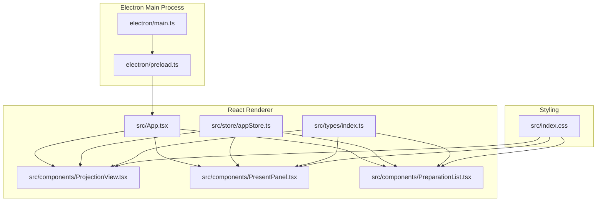
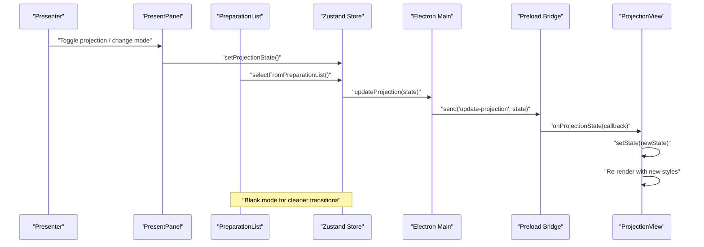
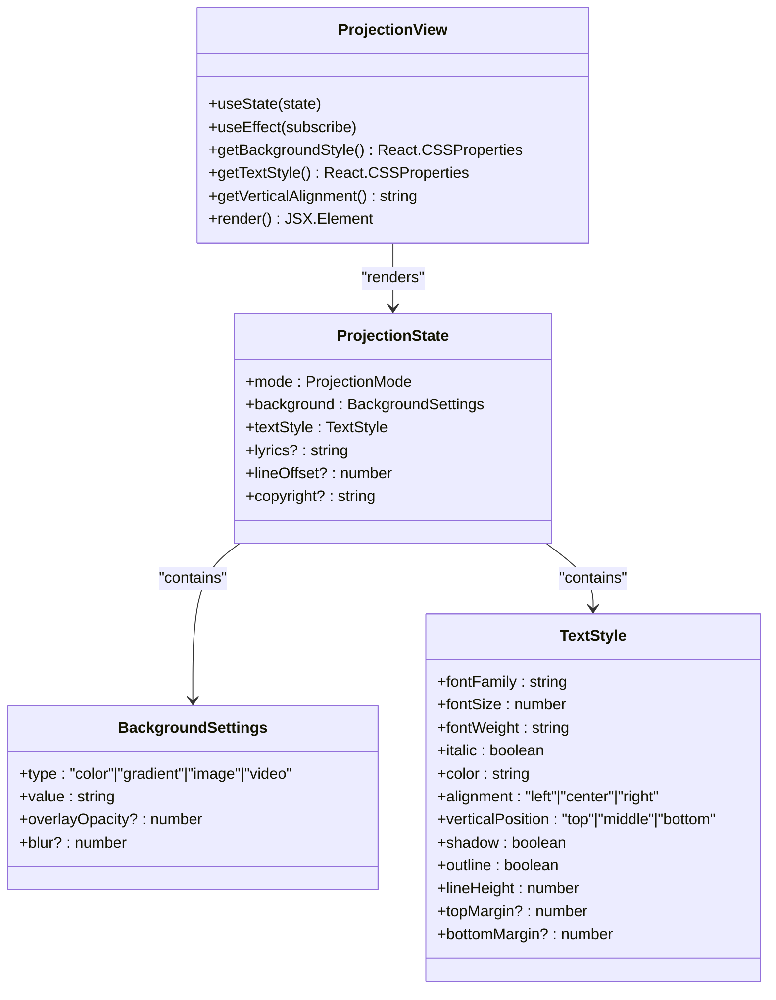
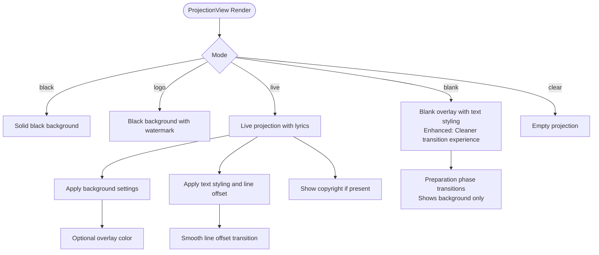
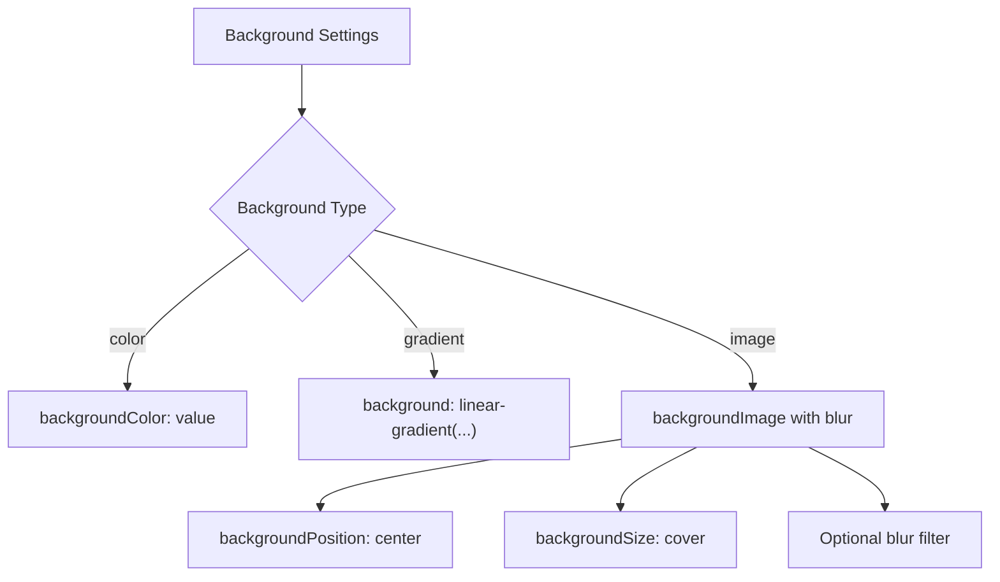
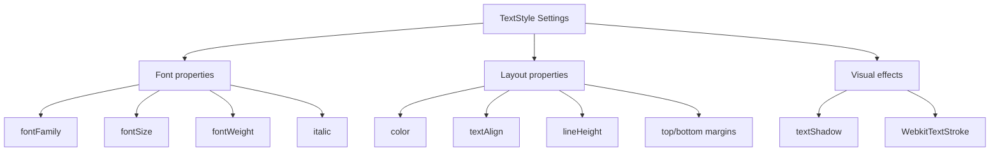
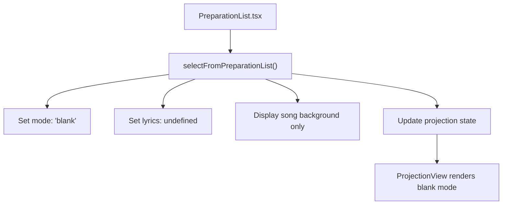
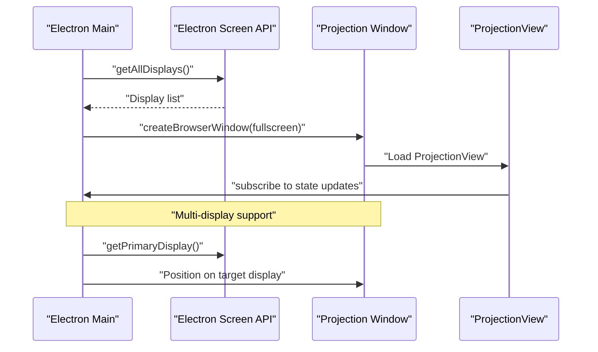
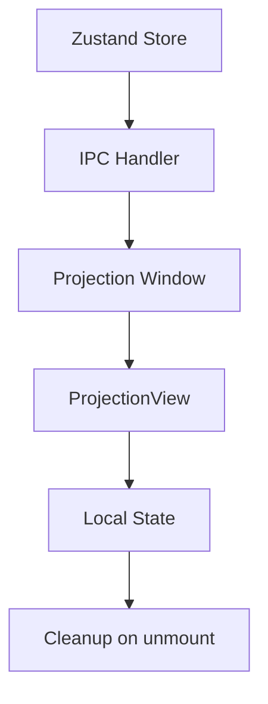
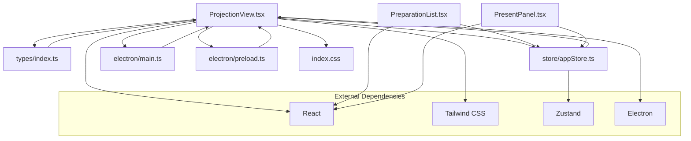

# Projection View Component

<cite>
**Referenced Files in This Document**
- [ProjectionView.tsx](file://src/components/ProjectionView.tsx)
- [appStore.ts](file://src/store/appStore.ts)
- [index.ts](file://src/types/index.ts)
- [main.ts](file://electron/main.ts)
- [preload.ts](file://electron/preload.ts)
- [PresentPanel.tsx](file://src/components/PresentPanel.tsx)
- [PreparationList.tsx](file://src/components/PreparationList.tsx)
- [App.tsx](file://src/App.tsx)
- [index.css](file://src/index.css)
</cite>

## Update Summary
**Changes Made**
- Enhanced projection control actions documentation to include blank mode functionality
- Updated preparation list interaction workflow to show cleaner transition experience
- Added documentation for the new selectFromPreparationList feature that displays only song background without immediately showing lyrics
- Updated projection modes documentation to reflect the expanded functionality

## Table of Contents
1. [Introduction](#introduction)
2. [Project Structure](#project-structure)
3. [Core Components](#core-components)
4. [Architecture Overview](#architecture-overview)
5. [Detailed Component Analysis](#detailed-component-analysis)
6. [Dependency Analysis](#dependency-analysis)
7. [Performance Considerations](#performance-considerations)
8. [Troubleshooting Guide](#troubleshooting-guide)
9. [Conclusion](#conclusion)
10. [Appendices](#appendices)

## Introduction
This document provides comprehensive documentation for the ProjectionView component, which renders fullscreen projection output for live presentations. It covers the component's fullscreen rendering capabilities, real-time state synchronization from the main application, multi-display support, projection mode system, background rendering pipeline, text styling application, responsive scaling, Electron window management integration, display detection APIs, and projection state updates. The component now includes enhanced projection control actions with blank mode functionality that provides cleaner transition experiences during preparation phases, allowing presenters to display only song backgrounds without immediately revealing lyrics.

## Project Structure
The ProjectionView component is part of a React-based desktop application built with Electron. The application architecture separates concerns across:
- Frontend React components for UI and presentation controls
- Zustand store for global state management
- Electron main process for window management and display detection
- Preload bridge exposing safe IPC APIs to the renderer
- Type definitions for projection state and styling

**Diagram sources**
- [main.ts:1-390](file://electron/main.ts#L1-L390)
- [preload.ts:1-43](file://electron/preload.ts#L1-L43)
- [App.tsx:1-102](file://src/App.tsx#L1-L102)
- [ProjectionView.tsx:1-134](file://src/components/ProjectionView.tsx#L1-L134)
- [PresentPanel.tsx:1-379](file://src/components/PresentPanel.tsx#L1-L379)
- [PreparationList.tsx:1-188](file://src/components/PreparationList.tsx#L1-L188)
- [appStore.ts:1-393](file://src/store/appStore.ts#L1-L393)
- [index.ts:1-89](file://src/types/index.ts#L1-L89)
- [index.css:1-100](file://src/index.css#L1-L100)

**Section sources**
- [main.ts:1-390](file://electron/main.ts#L1-L390)
- [preload.ts:1-43](file://electron/preload.ts#L1-L43)
- [App.tsx:1-102](file://src/App.tsx#L1-L102)
- [ProjectionView.tsx:1-134](file://src/components/ProjectionView.tsx#L1-L134)
- [PresentPanel.tsx:1-379](file://src/components/PresentPanel.tsx#L1-L379)
- [PreparationList.tsx:1-188](file://src/components/PreparationList.tsx#L1-L188)
- [appStore.ts:1-393](file://src/store/appStore.ts#L1-L393)
- [index.ts:1-89](file://src/types/index.ts#L1-L89)
- [index.css:1-100](file://src/index.css#L1-L100)

## Core Components
The ProjectionView component orchestrates fullscreen projection rendering with the following responsibilities:
- Real-time state synchronization via Electron IPC
- Fullscreen rendering using Tailwind CSS utilities
- Multi-mode projection rendering (live, blank, black, logo, clear)
- Dynamic background rendering (color, gradient, image)
- Text styling application with responsive margins
- Vertical alignment and line offset transitions
- Copyright display for live mode

Key integration points:
- Electron preload bridge exposes updateProjection and onProjectionState callbacks
- Zustand store manages projection state and dispatches updates to the projection window
- Electron main process creates and manages the projection window on target displays
- Enhanced preparation list functionality allows cleaner transition experiences through blank mode

**Updated** Added blank mode functionality for cleaner transition experiences during preparation phases

**Section sources**
- [ProjectionView.tsx:1-134](file://src/components/ProjectionView.tsx#L1-L134)
- [appStore.ts:350-367](file://src/store/appStore.ts#L350-L367)
- [main.ts:111-152](file://electron/main.ts#L111-L152)
- [preload.ts:3-21](file://electron/preload.ts#L3-L21)

## Architecture Overview
The projection system follows a unidirectional data flow with enhanced preparation list integration:
1. Presentation controls in PresentPanel trigger state changes
2. Preparation list interactions utilize blank mode for cleaner transitions
3. Zustand store updates projectionState and sends IPC updates
4. Electron main process forwards state to projection window
5. ProjectionView subscribes to state updates and re-renders

**Diagram sources**
- [PresentPanel.tsx:288-311](file://src/components/PresentPanel.tsx#L288-L311)
- [PreparationList.tsx:57-63](file://src/components/PreparationList.tsx#L57-L63)
- [appStore.ts:350-367](file://src/store/appStore.ts#L350-L367)
- [main.ts:186-190](file://electron/main.ts#L186-L190)
- [preload.ts:10-16](file://electron/preload.ts#L10-L16)
- [ProjectionView.tsx:22-29](file://src/components/ProjectionView.tsx#L22-L29)

## Detailed Component Analysis

### ProjectionView Component
The ProjectionView component renders fullscreen projection output with the following capabilities:
- Fullscreen rendering using w-screen h-screen utilities
- Mode-based rendering (black, logo, live, blank, clear)
- Dynamic background rendering with overlay support
- Responsive text styling with line-height and margins
- Smooth transitions for line offset animations
- Copyright display for live mode

**Diagram sources**
- [ProjectionView.tsx:4-20](file://src/components/ProjectionView.tsx#L4-L20)
- [index.ts:71-81](file://src/types/index.ts#L71-L81)
- [index.ts:21-27](file://src/types/index.ts#L21-L27)
- [index.ts:29-42](file://src/types/index.ts#L29-L42)

#### Rendering Modes
The component supports five projection modes:
- Black: Solid black background
- Logo: Dark background with centered "LyricDeck" watermark
- Live: Full projection with lyrics and background
- Blank: Transparent overlay with text styling (enhanced with cleaner transitions)
- Clear: Empty projection (used for transitions)

**Updated** Blank mode now provides cleaner transition experience by displaying only song background without immediately showing lyrics during preparation phase

**Diagram sources**
- [ProjectionView.tsx:77-132](file://src/components/ProjectionView.tsx#L77-L132)

#### Background Rendering Pipeline
The background rendering system supports three types:
- Color backgrounds with solid fills
- Gradient backgrounds with customizable gradients
- Image backgrounds with blur effects and positioning

**Diagram sources**
- [ProjectionView.tsx:31-48](file://src/components/ProjectionView.tsx#L31-L48)
- [index.ts:21-27](file://src/types/index.ts#L21-L27)

#### Text Styling Application
Text styling is applied through computed CSS properties:
- Font family, size, weight, and italic styling
- Color and text alignment
- Line height and vertical positioning
- Text shadows and stroke outlines
- Dynamic top/bottom margins for responsive layout

**Diagram sources**
- [ProjectionView.tsx:50-63](file://src/components/ProjectionView.tsx#L50-L63)
- [index.ts:29-42](file://src/types/index.ts#L29-L42)

**Section sources**
- [ProjectionView.tsx:1-134](file://src/components/ProjectionView.tsx#L1-L134)
- [index.ts:69-81](file://src/types/index.ts#L69-L81)

### Enhanced Preparation List Integration
The preparation list system now includes enhanced projection control actions that provide cleaner transition experiences:

#### Blank Mode Functionality
The `selectFromPreparationList` action has been enhanced to automatically switch to blank mode when selecting songs from the preparation list. This provides a cleaner transition experience by displaying only the song's background without immediately showing lyrics during the preparation phase.

**Updated** Enhanced projection control actions with blank mode functionality for smoother transitions

**Diagram sources**
- [PreparationList.tsx:57-63](file://src/components/PreparationList.tsx#L57-L63)
- [appStore.ts:350-367](file://src/store/appStore.ts#L350-L367)

#### Presentation Controls Integration
The presentation panel provides direct access to blank mode through dedicated buttons and keyboard shortcuts, complementing the preparation list functionality.

**Section sources**
- [PreparationList.tsx:1-188](file://src/components/PreparationList.tsx#L1-L188)
- [PresentPanel.tsx:288-311](file://src/components/PresentPanel.tsx#L288-L311)
- [appStore.ts:350-367](file://src/store/appStore.ts#L350-L367)

### Electron Integration
The projection system integrates tightly with Electron for window management and display detection:

**Diagram sources**
- [main.ts:111-152](file://electron/main.ts#L111-L152)
- [main.ts:155-164](file://electron/main.ts#L155-L164)
- [App.tsx:16-17](file://src/App.tsx#L16-L17)

#### Display Management
The Electron main process handles:
- Display enumeration and selection
- Multi-display window placement
- Primary display fallback logic
- Projection window lifecycle management

**Section sources**
- [main.ts:111-152](file://electron/main.ts#L111-L152)
- [main.ts:155-164](file://electron/main.ts#L155-L164)
- [preload.ts:3-21](file://electron/preload.ts#L3-L21)

### State Synchronization
Real-time state synchronization occurs through:
- IPC handlers for state updates
- Subscription mechanism for renderer updates
- Automatic cleanup of event listeners

**Diagram sources**
- [appStore.ts:242-249](file://src/store/appStore.ts#L242-L249)
- [main.ts:186-190](file://electron/main.ts#L186-L190)
- [ProjectionView.tsx:22-29](file://src/components/ProjectionView.tsx#L22-L29)

**Section sources**
- [appStore.ts:241-302](file://src/store/appStore.ts#L241-L302)
- [main.ts:186-190](file://electron/main.ts#L186-L190)
- [preload.ts:10-16](file://electron/preload.ts#L10-L16)

## Dependency Analysis
The ProjectionView component has the following dependencies and relationships:

**Diagram sources**
- [ProjectionView.tsx:1-3](file://src/components/ProjectionView.tsx#L1-L3)
- [index.ts:1-89](file://src/types/index.ts#L1-L89)
- [appStore.ts:1-3](file://src/store/appStore.ts#L1-L3)
- [main.ts:1-5](file://electron/main.ts#L1-L5)
- [preload.ts:1-3](file://electron/preload.ts#L1-L3)
- [index.css:1-3](file://src/index.css#L1-L3)
- [PreparationList.tsx:1-3](file://src/components/PreparationList.tsx#L1-L3)
- [PresentPanel.tsx:1-4](file://src/components/PresentPanel.tsx#L1-L4)

Key dependency characteristics:
- Low coupling with external libraries (React, Tailwind, Zustand)
- Strong separation between presentation logic and Electron integration
- Type-safe state management through TypeScript interfaces
- Minimal runtime dependencies for optimal performance
- Enhanced preparation list integration for improved workflow

**Section sources**
- [ProjectionView.tsx:1-3](file://src/components/ProjectionView.tsx#L1-L3)
- [index.ts:1-89](file://src/types/index.ts#L1-L89)
- [appStore.ts:1-3](file://src/store/appStore.ts#L1-L3)
- [main.ts:1-5](file://electron/main.ts#L1-L5)
- [preload.ts:1-3](file://electron/preload.ts#L1-L3)

## Performance Considerations
Optimizing the ProjectionView component for smooth live presentation rendering:

### Rendering Optimizations
- Use CSS transforms for line offset animations (hardware-accelerated)
- Minimize DOM reflows by batching style updates
- Leverage Tailwind utility classes for efficient styling
- Avoid unnecessary re-renders through proper state management
- Optimize blank mode rendering for cleaner transitions

### Memory Management
- Clean up IPC event listeners on component unmount
- Dispose of projection window resources properly
- Monitor memory usage during long presentations
- Efficient handling of preparation list state changes

### Display Performance
- Use hardware-accelerated CSS properties (transform, filter)
- Optimize image backgrounds with appropriate sizing
- Consider GPU acceleration for complex effects
- Smooth transitions between blank and live modes

### State Synchronization
- Debounce rapid state updates to prevent excessive re-renders
- Use selective state updates for projection-specific properties
- Cache computed style values when possible
- Optimize preparation list interaction performance

## Troubleshooting Guide

### Common Display Issues
**Problem**: Projection window fails to open on secondary display
- Verify display detection returns multiple displays
- Check display ID selection logic
- Ensure projection window creation succeeds

**Problem**: Incorrect fullscreen positioning
- Validate display bounds calculation
- Confirm window position matches display coordinates
- Test with different DPI settings

**Problem**: Black screen or missing content
- Verify IPC state updates are received
- Check projection mode rendering logic
- Ensure background rendering applies correctly

### State Synchronization Problems
**Issue**: State updates not reflected in projection
- Confirm IPC handler registration
- Verify state update propagation chain
- Check for event listener cleanup issues

**Issue**: Stale state in projection window
- Implement proper cleanup of subscriptions
- Validate state update frequency
- Monitor for memory leaks

### Preparation List Integration Issues
**Issue**: Blank mode not activating from preparation list
- Verify selectFromPreparationList action implementation
- Check projection state updates for blank mode
- Ensure proper cleanup of lyrics and line offset

**Issue**: Inconsistent transition behavior
- Monitor preparation list click events
- Verify blank mode state persistence
- Check for conflicts with manual mode switching

### Performance Issues
**Symptoms**: Choppy animations or delayed updates
- Reduce animation complexity
- Optimize background rendering
- Monitor CPU/GPU usage during presentations
- Optimize preparation list interaction performance

**Section sources**
- [main.ts:111-152](file://electron/main.ts#L111-L152)
- [preload.ts:10-16](file://electron/preload.ts#L10-L16)
- [ProjectionView.tsx:22-29](file://src/components/ProjectionView.tsx#L22-L29)
- [appStore.ts:350-367](file://src/store/appStore.ts#L350-L367)

## Conclusion
The ProjectionView component provides a robust, performant solution for fullscreen lyric projection in live presentation environments. Its architecture emphasizes real-time state synchronization, multi-display support, and responsive rendering while maintaining clean separation between presentation logic and Electron integration. The component's design enables smooth operation during live events through careful optimization of rendering pipelines, efficient state management, and reliable IPC communication.

**Updated** The enhanced projection control actions with blank mode functionality significantly improve the preparation workflow by providing cleaner transition experiences. Presenters can now smoothly transition between songs using blank mode, displaying only the background while preparing for the next presentation, resulting in professional-quality transitions without immediate lyric reveals.

Key strengths include:
- Seamless integration with the presentation controls system
- Comprehensive multi-mode rendering support including enhanced blank mode
- Efficient background and text styling systems
- Reliable multi-display window management
- Performance-optimized rendering pipeline
- Enhanced preparation list integration for improved workflow

The component serves as a critical foundation for live presentation workflows, enabling presenters to deliver professional-quality lyric projections with minimal technical overhead while enjoying improved preparation experiences through the blank mode functionality.

## Appendices

### Projection Setup Workflows

#### Basic Projection Setup
1. Select target display in presentation panel
2. Click "Start Projection" button
3. Verify projection window opens on selected display
4. Adjust projection mode as needed

#### Enhanced Preparation Workflow with Blank Mode
1. Build preparation list with desired songs
2. Select song from preparation list
3. System automatically switches to blank mode with background only
4. Prepare for presentation without immediate lyric reveal
5. Switch to live mode when ready to present

#### Multi-Display Configuration
1. Enumerate available displays via Electron screen API
2. Select secondary display for projection
3. Configure display-specific settings
4. Test projection output quality

#### Troubleshooting Display Issues
1. Check display detection results
2. Verify projection window positioning
3. Test with different display configurations
4. Monitor for resolution mismatch issues

### Enhanced Preparation List Features
- **Blank Mode Integration**: Automatic blank mode activation when selecting songs from preparation list
- **Cleaner Transitions**: Background-only display during preparation phase
- **Smooth Workflow**: Professional transition experience between songs
- **State Management**: Proper handling of lyrics and line offset during preparation

### Performance Optimization Checklist
- Use hardware-accelerated CSS properties
- Minimize DOM complexity in projection view
- Optimize background image loading
- Implement proper state update throttling
- Monitor resource usage during presentations
- Optimize preparation list interaction performance
- Ensure smooth blank mode transitions