# Projection View Component

<cite>
**Referenced Files in This Document**
- [ProjectionView.tsx](file://src/components/ProjectionView.tsx)
- [sanitize.ts](file://src/utils/sanitize.ts)
- [appStore.ts](file://src/store/appStore.ts)
- [index.ts](file://src/types/index.ts)
- [main.ts](file://electron/main.ts)
- [preload.ts](file://electron/preload.ts)
- [PresentPanel.tsx](file://src/components/PresentPanel.tsx)
- [PreparationList.tsx](file://src/components/PreparationList.tsx)
- [App.tsx](file://src/App.tsx)
- [index.css](file://src/index.css)
</cite>

## Update Summary
**Changes Made**
- Enhanced ProjectionView component with two key security improvements for CSS injection prevention
- Updated getBackgroundStyle() method to use safeBackgroundStyle() utility for secure background rendering
- Enhanced overlay opacity handling with sanitizeNumber() validation to ensure values remain within valid 0-1 range
- Added comprehensive security utilities for CSS value sanitization including color, gradient, image URL, and number validation

## Table of Contents
1. [Introduction](#introduction)
2. [Project Structure](#project-structure)
3. [Core Components](#core-components)
4. [Architecture Overview](#architecture-overview)
5. [Detailed Component Analysis](#detailed-component-analysis)
6. [Security Enhancements](#security-enhancements)
7. [Dependency Analysis](#dependency-analysis)
8. [Performance Considerations](#performance-considerations)
9. [Troubleshooting Guide](#troubleshooting-guide)
10. [Conclusion](#conclusion)
11. [Appendices](#appendices)

## Introduction
This document provides comprehensive documentation for the ProjectionView component, which renders fullscreen projection output for live presentations. It covers the component's fullscreen rendering capabilities, real-time state synchronization from the main application, multi-display support, projection mode system, background rendering pipeline, text styling application, responsive scaling, Electron window management integration, display detection APIs, and projection state updates. The component now includes enhanced smooth line transition animations with configurable timing through the scrollDuration parameter, enabling animated line movements with precise control over transition duration. Additionally, the component has been strengthened with robust security measures to prevent CSS injection attacks through comprehensive input validation and sanitization.

## Project Structure
The ProjectionView component is part of a React-based desktop application built with Electron. The application architecture separates concerns across:
- Frontend React components for UI and presentation controls
- Zustand store for global state management
- Electron main process for window management and display detection
- Preload bridge exposing safe IPC APIs to the renderer
- Type definitions for projection state and styling
- Security utilities for CSS injection prevention

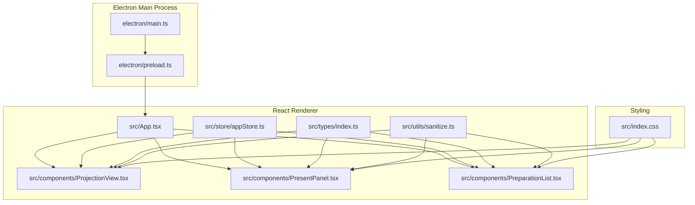

**Diagram sources**
- [main.ts:1-390](file://electron/main.ts#L1-L390)
- [preload.ts:1-43](file://electron/preload.ts#L1-L43)
- [App.tsx:1-102](file://src/App.tsx#L1-L102)
- [ProjectionView.tsx:1-127](file://src/components/ProjectionView.tsx#L1-L127)
- [sanitize.ts:1-132](file://src/utils/sanitize.ts#L1-L132)
- [PresentPanel.tsx:1-459](file://src/components/PresentPanel.tsx#L1-L459)
- [PreparationList.tsx:1-188](file://src/components/PreparationList.tsx#L1-L188)
- [appStore.ts:1-396](file://src/store/appStore.ts#L1-L396)
- [index.ts:1-90](file://src/types/index.ts#L1-L90)
- [index.css:1-100](file://src/index.css#L1-L100)

**Section sources**
- [main.ts:1-390](file://electron/main.ts#L1-L390)
- [preload.ts:1-43](file://electron/preload.ts#L1-L43)
- [App.tsx:1-102](file://src/App.tsx#L1-L102)
- [ProjectionView.tsx:1-127](file://src/components/ProjectionView.tsx#L1-L127)
- [sanitize.ts:1-132](file://src/utils/sanitize.ts#L1-L132)
- [PresentPanel.tsx:1-459](file://src/components/PresentPanel.tsx#L1-L459)
- [PreparationList.tsx:1-188](file://src/components/PreparationList.tsx#L1-L188)
- [appStore.ts:1-396](file://src/store/appStore.ts#L1-L396)
- [index.ts:1-90](file://src/types/index.ts#L1-L90)
- [index.css:1-100](file://src/index.css#L1-L100)

## Core Components
The ProjectionView component orchestrates fullscreen projection rendering with the following responsibilities:
- Real-time state synchronization via Electron IPC
- Fullscreen rendering using Tailwind CSS utilities
- Multi-mode projection rendering (live, blank, black, logo, clear)
- Dynamic background rendering (color, gradient, image) with security validation
- Text styling application with responsive margins
- Smooth vertical alignment and line offset transitions with configurable timing
- Copyright display for live mode
- **Enhanced** Secure background style generation using safeBackgroundStyle() utility
- **Enhanced** Input validation for overlay opacity using sanitizeNumber() function

Key integration points:
- Electron preload bridge exposes updateProjection and onProjectionState callbacks
- Zustand store manages projection state and dispatches updates to the projection window
- Electron main process creates and manages the projection window on target displays
- Enhanced preparation list functionality allows cleaner transition experiences through blank mode
- Scroll duration parameter enables smooth line movement animations with configurable timing
- **New** Comprehensive security utilities prevent CSS injection attacks through input validation

**Updated** Enhanced with smooth line transition animations, scrollDuration parameter support, and robust security measures for CSS injection prevention

**Section sources**
- [ProjectionView.tsx:1-127](file://src/components/ProjectionView.tsx#L1-L127)
- [sanitize.ts:1-132](file://src/utils/sanitize.ts#L1-L132)
- [appStore.ts:300-306](file://src/store/appStore.ts#L300-L306)
- [main.ts:111-152](file://electron/main.ts#L111-L152)
- [preload.ts:3-21](file://electron/preload.ts#L3-L21)

## Architecture Overview
The projection system follows a unidirectional data flow with enhanced preparation list integration, smooth line transition animations, and comprehensive security validation:
1. Presentation controls in PresentPanel trigger state changes with duration parameters
2. Preparation list interactions utilize blank mode for cleaner transitions
3. Zustand store updates projectionState with scrollDuration and sends IPC updates
4. Electron main process forwards state to projection window
5. ProjectionView subscribes to state updates and renders with smooth animations
6. **Enhanced** All user-provided CSS values are validated and sanitized before rendering

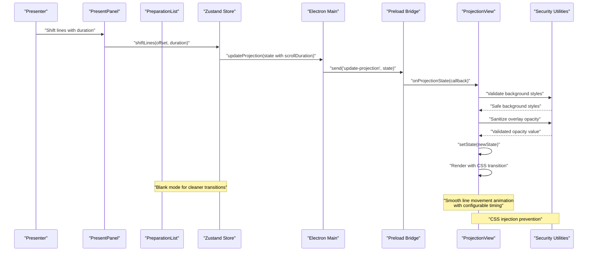

**Diagram sources**
- [PresentPanel.tsx:333-361](file://src/components/PresentPanel.tsx#L333-L361)
- [appStore.ts:300-306](file://src/store/appStore.ts#L300-L306)
- [PreparationList.tsx:57-63](file://src/components/PreparationList.tsx#L57-L63)
- [main.ts:186-190](file://electron/main.ts#L186-L190)
- [preload.ts:10-16](file://electron/preload.ts#L10-L16)
- [ProjectionView.tsx:32-34](file://src/components/ProjectionView.tsx#L32-L34)
- [ProjectionView.tsx:75-77](file://src/components/ProjectionView.tsx#L75-L77)
- [sanitize.ts:106-131](file://src/utils/sanitize.ts#L106-L131)

## Detailed Component Analysis

### ProjectionView Component
The ProjectionView component renders fullscreen projection output with enhanced smooth line transition animations and comprehensive security validation:
- Fullscreen rendering using w-screen h-screen utilities
- Mode-based rendering (black, logo, live, blank, clear)
- Dynamic background rendering with overlay support and security validation
- Text styling application with responsive margins
- Smooth transitions for line offset animations with configurable timing
- Copyright display for live mode
- **Enhanced** Secure background style generation using safeBackgroundStyle() utility
- **Enhanced** Input validation for overlay opacity using sanitizeNumber() function

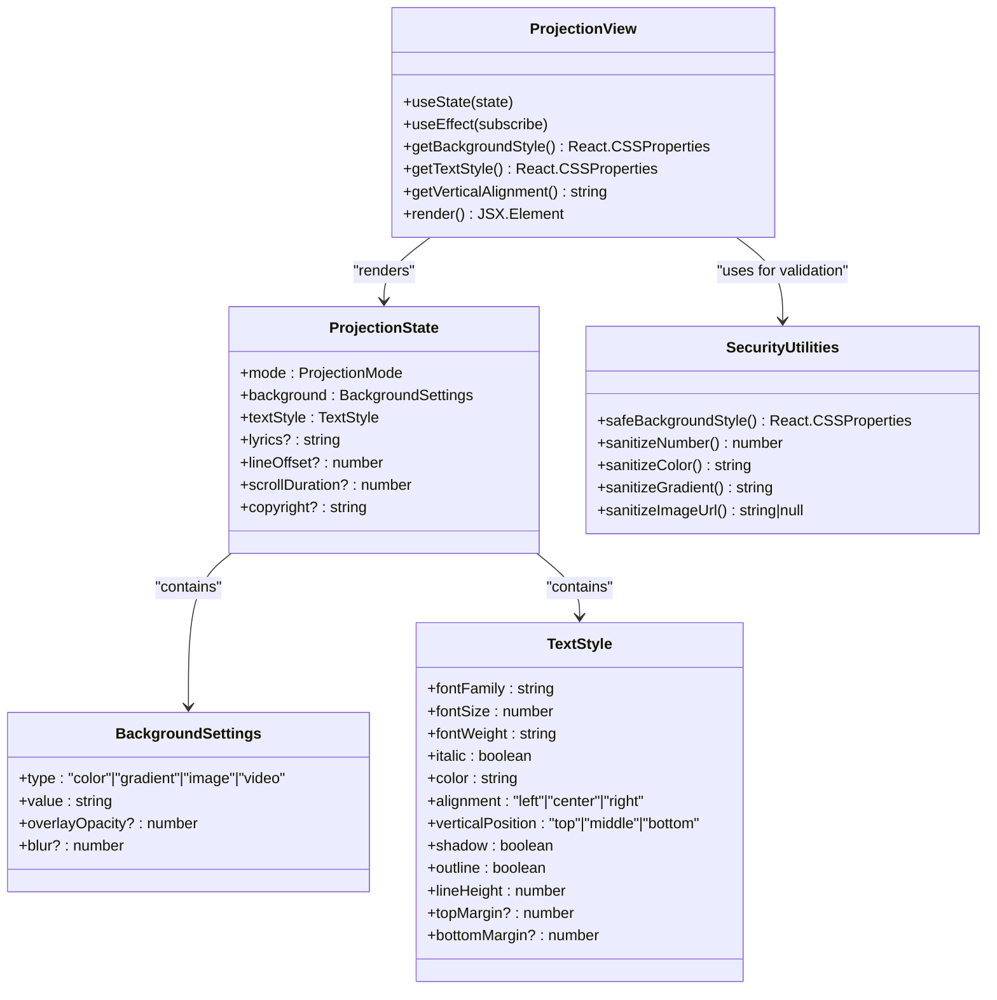

**Diagram sources**
- [ProjectionView.tsx:4-20](file://src/components/ProjectionView.tsx#L4-L20)
- [index.ts:71-82](file://src/types/index.ts#L71-L82)
- [index.ts:21-27](file://src/types/index.ts#L21-L27)
- [index.ts:29-42](file://src/types/index.ts#L29-L42)
- [sanitize.ts:106-131](file://src/utils/sanitize.ts#L106-L131)

#### Rendering Modes
The component supports five projection modes:
- Black: Solid black background
- Logo: Dark background with centered "LyricDeck" watermark
- Live: Full projection with lyrics and background, including smooth line transition animations
- Blank: Transparent overlay with text styling (enhanced with cleaner transitions)
- Clear: Empty projection (used for transitions)

**Updated** Live mode now includes smooth line transition animations with configurable timing through scrollDuration parameter and enhanced security validation

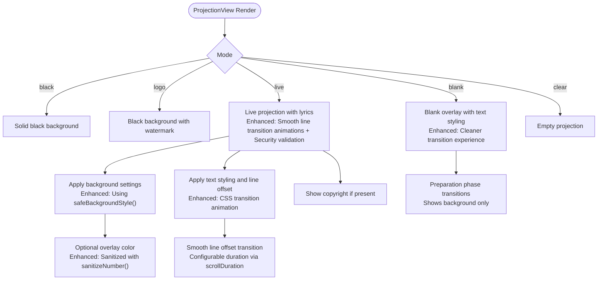

**Diagram sources**
- [ProjectionView.tsx:77-138](file://src/components/ProjectionView.tsx#L77-L138)

#### Background Rendering Pipeline
The background rendering system supports three types with comprehensive security validation:
- Color backgrounds with solid fills and color validation
- Gradient backgrounds with customizable gradients and gradient sanitization
- Image backgrounds with blur effects, positioning, and URL validation

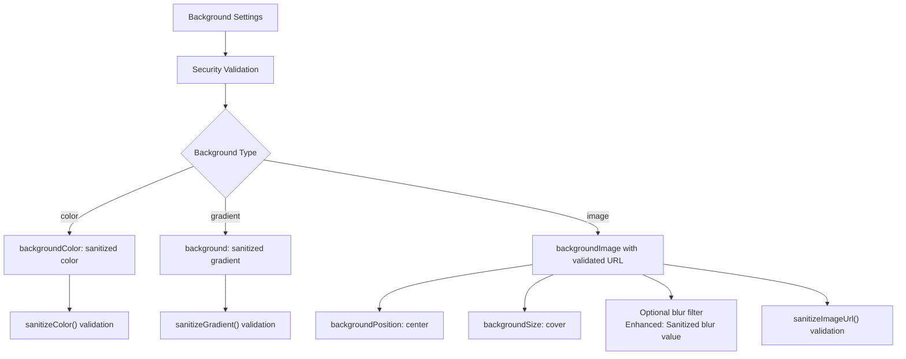

**Diagram sources**
- [ProjectionView.tsx:32-34](file://src/components/ProjectionView.tsx#L32-L34)
- [sanitize.ts:106-131](file://src/utils/sanitize.ts#L106-L131)
- [index.ts:21-27](file://src/types/index.ts#L21-L27)

#### Text Styling Application
Text styling is applied through computed CSS properties:
- Font family, size, weight, and italic styling
- Color and text alignment
- Line height and vertical positioning
- Text shadows and stroke outlines
- Dynamic top/bottom margins for responsive layout

**Updated** Enhanced with smooth line transition animations controlled by scrollDuration parameter

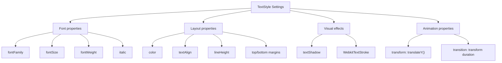

**Diagram sources**
- [ProjectionView.tsx:36-49](file://src/components/ProjectionView.tsx#L36-L49)
- [index.ts:29-42](file://src/types/index.ts#L29-L42)

#### Smooth Line Transition Animations
The enhanced line transition system provides smooth animations with configurable timing:
- CSS transition property automatically applied when scrollDuration > 0
- Linear timing function ensures consistent animation speed
- Transform calculations support smooth vertical positioning
- Duration parameter controls animation speed precisely
- Hardware-accelerated CSS transforms for optimal performance

**New** Smooth line transition animations with configurable timing through scrollDuration parameter

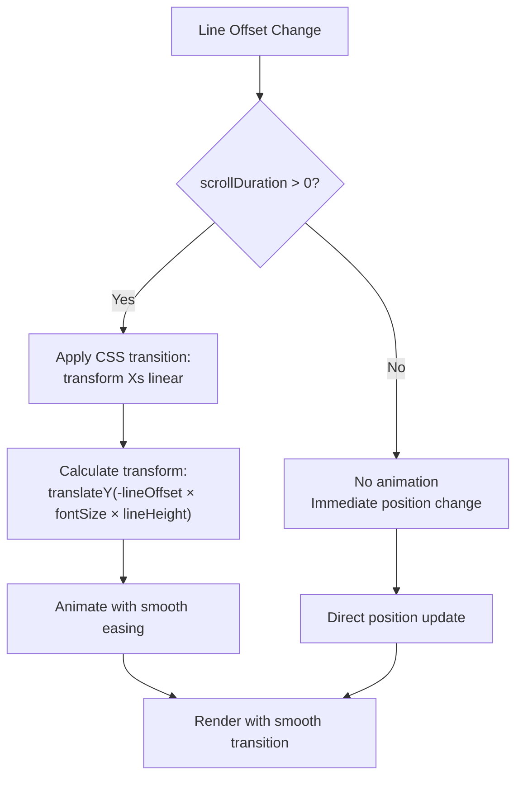

**Diagram sources**
- [ProjectionView.tsx:103-110](file://src/components/ProjectionView.tsx#L103-L110)

**Section sources**
- [ProjectionView.tsx:1-127](file://src/components/ProjectionView.tsx#L1-L127)
- [index.ts:69-82](file://src/types/index.ts#L69-L82)

### Enhanced Preparation List Integration
The preparation list system now includes enhanced projection control actions that provide cleaner transition experiences:

#### Blank Mode Functionality
The `selectFromPreparationList` action has been enhanced to automatically switch to blank mode when selecting songs from the preparation list. This provides a cleaner transition experience by displaying only the song's background without immediately showing lyrics during the preparation phase.

**Updated** Enhanced projection control actions with blank mode functionality for smoother transitions

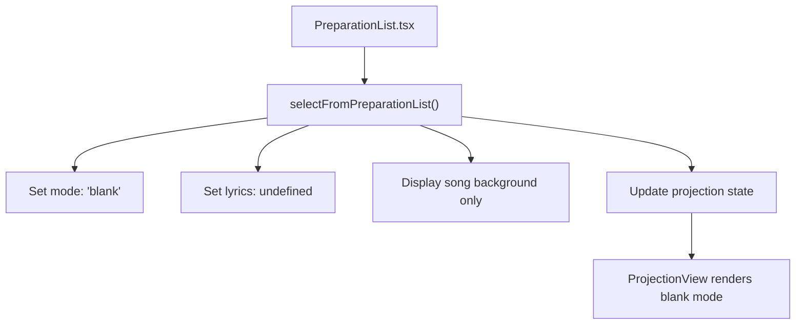

**Diagram sources**
- [PreparationList.tsx:57-63](file://src/components/PreparationList.tsx#L57-L63)
- [appStore.ts:353-370](file://src/store/appStore.ts#L353-L370)

#### Presentation Controls Integration
The presentation panel provides direct access to blank mode through dedicated buttons and keyboard shortcuts, complementing the preparation list functionality.

**Section sources**
- [PreparationList.tsx:1-188](file://src/components/PreparationList.tsx#L1-L188)
- [PresentPanel.tsx:288-311](file://src/components/PresentPanel.tsx#L288-L311)
- [appStore.ts:353-370](file://src/store/appStore.ts#L353-L370)

### Enhanced Line Movement System
The shiftLines functionality has been enhanced to support smooth animations with configurable timing:

#### Scroll Duration Parameter
The shiftLines function now accepts a duration parameter that controls animation timing:
- Duration parameter passed from presentation controls
- Stored in projectionState.scrollDuration
- Applied as CSS transition duration for line movements
- Enables precise control over animation speed
- Supports smooth, professional transitions

**New** Enhanced shiftLines function with scrollDuration parameter for smooth animations

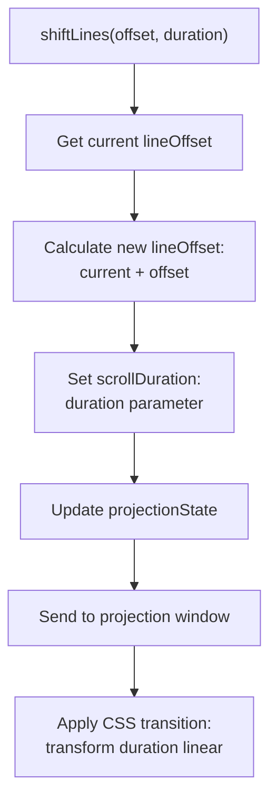

**Diagram sources**
- [appStore.ts:300-306](file://src/store/appStore.ts#L300-L306)

#### Presentation Controls Integration
The presentation panel provides intuitive controls for line shifting with duration configuration:
- Scroll speed input field for duration setting
- Line shift buttons with configurable timing
- Real-time preview of animation effects
- Keyboard shortcuts for quick adjustments

**Section sources**
- [PresentPanel.tsx:320-362](file://src/components/PresentPanel.tsx#L320-362)
- [appStore.ts:300-306](file://src/store/appStore.ts#L300-L306)

### Electron Integration
The projection system integrates tightly with Electron for window management and display detection:

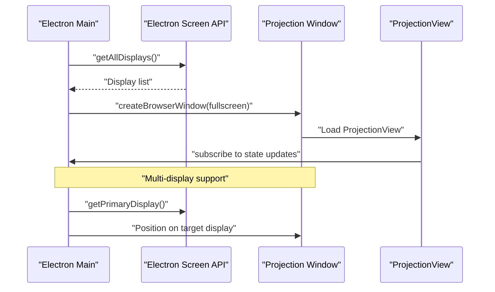

**Diagram sources**
- [main.ts:111-152](file://electron/main.ts#L111-L152)
- [main.ts:155-164](file://electron/main.ts#L155-L164)
- [App.tsx:16-17](file://src/App.tsx#L16-L17)

#### Display Management
The Electron main process handles:
- Display enumeration and selection
- Multi-display window placement
- Primary display fallback logic
- Projection window lifecycle management

**Section sources**
- [main.ts:111-152](file://electron/main.ts#L111-L152)
- [main.ts:155-164](file://electron/main.ts#L155-L164)
- [preload.ts:3-21](file://electron/preload.ts#L3-L21)

### State Synchronization
Real-time state synchronization occurs through:
- IPC handlers for state updates with scrollDuration support
- Subscription mechanism for renderer updates
- Automatic cleanup of event listeners

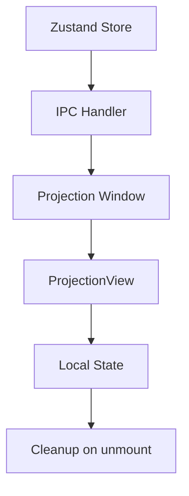

**Diagram sources**
- [appStore.ts:242-250](file://src/store/appStore.ts#L242-L250)
- [main.ts:186-190](file://electron/main.ts#L186-L190)
- [ProjectionView.tsx:22-29](file://src/components/ProjectionView.tsx#L22-L29)

**Section sources**
- [appStore.ts:241-306](file://src/store/appStore.ts#L241-L306)
- [main.ts:186-190](file://electron/main.ts#L186-L190)
- [preload.ts:10-16](file://electron/preload.ts#L10-L16)

## Security Enhancements

### CSS Injection Prevention System
The ProjectionView component now implements comprehensive security measures to prevent CSS injection attacks through multiple layers of validation and sanitization:

#### Safe Background Style Generation
The `getBackgroundStyle()` method has been completely replaced with the `safeBackgroundStyle()` utility function, providing secure background style generation:

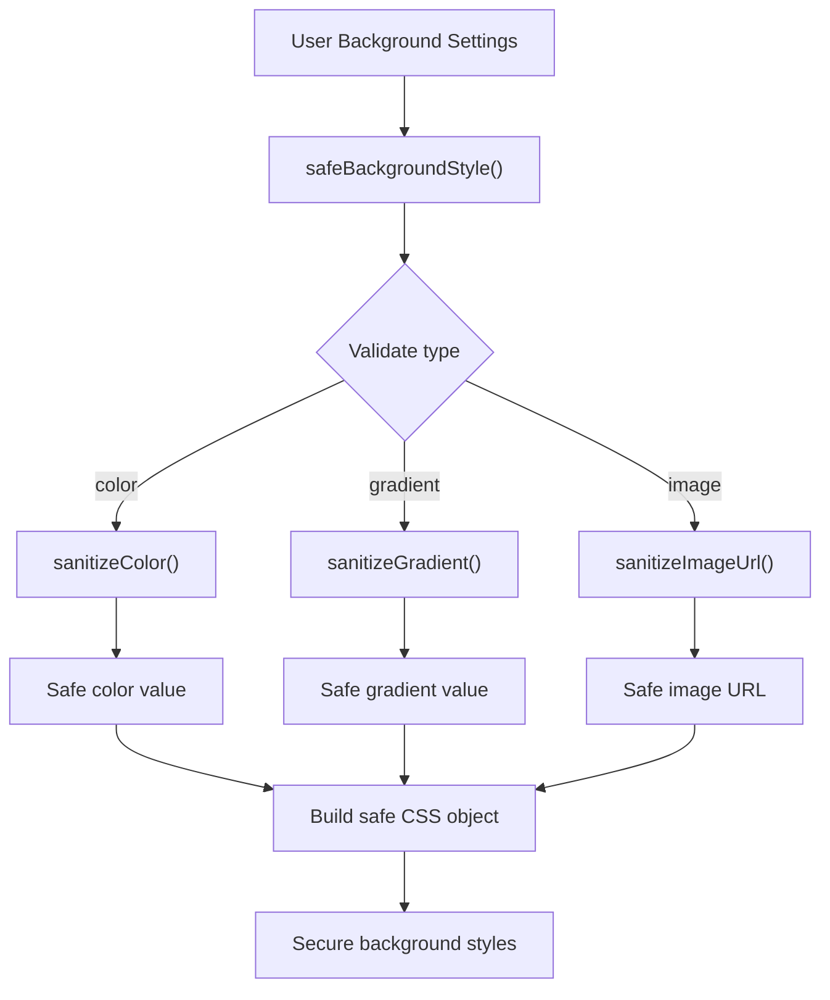

**Diagram sources**
- [ProjectionView.tsx:32-34](file://src/components/ProjectionView.tsx#L32-L34)
- [sanitize.ts:106-131](file://src/utils/sanitize.ts#L106-L131)

#### Overlay Opacity Validation
The overlay opacity handling has been enhanced with `sanitizeNumber()` validation to ensure values remain within the valid 0-1 range:

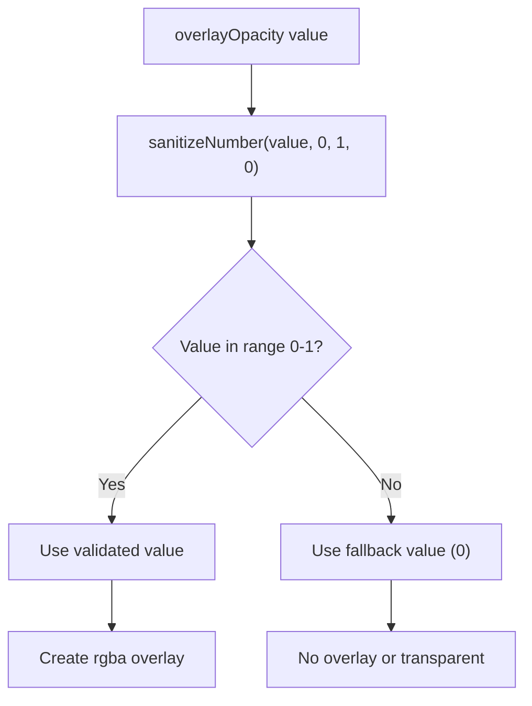

**Diagram sources**
- [ProjectionView.tsx:75-77](file://src/components/ProjectionView.tsx#L75-L77)
- [sanitize.ts:96-100](file://src/utils/sanitize.ts#L96-L100)

### Security Utility Functions
The security system provides comprehensive validation functions:

#### Color Validation (`sanitizeColor`)
- Validates hex colors (#RGB, #RRGGBB, #RRGGBBAA)
- Validates RGB/RGBA color functions
- Validates HSL/HSLA color functions
- Allows safe named colors (transparent, black, white, etc.)
- Returns fallback color for invalid inputs

#### Gradient Validation (`sanitizeGradient`)
- Validates gradient function syntax (linear-gradient, radial-gradient, conic-gradient)
- Rejects dangerous patterns (expression(), javascript:, vbscript:)
- Prevents CSS injection through malicious gradient values
- Returns safe default gradient for invalid inputs

#### Image URL Validation (`sanitizeImageUrl`)
- Allows custom lyricdeck-img:// protocol
- Validates safe data URLs (png, jpeg, gif, webp, bmp, svg+xml)
- Blocks potentially dangerous protocols and data URIs
- Returns null for unsafe URLs

#### Number Validation (`sanitizeNumber`)
- Ensures numeric values are finite numbers
- Clamps values within specified min/max ranges
- Provides fallback values for invalid inputs
- Used for opacity, blur, and other numeric CSS properties

**Section sources**
- [ProjectionView.tsx:32-34](file://src/components/ProjectionView.tsx#L32-L34)
- [ProjectionView.tsx:75-77](file://src/components/ProjectionView.tsx#L75-L77)
- [sanitize.ts:1-132](file://src/utils/sanitize.ts#L1-132)

## Dependency Analysis
The ProjectionView component has the following dependencies and relationships with enhanced security utilities:

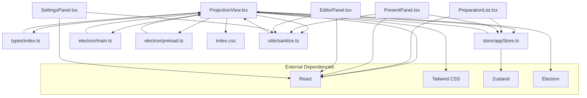

**Diagram sources**
- [ProjectionView.tsx:1-3](file://src/components/ProjectionView.tsx#L1-L3)
- [index.ts:1-90](file://src/types/index.ts#L1-L90)
- [appStore.ts:1-3](file://src/store/appStore.ts#L1-L3)
- [main.ts:1-5](file://electron/main.ts#L1-L5)
- [preload.ts:1-3](file://electron/preload.ts#L1-L3)
- [sanitize.ts:1-5](file://src/utils/sanitize.ts#L1-L5)
- [index.css:1-3](file://src/index.css#L1-L3)
- [PreparationList.tsx:1-3](file://src/components/PreparationList.tsx#L1-L3)
- [PresentPanel.tsx:1-4](file://src/components/PresentPanel.tsx#L1-L4)
- [EditorPanel.tsx:1-4](file://src/components/EditorPanel.tsx#L1-L4)
- [SettingsPanel.tsx:1-5](file://src/components/SettingsPanel.tsx#L1-L5)

Key dependency characteristics:
- Low coupling with external libraries (React, Tailwind, Zustand)
- Strong separation between presentation logic and Electron integration
- Type-safe state management through TypeScript interfaces
- Minimal runtime dependencies for optimal performance
- Enhanced preparation list integration for improved workflow
- ScrollDuration parameter support for smooth animations
- **New** Comprehensive security utilities for CSS injection prevention
- **New** Centralized security validation across multiple components

**Section sources**
- [ProjectionView.tsx:1-3](file://src/components/ProjectionView.tsx#L1-L3)
- [index.ts:1-90](file://src/types/index.ts#L1-L90)
- [appStore.ts:1-3](file://src/store/appStore.ts#L1-L3)
- [main.ts:1-5](file://electron/main.ts#L1-L5)
- [preload.ts:1-3](file://electron/preload.ts#L1-L3)
- [sanitize.ts:1-5](file://src/utils/sanitize.ts#L1-L5)

## Performance Considerations
Optimizing the ProjectionView component for smooth live presentation rendering with enhanced animations and security validation:

### Rendering Optimizations
- Use CSS transforms for line offset animations (hardware-accelerated)
- Leverage Tailwind utility classes for efficient styling
- Avoid unnecessary re-renders through proper state management
- Optimize blank mode rendering for cleaner transitions
- Hardware-accelerated CSS transitions for smooth animations
- Configurable animation timing reduces CPU overhead during rapid changes
- **Enhanced** Efficient security validation with minimal performance impact

### Memory Management
- Clean up IPC event listeners on component unmount
- Dispose of projection window resources properly
- Monitor memory usage during long presentations
- Efficient handling of preparation list state changes
- Animation state cleanup prevents memory leaks
- **Enhanced** Security utility functions are lightweight and reusable

### Display Performance
- Use hardware-accelerated CSS properties (transform, filter)
- Optimize image backgrounds with appropriate sizing
- Consider GPU acceleration for complex effects
- Smooth transitions between blank and live modes
- Optimized CSS transition calculations for minimal performance impact
- **Enhanced** Security validation occurs once per render cycle

### State Synchronization
- Debounce rapid state updates to prevent excessive re-renders
- Use selective state updates for projection-specific properties
- Cache computed style values when possible
- Optimize preparation list interaction performance
- Efficient scrollDuration parameter handling for smooth animations
- **Enhanced** Security validation integrated into existing render cycle

### Animation Performance
- Linear timing function ensures consistent frame rates
- Hardware-accelerated transforms minimize CPU usage
- Configurable duration prevents overly slow animations
- CSS transitions optimized for smooth 60fps performance
- **Enhanced** Security validation does not impact animation performance

### Security Performance
- **New** Lightweight validation functions with minimal overhead
- **New** Reusable security utilities across components
- **New** Efficient regex patterns for fast validation
- **New** Early return patterns for invalid inputs
- **New** Caching of validation results where appropriate

## Troubleshooting Guide

### Common Display Issues
**Problem**: Projection window fails to open on secondary display
- Verify display detection returns multiple displays
- Check display ID selection logic
- Ensure projection window creation succeeds

**Problem**: Incorrect fullscreen positioning
- Validate display bounds calculation
- Confirm window position matches display coordinates
- Test with different DPI settings

**Problem**: Black screen or missing content
- Verify IPC state updates are received
- Check projection mode rendering logic
- Ensure background rendering applies correctly
- **Enhanced** Check security validation is not blocking legitimate content

### State Synchronization Problems
**Issue**: State updates not reflected in projection
- Confirm IPC handler registration
- Verify state update propagation chain
- Check for event listener cleanup issues

**Issue**: Stale state in projection window
- Implement proper cleanup of subscriptions
- Validate state update frequency
- Monitor for memory leaks

### Animation and Transition Issues
**Issue**: Line transitions not animating smoothly
- Verify scrollDuration parameter > 0
- Check CSS transition property application
- Ensure transform calculations are correct
- Monitor browser compatibility for CSS transitions

**Issue**: Animation timing feels too fast or slow
- Adjust scrollDuration parameter in presentation controls
- Test with different duration values
- Verify linear timing function is applied correctly

**Issue**: Jittery or choppy animations
- Reduce animation complexity
- Optimize background rendering
- Monitor CPU/GPU usage during presentations
- Ensure hardware acceleration is enabled

### Security-Related Issues
**Issue**: Background styles not displaying correctly
- Check if security validation is rejecting legitimate values
- Verify color format matches expected patterns
- Ensure gradient syntax is valid
- Confirm image URLs use allowed protocols

**Issue**: Overlay opacity not working
- Verify opacity values are within 0-1 range
- Check sanitizeNumber() validation is functioning
- Ensure overlay opacity is being calculated correctly

**Issue**: Content blocked by security validation
- Review security utility function behavior
- Check for overly restrictive validation rules
- Verify input data format matches expected patterns

### Preparation List Integration Issues
**Issue**: Blank mode not activating from preparation list
- Verify selectFromPreparationList action implementation
- Check projection state updates for blank mode
- Ensure proper cleanup of lyrics and line offset

**Issue**: Inconsistent transition behavior
- Monitor preparation list click events
- Verify blank mode state persistence
- Check for conflicts with manual mode switching

### Performance Issues
**Symptoms**: Choppy animations or delayed updates
- Reduce animation complexity
- Optimize background rendering
- Monitor CPU/GPU usage during presentations
- Optimize preparation list interaction performance
- Check scrollDuration values for optimal performance
- Monitor animation frame rates during testing
- **Enhanced** Monitor security validation performance impact

**Section sources**
- [main.ts:111-152](file://electron/main.ts#L111-L152)
- [preload.ts:10-16](file://electron/preload.ts#L10-L16)
- [ProjectionView.tsx:22-29](file://src/components/ProjectionView.tsx#L22-L29)
- [appStore.ts:353-370](file://src/store/appStore.ts#L353-L370)
- [appStore.ts:300-306](file://src/store/appStore.ts#L300-L306)
- [sanitize.ts:1-132](file://src/utils/sanitize.ts#L1-L132)

## Conclusion
The ProjectionView component provides a robust, performant solution for fullscreen lyric projection in live presentation environments. Its architecture emphasizes real-time state synchronization, multi-display support, and responsive rendering while maintaining clean separation between presentation logic and Electron integration. The component's design enables smooth operation during live events through careful optimization of rendering pipelines, efficient state management, and reliable IPC communication.

**Updated** The enhanced smooth line transition animations with scrollDuration parameter support significantly improve the presentation experience by enabling professional-grade animated line movements with precise timing control. Presenters can now create smooth, polished transitions between lyrics sections with configurable animation speeds, enhancing the overall quality of live presentations. Additionally, the comprehensive security enhancements provide robust protection against CSS injection attacks through multiple layers of validation and sanitization.

Key strengths include:
- Seamless integration with the presentation controls system
- Comprehensive multi-mode rendering support including enhanced blank mode
- Efficient background and text styling systems
- Reliable multi-display window management
- Performance-optimized rendering pipeline with smooth animations
- Enhanced preparation list integration for improved workflow
- Configurable animation timing for professional presentation quality
- **New** Comprehensive security measures preventing CSS injection attacks
- **New** Robust input validation ensuring data integrity and safety

The component serves as a critical foundation for live presentation workflows, enabling presenters to deliver professional-quality lyric projections with minimal technical overhead while enjoying improved preparation experiences through the blank mode functionality, smooth animation capabilities, and enhanced security protections.

## Appendices

### Projection Setup Workflows

#### Basic Projection Setup
1. Select target display in presentation panel
2. Click "Start Projection" button
3. Verify projection window opens on selected display
4. Adjust projection mode as needed

#### Enhanced Preparation Workflow with Blank Mode
1. Build preparation list with desired songs
2. Select song from preparation list
3. System automatically switches to blank mode with background only
4. Prepare for presentation without immediate lyric reveal
5. Switch to live mode when ready to present

#### Smooth Line Transition Setup
1. Configure scroll speed in presentation controls
2. Use line shift buttons to move between lyrics sections
3. Adjust duration for desired animation speed
4. Test animations with different timing values
5. Fine-tune for optimal presentation quality

#### Multi-Display Configuration
1. Enumerate available displays via Electron screen API
2. Select secondary display for projection
3. Configure display-specific settings
4. Test projection output quality

#### Security Configuration
1. Verify background settings use supported formats
2. Ensure image URLs use allowed protocols (lyricdeck-img:// or safe data URLs)
3. Validate color values match expected patterns
4. Test gradient syntax for compatibility
5. Monitor security validation logs for rejected inputs

#### Troubleshooting Display Issues
1. Check display detection results
2. Verify projection window positioning
3. Test with different display configurations
4. Monitor for resolution mismatch issues

### Enhanced Preparation List Features
- **Blank Mode Integration**: Automatic blank mode activation when selecting songs from preparation list
- **Cleaner Transitions**: Background-only display during preparation phase
- **Smooth Workflow**: Professional transition experience between songs
- **State Management**: Proper handling of lyrics and line offset during preparation

### Enhanced Animation Features
- **Configurable Timing**: scrollDuration parameter controls animation speed
- **Linear Easing**: Consistent animation speed for professional feel
- **Hardware Acceleration**: CSS transforms optimized for smooth performance
- **Real-time Control**: Dynamic adjustment of animation timing during presentations

### Security Enhancement Features
- **CSS Injection Prevention**: Comprehensive validation of all user-provided CSS values
- **Safe Background Styles**: Secure background rendering through safeBackgroundStyle() utility
- **Input Validation**: Robust sanitization of colors, gradients, image URLs, and numeric values
- **Multiple Validation Layers**: Defense-in-depth approach to security
- **Reusable Security Utilities**: Centralized security functions used across components

### Performance Optimization Checklist
- Use hardware-accelerated CSS properties
- Minimize DOM complexity in projection view
- Optimize background image loading
- Implement proper state update throttling
- Monitor resource usage during presentations
- Optimize preparation list interaction performance
- Ensure smooth blank mode transitions
- Optimize animation performance with appropriate scrollDuration values
- Monitor frame rates during animation testing
- Test animation compatibility across different browsers and devices
- **New** Monitor security validation performance impact
- **New** Validate security utility efficiency under load
- **New** Test security measures with various input formats

### Security Best Practices
- Always use safeBackgroundStyle() for background rendering
- Validate all user inputs through security utilities
- Use sanitizeNumber() for numeric CSS properties
- Implement proper error handling for security validation failures
- Regularly review security utility functions for vulnerabilities
- Test with malicious inputs to ensure protection effectiveness
- Monitor security logs for potential attack attempts