# Settings and Configuration Component

<cite>
**Referenced Files in This Document**
- [SettingsPanel.tsx](file://src/components/SettingsPanel.tsx)
- [appStore.ts](file://src/store/appStore.ts)
- [ProjectionView.tsx](file://src/components/ProjectionView.tsx)
- [BackgroundGallery.tsx](file://src/components/BackgroundGallery.tsx)
- [index.ts](file://src/types/index.ts)
- [en.ts](file://src/i18n/en.ts)
- [zhTW.ts](file://src/i18n/zhTW.ts)
- [ja.ts](file://src/i18n/ja.ts)
- [index.ts](file://src/i18n/index.ts)
- [main.ts](file://electron/main.ts)
- [db.ts](file://electron/db.ts)
- [preload.ts](file://electron/preload.ts)
- [index.css](file://src/index.css)
- [main.tsx](file://src/main.tsx)
- [App.tsx](file://src/App.tsx)
</cite>

## Update Summary
**Changes Made**
- Added comprehensive Upsert Import functionality with detailed documentation
- Documented new Data Purge capabilities including full system reset and selective song deletion
- Enhanced Internationalization support with Japanese language and improved locale management
- Updated State Management integration through enhanced resetState action in appStore
- Added new UI sections for Import/Export and Purge Data management
- Integrated backend database upsert operations for image and song management
- Enhanced gallery refresh mechanism using React keys for better state synchronization
- Expanded status messaging system for improved user feedback

## Table of Contents
1. [Introduction](#introduction)
2. [Project Structure](#project-structure)
3. [Core Components](#core-components)
4. [Architecture Overview](#architecture-overview)
5. [Detailed Component Analysis](#detailed-component-analysis)
6. [Dependency Analysis](#dependency-analysis)
7. [Performance Considerations](#performance-considerations)
8. [Troubleshooting Guide](#troubleshooting-guide)
9. [Conclusion](#conclusion)

## Introduction
This document provides comprehensive technical documentation for the SettingsPanel component, which enables users to configure background customization and text styling for presentations. It covers the background settings system (color pickers, gradient configurations, image upload and management, and video background support), the text styling system (fonts, colors, alignment, shadows, outlines, and responsive typography), integration with the global state store for persistent settings, validation of configuration values, and real-time preview updates. It also explains the component's impact on projection rendering and its role in creating optimal viewing experiences.

**Updated** Added comprehensive data management capabilities including upsert import functionality for updating existing content while preserving IDs, complete data purge options for system reset, enhanced internationalization support for multilingual user interfaces (English, Traditional Chinese, Japanese), and improved gallery refresh mechanisms using React keys for better state synchronization.

## Project Structure
The SettingsPanel component resides in the components directory and integrates with the global Zustand store, type definitions, internationalization, and Electron backend for background image management and projection updates.

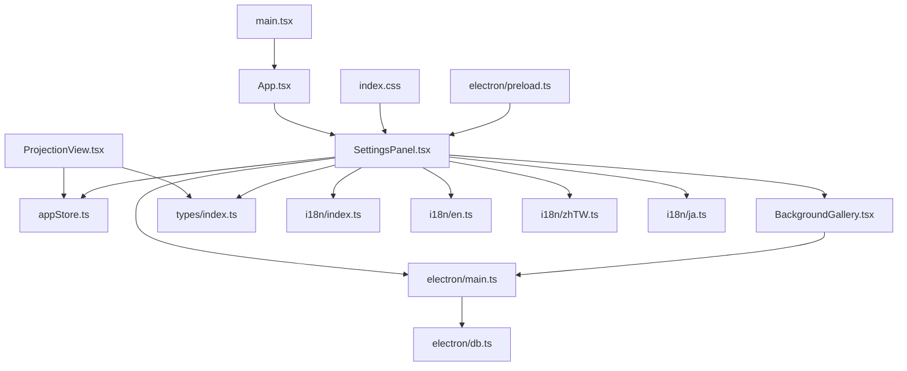

**Diagram sources**
- [SettingsPanel.tsx:1-664](file://src/components/SettingsPanel.tsx#L1-L664)
- [appStore.ts:1-425](file://src/store/appStore.ts#L1-L425)
- [ProjectionView.tsx:1-134](file://src/components/ProjectionView.tsx#L1-L134)
- [BackgroundGallery.tsx:1-99](file://src/components/BackgroundGallery.tsx#L1-L99)
- [index.ts:1-89](file://src/types/index.ts#L1-L89)
- [en.ts:1-199](file://src/i18n/en.ts#L1-L199)
- [zhTW.ts:1-199](file://src/i18n/zhTW.ts#L1-L199)
- [ja.ts:1-199](file://src/i18n/ja.ts#L1-L199)
- [index.ts:1-46](file://src/i18n/index.ts#L1-L46)
- [main.ts:1-484](file://electron/main.ts#L1-L484)
- [db.ts:1-250](file://electron/db.ts#L1-L250)
- [preload.ts:1-48](file://electron/preload.ts#L1-L48)
- [index.css:1-100](file://src/index.css#L1-L100)
- [main.tsx:1-11](file://src/main.tsx#L1-L11)
- [App.tsx:1-102](file://src/App.tsx#L1-L102)

**Section sources**
- [SettingsPanel.tsx:1-664](file://src/components/SettingsPanel.tsx#L1-L664)
- [appStore.ts:1-425](file://src/store/appStore.ts#L1-L425)
- [ProjectionView.tsx:1-134](file://src/components/ProjectionView.tsx#L1-L134)
- [BackgroundGallery.tsx:1-99](file://src/components/BackgroundGallery.tsx#L1-L99)
- [index.ts:1-89](file://src/types/index.ts#L1-L89)
- [en.ts:100-199](file://src/i18n/en.ts#L100-L199)
- [zhTW.ts:102-199](file://src/i18n/zhTW.ts#L102-L199)
- [ja.ts:102-199](file://src/i18n/ja.ts#L102-L199)
- [index.ts:1-46](file://src/i18n/index.ts#L1-L46)
- [main.ts:1-484](file://electron/main.ts#L1-L484)
- [db.ts:1-250](file://electron/db.ts#L1-L250)
- [preload.ts:1-48](file://electron/preload.ts#L1-L48)
- [index.css:1-100](file://src/index.css#L1-L100)
- [main.tsx:1-11](file://src/main.tsx#L1-L11)
- [App.tsx:1-102](file://src/App.tsx#L1-L102)

## Core Components
- SettingsPanel: Central configuration UI for background and text styling, with real-time preview and persistence.
- BackgroundGallery: Image library management with add/delete operations and selection callbacks.
- ProjectionView: Real-time projection renderer that consumes the global projection state.
- Global Store (Zustand): Provides reactive state for songs, projection, and settings with persistence hooks.
- Types: Defines BackgroundSettings, TextStyle, PresentationSettings, Song, and ProjectionState structures.
- Internationalization: Provides localized strings for UI labels and messages in English, Traditional Chinese, and Japanese.

**Updated** Enhanced with comprehensive data management features including upsert import, data purge capabilities, full internationalization support for three languages, and improved gallery refresh mechanisms using React keys.

**Section sources**
- [SettingsPanel.tsx:1-664](file://src/components/SettingsPanel.tsx#L1-L664)
- [BackgroundGallery.tsx:1-99](file://src/components/BackgroundGallery.tsx#L1-L99)
- [ProjectionView.tsx:1-134](file://src/components/ProjectionView.tsx#L1-L134)
- [appStore.ts:1-425](file://src/store/appStore.ts#L1-L425)
- [index.ts:1-89](file://src/types/index.ts#L1-L89)
- [en.ts:100-199](file://src/i18n/en.ts#L100-L199)
- [zhTW.ts:102-199](file://src/i18n/zhTW.ts#L102-L199)
- [ja.ts:102-199](file://src/i18n/ja.ts#L102-L199)
- [index.ts:1-46](file://src/i18n/index.ts#L1-L46)

## Architecture Overview
The SettingsPanel updates the global store, which persists changes and synchronizes with the projection window. Background images are managed via Electron IPC and stored in an embedded SQLite database, served via a custom protocol. New data management features include upsert import for updating existing content and comprehensive purge capabilities for system reset.

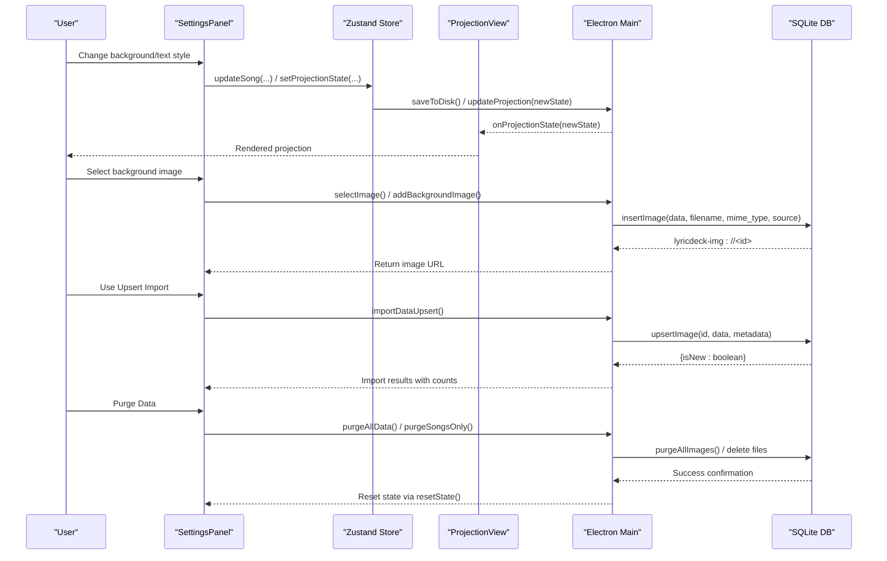

**Diagram sources**
- [SettingsPanel.tsx:514-535](file://src/components/SettingsPanel.tsx#L514-L535)
- [appStore.ts:412-423](file://src/store/appStore.ts#L412-L423)
- [ProjectionView.tsx:22-29](file://src/components/ProjectionView.tsx#L22-L29)
- [main.ts:356-425](file://electron/main.ts#L356-L425)
- [db.ts:178-205](file://electron/db.ts#L178-L205)
- [main.ts:428-448](file://electron/main.ts#L428-L448)

## Detailed Component Analysis

### Background Settings System
The background settings system supports three modes: color, gradient, and image. Users can switch modes, adjust overlay opacity, and preview changes in real time.

- Mode switching: Buttons toggle between color, gradient, and image modes.
- Color mode: Uses a native color picker and hex text input for precise color selection.
- Gradient mode: Accepts arbitrary CSS gradient values with preset suggestions.
- Image mode: Allows selecting images from disk or the gallery, with a live preview overlay and sample text rendering.
- Overlay opacity: Range slider controls dark overlay intensity for improved text readability.

**Diagram sources**
- [SettingsPanel.tsx:94-268](file://src/components/SettingsPanel.tsx#L94-L268)
- [ProjectionView.tsx:31-48](file://src/components/ProjectionView.tsx#L31-L48)

**Section sources**
- [SettingsPanel.tsx:94-268](file://src/components/SettingsPanel.tsx#L94-L268)
- [ProjectionView.tsx:31-48](file://src/components/ProjectionView.tsx#L31-L48)

### Text Styling System
The text styling system provides comprehensive controls for fonts, colors, alignment, positioning, spacing, and visual effects.

- Font family: Dropdown with common web-safe fonts including expanded Asian language support.
- Font size: Numeric input with min/max constraints.
- Font weight: Normal, bold, lighter options.
- Text color: Color picker with hex input.
- Alignment: Left, center, right.
- Vertical position: Top, middle, bottom.
- Line height: Numeric input with step increments.
- Margins: Top and bottom margins with step increments.
- Effects: Text shadow, outline, italic toggles.

**Updated** Enhanced font family options now include Traditional Chinese font (華康超圓體) alongside existing Western fonts for comprehensive Asian language typography support.

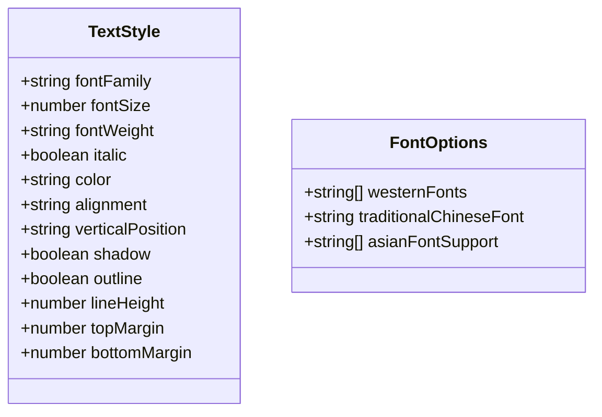

**Diagram sources**
- [index.ts:29-42](file://src/types/index.ts#L29-L42)
- [SettingsPanel.tsx:276-289](file://src/components/SettingsPanel.tsx#L276-L289)

**Section sources**
- [SettingsPanel.tsx:270-422](file://src/components/SettingsPanel.tsx#L270-L422)
- [index.ts:29-42](file://src/types/index.ts#L29-L42)
- [SettingsPanel.tsx:276-289](file://src/components/SettingsPanel.tsx#L276-L289)

### Font Family Options
The font family dropdown now provides comprehensive typography options supporting both Western and Asian languages:

**Western Fonts:**
- Arial, Helvetica, Georgia, Times New Roman, Verdana, Trebuchet MS, Impact, Comic Sans MS

**Asian Language Support:**
- 華康超圓體 (Traditional Chinese font)

**Internationalization Considerations:**
- Font names are displayed in their respective languages
- Traditional Chinese font support enables proper rendering of Asian characters
- Maintains backward compatibility with existing Western font families

**Section sources**
- [SettingsPanel.tsx:276-289](file://src/components/SettingsPanel.tsx#L276-L289)
- [zhTW.ts:116](file://src/i18n/zhTW.ts#L116)

### Background Image Management
Background images are uploaded from disk or added to the gallery, persisted in an embedded SQLite database, and served via a custom protocol.

- Upload from disk: Opens a file dialog, reads binary data, stores in DB, and returns a URL.
- Gallery management: Lists, adds, deletes, and selects images from the gallery.
- Protocol handling: Serves images via lyricdeck-img://<id> with appropriate MIME types.

**Updated** Enhanced gallery refresh mechanism using React keys ensures immediate UI updates after import/export operations and maintains consistent state across the application.

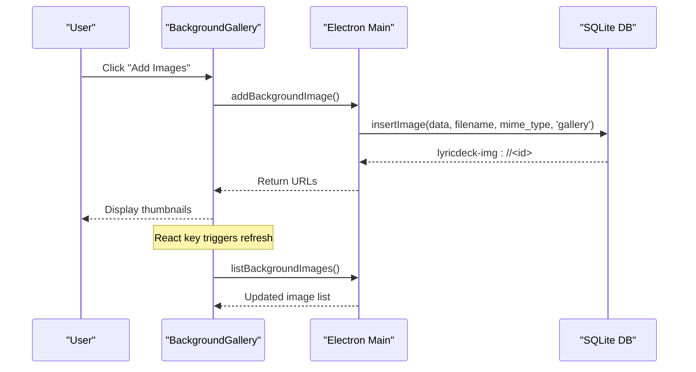

**Diagram sources**
- [BackgroundGallery.tsx:24-31](file://src/components/BackgroundGallery.tsx#L24-L31)
- [main.ts:237-255](file://electron/main.ts#L237-L255)
- [db.ts:70-87](file://electron/db.ts#L70-87)
- [SettingsPanel.tsx:10-16](file://src/components/SettingsPanel.tsx#L10-L16)

**Section sources**
- [BackgroundGallery.tsx:1-99](file://src/components/BackgroundGallery.tsx#L1-L99)
- [main.ts:221-264](file://electron/main.ts#L221-264)
- [db.ts:70-131](file://electron/db.ts#L70-L131)
- [SettingsPanel.tsx:10-16](file://src/components/SettingsPanel.tsx#L10-L16)

### Video Background Support
The BackgroundSettings type includes a video option, indicating future capability for video backgrounds. While the SettingsPanel currently supports color, gradient, and image modes, the underlying type definition allows for video backgrounds. Implementation would require adding a video mode selector and media player integration in the projection view.

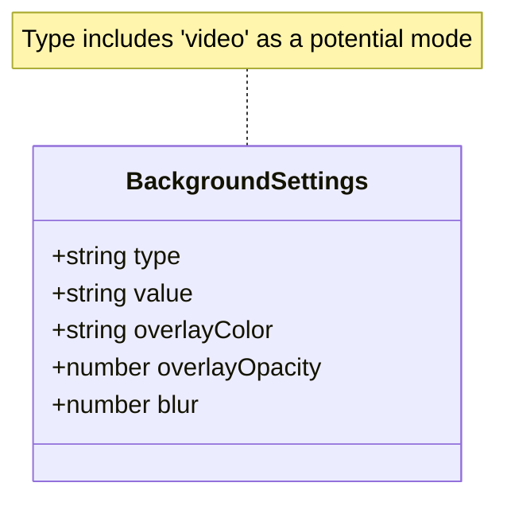

**Diagram sources**
- [index.ts:21-27](file://src/types/index.ts#L21-L27)

**Section sources**
- [index.ts:21-27](file://src/types/index.ts#L21-L27)

### Integration with Global State Store
SettingsPanel updates the global store using updateSong and setProjectionState, enabling immediate persistence and projection synchronization.

- updateSong: Updates a specific song's presentation settings.
- setProjectionState: Sends the latest projection state to the projection window.
- Persistence: saveToDisk and loadFromDisk handle data serialization to disk.
- Reset State: resetState action clears all application data and restores defaults.

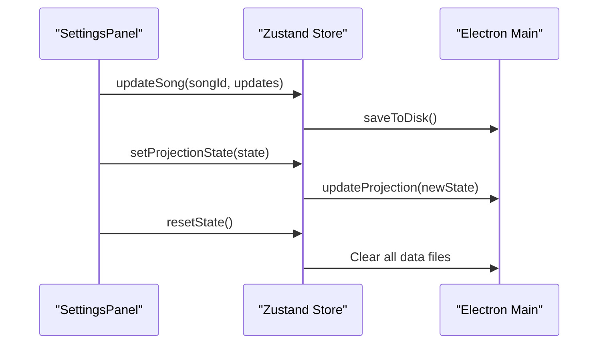

**Diagram sources**
- [SettingsPanel.tsx:44-60](file://src/components/SettingsPanel.tsx#L44-L60)
- [appStore.ts:180-186](file://src/store/appStore.ts#L180-L186)
- [appStore.ts:249-256](file://src/store/appStore.ts#L249-L256)
- [appStore.ts:412-423](file://src/store/appStore.ts#L412-L423)

**Section sources**
- [SettingsPanel.tsx:44-60](file://src/components/SettingsPanel.tsx#L44-L60)
- [appStore.ts:180-186](file://src/store/appStore.ts#L180-L186)
- [appStore.ts:249-256](file://src/store/appStore.ts#L249-L256)
- [appStore.ts:412-423](file://src/store/appStore.ts#L412-L423)

### Validation and Real-Time Preview
Validation occurs through controlled inputs and defaults:
- Numeric inputs enforce min/max constraints.
- Defaults ensure safe initial values for fonts, sizes, and styles.
- Real-time preview updates occur immediately upon user input, reflected in both the SettingsPanel preview and the ProjectionView.

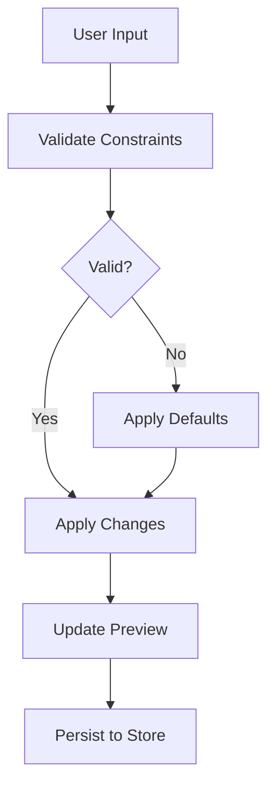

**Diagram sources**
- [SettingsPanel.tsx:292-301](file://src/components/SettingsPanel.tsx#L292-L301)
- [SettingsPanel.tsx:367-390](file://src/components/SettingsPanel.tsx#L367-L390)
- [ProjectionView.tsx:50-63](file://src/components/ProjectionView.tsx#L50-L63)

**Section sources**
- [SettingsPanel.tsx:292-301](file://src/components/SettingsPanel.tsx#L292-L301)
- [SettingsPanel.tsx:367-390](file://src/components/SettingsPanel.tsx#L367-L390)
- [ProjectionView.tsx:50-63](file://src/components/ProjectionView.tsx#L50-L63)

### Accessibility Considerations
To ensure text visibility across backgrounds:
- Use overlay opacity to darken backgrounds behind text.
- Prefer high-contrast color combinations (e.g., white text on dark overlays).
- Adjust text shadow and outline for improved legibility.
- Maintain sufficient line height and margins for readability.

**Enhanced** With Traditional Chinese font support, ensure proper character rendering and spacing for Asian language content. Test font fallback mechanisms and consider font loading performance for international users.

**Section sources**
- [SettingsPanel.tsx:254-267](file://src/components/SettingsPanel.tsx#L254-L267)
- [SettingsPanel.tsx:393-421](file://src/components/SettingsPanel.tsx#L393-L421)

### Common Styling Combinations
- Minimalist: Centered, bold, large font with subtle shadow on a neutral gradient.
- Dramatic: Bold, outlined text with strong contrast against a dark overlay on a full-bleed image.
- Readable: Increased line height and top/bottom margins with centered alignment on a soft gradient.
- Asian Language Optimized: Traditional Chinese font with appropriate line height and margins for better readability of Asian characters.

These combinations leverage the provided controls for fonts, alignment, shadows, outlines, and margins, with enhanced support for Asian typography.

**Section sources**
- [SettingsPanel.tsx:270-422](file://src/components/SettingsPanel.tsx#L270-L422)

### Data Management Features

#### Upsert Import Functionality
The upsert import feature allows users to import data while updating existing items by ID and adding new items. This is particularly useful for merging datasets and maintaining data integrity.

**Key Features:**
- **Smart Deduplication**: Existing songs and images are updated by ID, preventing duplicates
- **Selective Updates**: Only matching items are replaced; new items are added
- **Detailed Reporting**: Returns counts for added vs. updated items
- **Version Compatibility**: Supports both v1 and v2 export formats

**Implementation Details:**
- Backend uses `upsertImage()` function for database operations
- Songs are matched by ID and replaced in-place
- Images preserve creation timestamps when updated
- Settings and preparation lists are overwritten if present

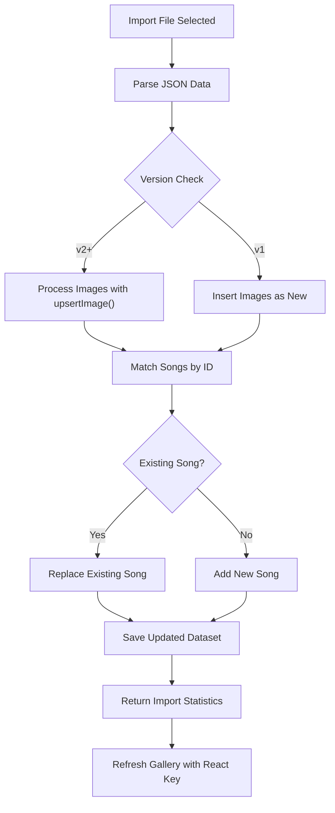

**Diagram sources**
- [main.ts:356-425](file://electron/main.ts#L356-L425)
- [db.ts:178-205](file://electron/db.ts#L178-L205)
- [SettingsPanel.tsx:514-535](file://src/components/SettingsPanel.tsx#L514-L535)

**Section sources**
- [SettingsPanel.tsx:514-535](file://src/components/SettingsPanel.tsx#L514-L535)
- [main.ts:356-425](file://electron/main.ts#L356-L425)
- [db.ts:178-205](file://electron/db.ts#L178-L205)

#### Comprehensive Data Purge Capabilities
The data purge system provides two levels of data deletion with safety confirmations:

**Purge All Data:**
- Deletes all songs, settings, and preparation lists
- Removes all background images from SQLite database
- Clears all meta information
- Resets application state to defaults

**Purge Songs Only:**
- Deletes only song data files
- Preserves settings and background images
- Maintains application configuration

**Safety Features:**
- Confirmation dialogs before execution
- Visual feedback during processing
- Success status notifications
- Automatic state reset after completion

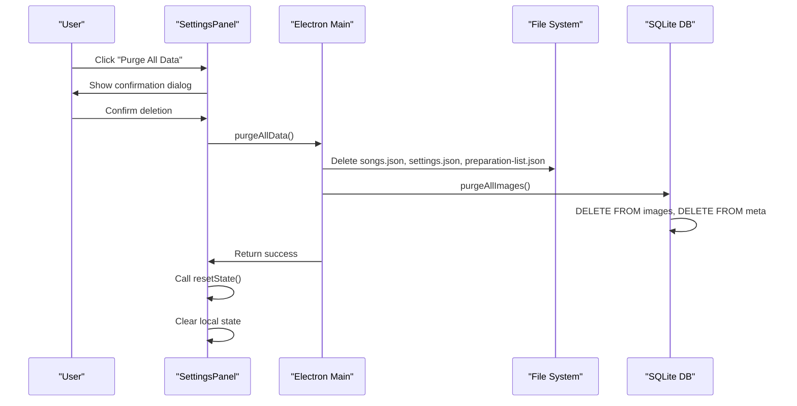

**Diagram sources**
- [SettingsPanel.tsx:597-611](file://src/components/SettingsPanel.tsx#L597-L611)
- [main.ts:428-442](file://electron/main.ts#L428-L442)
- [db.ts:242-247](file://electron/db.ts#L242-247)
- [appStore.ts:412-423](file://src/store/appStore.ts#L412-L423)

**Section sources**
- [SettingsPanel.tsx:585-663](file://src/components/SettingsPanel.tsx#L585-L663)
- [main.ts:428-448](file://electron/main.ts#L428-L448)
- [db.ts:242-247](file://electron/db.ts#L242-247)
- [appStore.ts:412-423](file://src/store/appStore.ts#L412-L423)

### Internationalization Support
The SettingsPanel provides comprehensive internationalization support for all features across multiple languages:

**Supported Languages:**
- English (default)
- Traditional Chinese (繁體中文)
- Japanese (日本語)

**Localized Features:**
- All UI labels and descriptions
- Error messages and status notifications
- Confirmation dialog text
- Import/export operation feedback
- Data purge warnings and instructions

**Language Switching:**
- Dynamic language selection without page reload
- Persistent language preference storage
- Real-time UI updates across all components

**Enhanced** The internationalization system now supports three languages with comprehensive translation coverage for all new data management features, including upsert import and data purge operations.

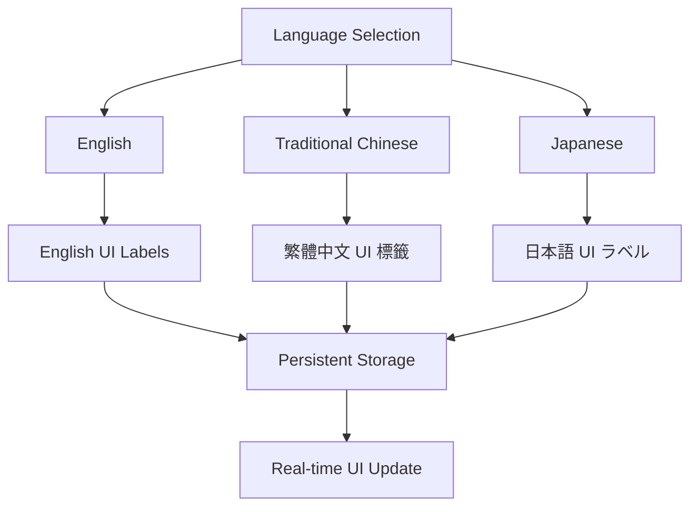

**Diagram sources**
- [index.ts:1-46](file://src/i18n/index.ts#L1-L46)
- [SettingsPanel.tsx:445-473](file://src/components/SettingsPanel.tsx#L445-L473)

**Section sources**
- [SettingsPanel.tsx:445-473](file://src/components/SettingsPanel.tsx#L445-L473)
- [en.ts:154-195](file://src/i18n/en.ts#L154-L195)
- [zhTW.ts:155-197](file://src/i18n/zhTW.ts#L155-L197)
- [ja.ts:155-197](file://src/i18n/ja.ts#L155-L197)
- [index.ts:1-46](file://src/i18n/index.ts#L1-L46)

## Dependency Analysis
The SettingsPanel depends on:
- Global store for reactive state and persistence.
- BackgroundGallery for image selection and management.
- Types for strict typing of background and text settings.
- Electron main process for image handling, data import/export, and projection updates.
- Internationalization system for multilingual UI support.
- Database layer for upsert operations and data purging.

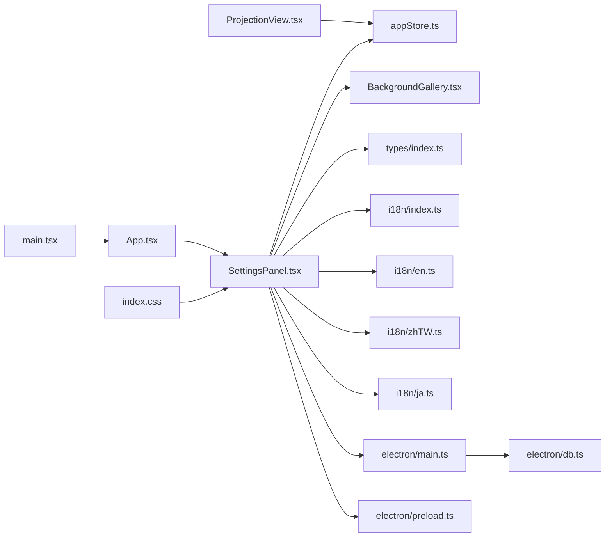

**Diagram sources**
- [SettingsPanel.tsx:1-6](file://src/components/SettingsPanel.tsx#L1-L6)
- [appStore.ts:1-3](file://src/store/appStore.ts#L1-L3)
- [BackgroundGallery.tsx:1-2](file://src/components/BackgroundGallery.tsx#L1-L2)
- [index.ts:1-3](file://src/types/index.ts#L1-L3)
- [en.ts:1-3](file://src/i18n/en.ts#L1-L3)
- [zhTW.ts:1-3](file://src/i18n/zhTW.ts#L1-L3)
- [ja.ts:1-3](file://src/i18n/ja.ts#L1-L3)
- [index.ts:1-3](file://src/i18n/index.ts#L1-L3)
- [main.ts:1-5](file://electron/main.ts#L1-L5)
- [db.ts:1-5](file://electron/db.ts#L1-L5)
- [preload.ts:1-3](file://electron/preload.ts#L1-L3)
- [index.css:1-3](file://src/index.css#L1-L3)
- [main.tsx:1-3](file://src/main.tsx#L1-L3)
- [App.tsx:1-3](file://src/App.tsx#L1-L3)

**Section sources**
- [SettingsPanel.tsx:1-6](file://src/components/SettingsPanel.tsx#L1-L6)
- [appStore.ts:1-3](file://src/store/appStore.ts#L1-L3)
- [BackgroundGallery.tsx:1-2](file://src/components/BackgroundGallery.tsx#L1-L2)
- [index.ts:1-3](file://src/types/index.ts#L1-L3)
- [en.ts:1-3](file://src/i18n/en.ts#L1-L3)
- [zhTW.ts:1-3](file://src/i18n/zhTW.ts#L1-L3)
- [ja.ts:1-3](file://src/i18n/ja.ts#L1-L3)
- [index.ts:1-3](file://src/i18n/index.ts#L1-L3)
- [main.ts:1-5](file://electron/main.ts#L1-L5)
- [db.ts:1-5](file://electron/db.ts#L1-L5)
- [preload.ts:1-3](file://electron/preload.ts#L1-L3)
- [index.css:1-3](file://src/index.css#L1-L3)
- [main.tsx:1-3](file://src/main.tsx#L1-L3)
- [App.tsx:1-3](file://src/App.tsx#L1-L3)

## Performance Considerations
- Background images: Serve via the custom protocol to avoid large base64 payloads in memory. Use thumbnails and lazy loading in the gallery.
- Projection rendering: Avoid unnecessary re-renders by batching updates and using minimal DOM changes.
- Text effects: Text shadows and outlines can be expensive; use judiciously and disable for low-power devices.
- Persistence: Debounce save operations to disk to reduce I/O overhead.
- Font loading: Consider font preloading strategies for Asian language fonts to minimize rendering delays.
- Internationalization: Cache frequently used translations to improve UI responsiveness across different locales.
- **Data Operations**: Upsert imports perform batch database operations efficiently, minimizing I/O overhead through transaction-like behavior.
- **Memory Management**: Large image imports are processed in chunks to prevent memory spikes during bulk operations.
- **Gallery Refresh**: React key-based refresh mechanism prevents unnecessary re-renders while ensuring UI consistency after data operations.

## Troubleshooting Guide
- Background image not appearing:
  - Verify the image URL is stored correctly and the custom protocol is registered.
  - Confirm the image exists in the gallery and is accessible via the protocol.
- Gradient not applying:
  - Ensure the CSS gradient string is valid and includes proper units.
- Text not visible:
  - Increase overlay opacity or adjust text color/outline/shadow.
- Projection not updating:
  - Confirm the projection window is open and receiving state updates.
- Font rendering issues:
  - Verify the selected font is available on the system.
  - Check font fallback mechanisms for Asian language characters.
  - Ensure proper font loading for Traditional Chinese fonts.
- **Import/Export Issues**:
  - Verify export file format matches expected structure (version, songs array, images object).
  - Check file permissions and disk space availability.
  - Ensure import file is not corrupted or truncated.
- **Upsert Import Problems**:
  - Verify song IDs match between import file and existing data.
  - Check image IDs for duplicate resolution conflicts.
  - Monitor import statistics for unexpected zero counts.
  - Ensure gallery refresh key is properly incremented after successful imports.
- **Data Purge Failures**:
  - Confirm user has write permissions to data directories.
  - Check for file locks or concurrent access issues.
  - Verify database connection stability during purge operations.
- **Internationalization Issues**:
  - Verify locale files are properly loaded and contain all required translations.
  - Check localStorage for saved language preferences.
  - Ensure all UI components respond to language changes.

**Section sources**
- [main.ts:362-374](file://electron/main.ts#L362-L374)
- [db.ts:106-118](file://electron/db.ts#L106-L118)
- [ProjectionView.tsx:22-29](file://src/components/ProjectionView.tsx#L22-L29)
- [main.ts:356-425](file://electron/main.ts#L356-L425)
- [main.ts:428-448](file://electron/main.ts#L428-L448)
- [index.ts:20-28](file://src/i18n/index.ts#L20-L28)

## Conclusion
The SettingsPanel component provides a robust, real-time configuration experience for background customization and text styling. Through tight integration with the global store, Electron-backed image management, and a projection renderer, it ensures consistent, accessible, and visually appealing presentations. 

**Enhanced** Recent updates have significantly expanded the component's capabilities with comprehensive data management features including upsert import functionality for intelligent data merging, complete data purge options for system maintenance, enhanced internationalization support for diverse user bases (English, Traditional Chinese, Japanese), and improved gallery refresh mechanisms using React keys. The component now provides enterprise-grade data operations while maintaining the intuitive user interface that makes LyricDeck accessible to users of all technical levels.

Future enhancements could include video background support, advanced typography controls, optimized font loading strategies, additional data migration tools, and expanded language support to further enhance the viewing experience across different languages and platforms.