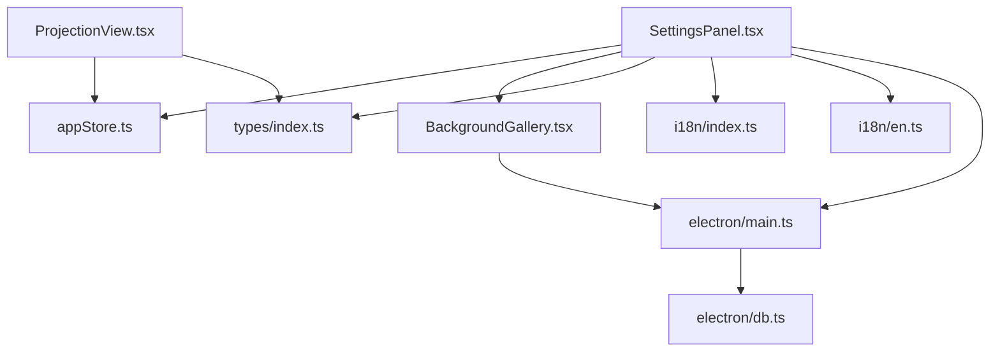
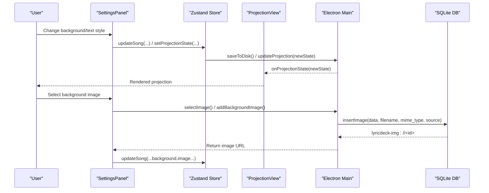
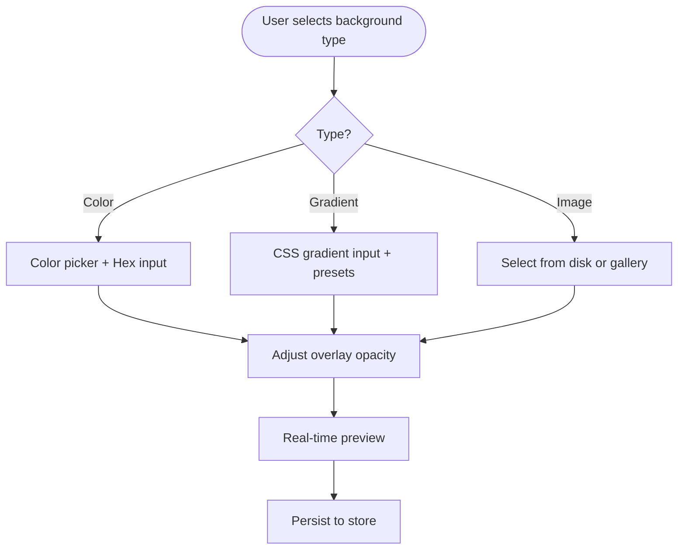
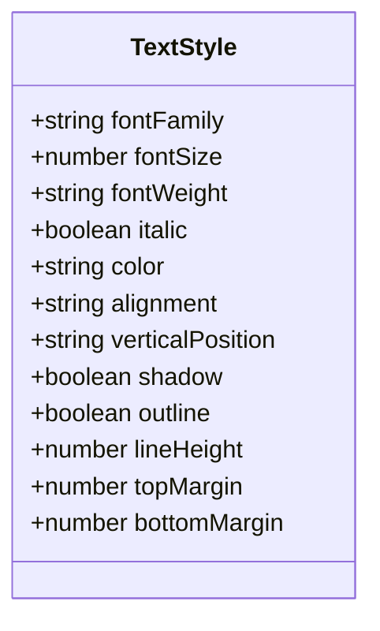
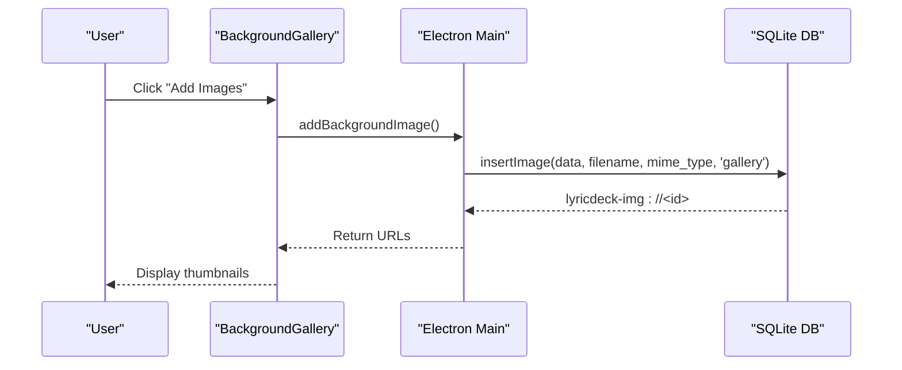
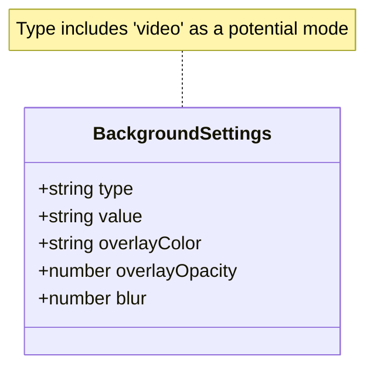
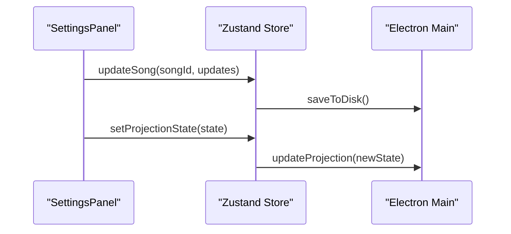
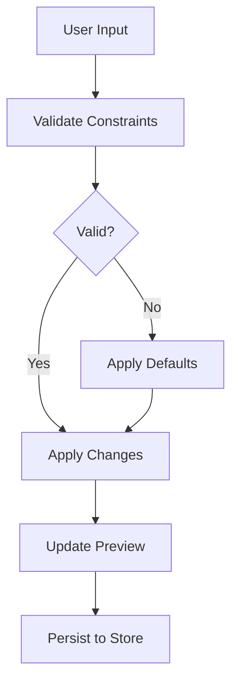
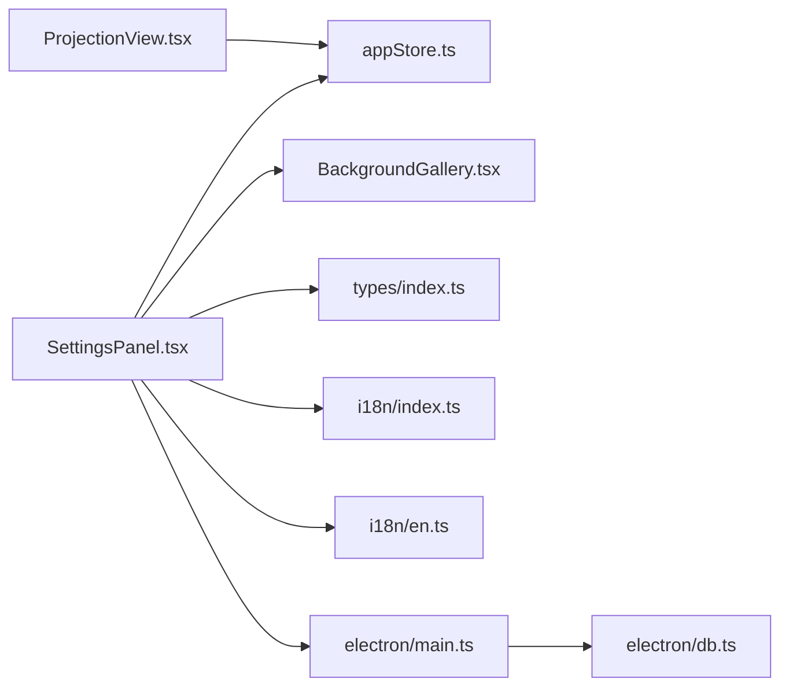

# Settings and Configuration Component

<cite>
**Referenced Files in This Document**
- [SettingsPanel.tsx](file://src/components/SettingsPanel.tsx)
- [appStore.ts](file://src/store/appStore.ts)
- [ProjectionView.tsx](file://src/components/ProjectionView.tsx)
- [BackgroundGallery.tsx](file://src/components/BackgroundGallery.tsx)
- [index.ts](file://src/types/index.ts)
- [en.ts](file://src/i18n/en.ts)
- [index.ts](file://src/i18n/index.ts)
- [main.ts](file://electron/main.ts)
- [db.ts](file://electron/db.ts)
</cite>

## Table of Contents
1. [Introduction](#introduction)
2. [Project Structure](#project-structure)
3. [Core Components](#core-components)
4. [Architecture Overview](#architecture-overview)
5. [Detailed Component Analysis](#detailed-component-analysis)
6. [Dependency Analysis](#dependency-analysis)
7. [Performance Considerations](#performance-considerations)
8. [Troubleshooting Guide](#troubleshooting-guide)
9. [Conclusion](#conclusion)

## Introduction
This document provides comprehensive technical documentation for the SettingsPanel component, which enables users to configure background customization and text styling for presentations. It covers the background settings system (color pickers, gradient configurations, image upload and management, and video background support), the text styling system (fonts, colors, alignment, shadows, outlines, and responsive typography), integration with the global state store for persistent settings, validation of configuration values, and real-time preview updates. It also explains the component’s impact on projection rendering and its role in creating optimal viewing experiences.

## Project Structure
The SettingsPanel component resides in the components directory and integrates with the global Zustand store, type definitions, internationalization, and Electron backend for background image management and projection updates.

**Diagram sources**
- [SettingsPanel.tsx:1-523](file://src/components/SettingsPanel.tsx#L1-L523)
- [appStore.ts:1-385](file://src/store/appStore.ts#L1-L385)
- [ProjectionView.tsx:1-134](file://src/components/ProjectionView.tsx#L1-L134)
- [BackgroundGallery.tsx:1-98](file://src/components/BackgroundGallery.tsx#L1-L98)
- [index.ts:1-89](file://src/types/index.ts#L1-L89)
- [en.ts:1-180](file://src/i18n/en.ts#L1-L180)
- [index.ts:1-43](file://src/i18n/index.ts#L1-L43)
- [main.ts:1-390](file://electron/main.ts#L1-L390)
- [db.ts:1-214](file://electron/db.ts#L1-L214)

**Section sources**
- [SettingsPanel.tsx:1-523](file://src/components/SettingsPanel.tsx#L1-L523)
- [appStore.ts:1-385](file://src/store/appStore.ts#L1-L385)
- [ProjectionView.tsx:1-134](file://src/components/ProjectionView.tsx#L1-L134)
- [BackgroundGallery.tsx:1-98](file://src/components/BackgroundGallery.tsx#L1-L98)
- [index.ts:1-89](file://src/types/index.ts#L1-L89)
- [en.ts:1-180](file://src/i18n/en.ts#L1-L180)
- [index.ts:1-43](file://src/i18n/index.ts#L1-L43)
- [main.ts:1-390](file://electron/main.ts#L1-L390)
- [db.ts:1-214](file://electron/db.ts#L1-L214)

## Core Components
- SettingsPanel: Central configuration UI for background and text styling, with real-time preview and persistence.
- BackgroundGallery: Image library management with add/delete operations and selection callbacks.
- ProjectionView: Real-time projection renderer that consumes the global projection state.
- Global Store (Zustand): Provides reactive state for songs, projection, and settings with persistence hooks.
- Types: Defines BackgroundSettings, TextStyle, PresentationSettings, Song, and ProjectionState structures.
- Internationalization: Provides localized strings for UI labels and messages.

**Section sources**
- [SettingsPanel.tsx:1-523](file://src/components/SettingsPanel.tsx#L1-L523)
- [BackgroundGallery.tsx:1-98](file://src/components/BackgroundGallery.tsx#L1-L98)
- [ProjectionView.tsx:1-134](file://src/components/ProjectionView.tsx#L1-L134)
- [appStore.ts:1-385](file://src/store/appStore.ts#L1-L385)
- [index.ts:1-89](file://src/types/index.ts#L1-L89)
- [en.ts:100-179](file://src/i18n/en.ts#L100-L179)
- [index.ts:1-43](file://src/i18n/index.ts#L1-L43)

## Architecture Overview
The SettingsPanel updates the global store, which persists changes and synchronizes with the projection window. Background images are managed via Electron IPC and stored in an embedded SQLite database, served via a custom protocol.

**Diagram sources**
- [SettingsPanel.tsx:29-54](file://src/components/SettingsPanel.tsx#L29-L54)
- [appStore.ts:174-180](file://src/store/appStore.ts#L174-L180)
- [ProjectionView.tsx:22-29](file://src/components/ProjectionView.tsx#L22-L29)
- [main.ts:221-235](file://electron/main.ts#L221-L235)
- [db.ts:70-87](file://electron/db.ts#L70-L87)

## Detailed Component Analysis

### Background Settings System
The background settings system supports three modes: color, gradient, and image. Users can switch modes, adjust overlay opacity, and preview changes in real time.

- Mode switching: Buttons toggle between color, gradient, and image modes.
- Color mode: Uses a native color picker and hex text input for precise color selection.
- Gradient mode: Accepts arbitrary CSS gradient values with preset suggestions.
- Image mode: Allows selecting images from disk or the gallery, with a live preview overlay and sample text rendering.
- Overlay opacity: Range slider controls dark overlay intensity for improved text readability.

**Diagram sources**
- [SettingsPanel.tsx:74-241](file://src/components/SettingsPanel.tsx#L74-L241)
- [ProjectionView.tsx:31-48](file://src/components/ProjectionView.tsx#L31-L48)

**Section sources**
- [SettingsPanel.tsx:29-241](file://src/components/SettingsPanel.tsx#L29-L241)
- [ProjectionView.tsx:31-48](file://src/components/ProjectionView.tsx#L31-L48)

### Text Styling System
The text styling system provides comprehensive controls for fonts, colors, alignment, positioning, spacing, and visual effects.

- Font family: Dropdown with common web-safe fonts.
- Font size: Numeric input with min/max constraints.
- Font weight: Normal, bold, lighter options.
- Text color: Color picker with hex input.
- Alignment: Left, center, right.
- Vertical position: Top, middle, bottom.
- Line height: Numeric input with step increments.
- Margins: Top and bottom margins with step increments.
- Effects: Text shadow, outline, italic toggles.

**Diagram sources**
- [index.ts:29-42](file://src/types/index.ts#L29-L42)

**Section sources**
- [SettingsPanel.tsx:244-396](file://src/components/SettingsPanel.tsx#L244-L396)
- [index.ts:29-42](file://src/types/index.ts#L29-L42)

### Background Image Management
Background images are uploaded from disk or added to the gallery, persisted in an embedded SQLite database, and served via a custom protocol.

- Upload from disk: Opens a file dialog, reads binary data, stores in DB, and returns a URL.
- Gallery management: Lists, adds, deletes, and selects images from the gallery.
- Protocol handling: Serves images via lyricdeck-img://<id> with appropriate MIME types.

**Diagram sources**
- [BackgroundGallery.tsx:24-31](file://src/components/BackgroundGallery.tsx#L24-L31)
- [main.ts:237-255](file://electron/main.ts#L237-L255)
- [db.ts:70-87](file://electron/db.ts#L70-L87)

**Section sources**
- [BackgroundGallery.tsx:1-98](file://src/components/BackgroundGallery.tsx#L1-L98)
- [main.ts:221-264](file://electron/main.ts#L221-L264)
- [db.ts:70-131](file://electron/db.ts#L70-L131)

### Video Background Support
The BackgroundSettings type includes a video option, indicating future capability for video backgrounds. While the SettingsPanel currently supports color, gradient, and image modes, the underlying type definition allows for video backgrounds. Implementation would require adding a video mode selector and media player integration in the projection view.

**Diagram sources**
- [index.ts:21-27](file://src/types/index.ts#L21-L27)

**Section sources**
- [index.ts:21-27](file://src/types/index.ts#L21-L27)

### Integration with Global State Store
SettingsPanel updates the global store using updateSong and setProjectionState, enabling immediate persistence and projection synchronization.

- updateSong: Updates a specific song’s presentation settings.
- setProjectionState: Sends the latest projection state to the projection window.
- Persistence: saveToDisk and loadFromDisk handle data serialization to disk.

**Diagram sources**
- [SettingsPanel.tsx:29-45](file://src/components/SettingsPanel.tsx#L29-L45)
- [appStore.ts:174-180](file://src/store/appStore.ts#L174-L180)
- [appStore.ts:242-249](file://src/store/appStore.ts#L242-L249)

**Section sources**
- [SettingsPanel.tsx:29-45](file://src/components/SettingsPanel.tsx#L29-L45)
- [appStore.ts:174-180](file://src/store/appStore.ts#L174-L180)
- [appStore.ts:242-249](file://src/store/appStore.ts#L242-L249)

### Validation and Real-Time Preview
Validation occurs through controlled inputs and defaults:
- Numeric inputs enforce min/max constraints.
- Defaults ensure safe initial values for fonts, sizes, and styles.
- Real-time preview updates occur immediately upon user input, reflected in both the SettingsPanel preview and the ProjectionView.

**Diagram sources**
- [SettingsPanel.tsx:267-274](file://src/components/SettingsPanel.tsx#L267-L274)
- [SettingsPanel.tsx:331-339](file://src/components/SettingsPanel.tsx#L331-L339)
- [ProjectionView.tsx:50-63](file://src/components/ProjectionView.tsx#L50-L63)

**Section sources**
- [SettingsPanel.tsx:267-274](file://src/components/SettingsPanel.tsx#L267-L274)
- [SettingsPanel.tsx:331-339](file://src/components/SettingsPanel.tsx#L331-L339)
- [ProjectionView.tsx:50-63](file://src/components/ProjectionView.tsx#L50-L63)

### Accessibility Considerations
To ensure text visibility across backgrounds:
- Use overlay opacity to darken backgrounds behind text.
- Prefer high-contrast color combinations (e.g., white text on dark overlays).
- Adjust text shadow and outline for improved legibility.
- Maintain sufficient line height and margins for readability.

These controls are exposed directly in the SettingsPanel under the Text Style section.

**Section sources**
- [SettingsPanel.tsx:228-241](file://src/components/SettingsPanel.tsx#L228-L241)
- [SettingsPanel.tsx:367-396](file://src/components/SettingsPanel.tsx#L367-L396)

### Common Styling Combinations
- Minimalist: Centered, bold, large font with subtle shadow on a neutral gradient.
- Dramatic: Bold, outlined text with strong contrast against a dark overlay on a full-bleed image.
- Readable: Increased line height and top/bottom margins with centered alignment on a soft gradient.

These combinations leverage the provided controls for fonts, alignment, shadows, outlines, and margins.

**Section sources**
- [SettingsPanel.tsx:244-396](file://src/components/SettingsPanel.tsx#L244-L396)

## Dependency Analysis
The SettingsPanel depends on:
- Global store for reactive state and persistence.
- BackgroundGallery for image selection and management.
- Types for strict typing of background and text settings.
- Electron main process for image handling and projection updates.

**Diagram sources**
- [SettingsPanel.tsx:1-6](file://src/components/SettingsPanel.tsx#L1-L6)
- [appStore.ts:1-3](file://src/store/appStore.ts#L1-L3)
- [BackgroundGallery.tsx:1-2](file://src/components/BackgroundGallery.tsx#L1-L2)
- [index.ts:1-3](file://src/types/index.ts#L1-L3)
- [en.ts:1-3](file://src/i18n/en.ts#L1-L3)
- [index.ts:1-3](file://src/i18n/index.ts#L1-L3)
- [main.ts:1-5](file://electron/main.ts#L1-L5)
- [db.ts:1-5](file://electron/db.ts#L1-L5)

**Section sources**
- [SettingsPanel.tsx:1-6](file://src/components/SettingsPanel.tsx#L1-L6)
- [appStore.ts:1-3](file://src/store/appStore.ts#L1-L3)
- [BackgroundGallery.tsx:1-2](file://src/components/BackgroundGallery.tsx#L1-L2)
- [index.ts:1-3](file://src/types/index.ts#L1-L3)
- [en.ts:1-3](file://src/i18n/en.ts#L1-L3)
- [index.ts:1-3](file://src/i18n/index.ts#L1-L3)
- [main.ts:1-5](file://electron/main.ts#L1-L5)
- [db.ts:1-5](file://electron/db.ts#L1-L5)

## Performance Considerations
- Background images: Serve via the custom protocol to avoid large base64 payloads in memory. Use thumbnails and lazy loading in the gallery.
- Projection rendering: Avoid unnecessary re-renders by batching updates and using minimal DOM changes.
- Text effects: Text shadows and outlines can be expensive; use judiciously and disable for low-power devices.
- Persistence: Debounce save operations to disk to reduce I/O overhead.

[No sources needed since this section provides general guidance]

## Troubleshooting Guide
- Background image not appearing:
  - Verify the image URL is stored correctly and the custom protocol is registered.
  - Confirm the image exists in the gallery and is accessible via the protocol.
- Gradient not applying:
  - Ensure the CSS gradient string is valid and includes proper units.
- Text not visible:
  - Increase overlay opacity or adjust text color/outline/shadow.
- Projection not updating:
  - Confirm the projection window is open and receiving state updates.

**Section sources**
- [main.ts:362-374](file://electron/main.ts#L362-L374)
- [db.ts:106-118](file://electron/db.ts#L106-L118)
- [ProjectionView.tsx:22-29](file://src/components/ProjectionView.tsx#L22-L29)

## Conclusion
The SettingsPanel component provides a robust, real-time configuration experience for background customization and text styling. Through tight integration with the global store, Electron-backed image management, and a projection renderer, it ensures consistent, accessible, and visually appealing presentations. Future enhancements could include video background support and advanced typography controls to further optimize the viewing experience.