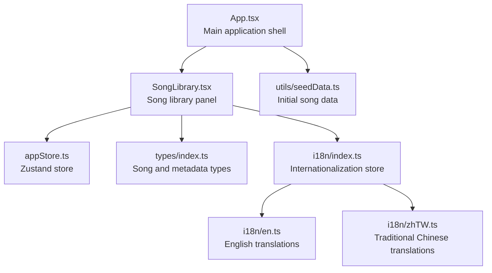
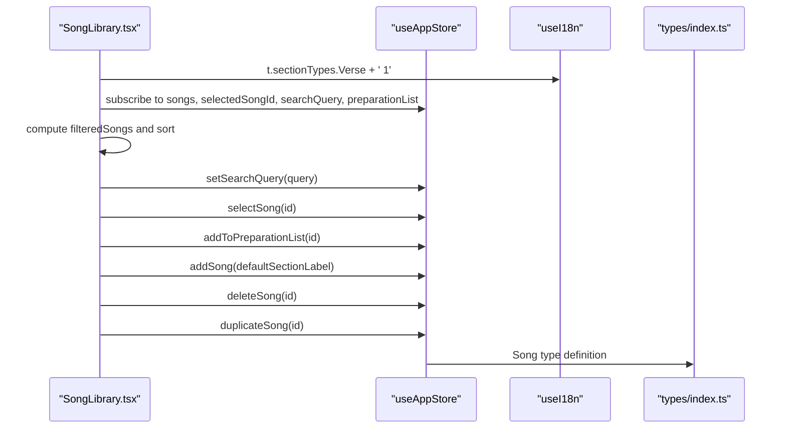
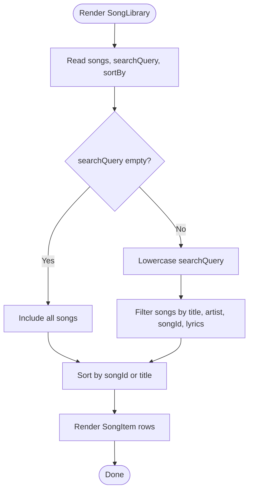
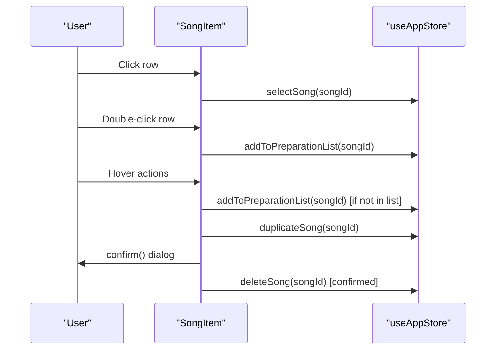
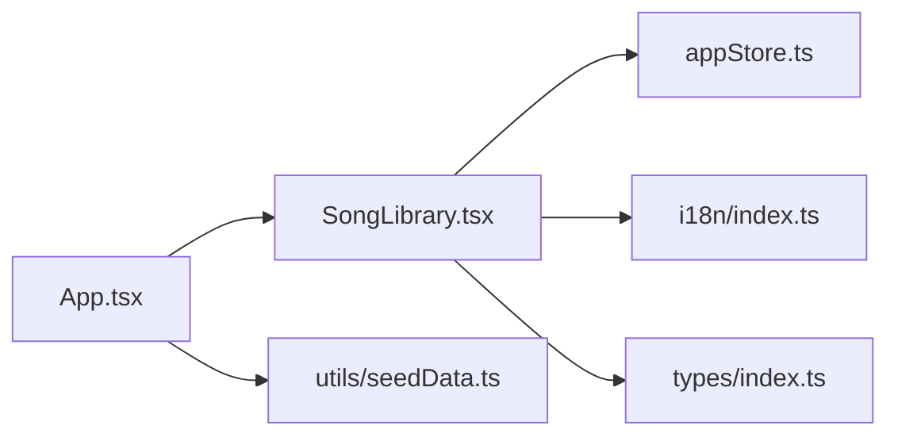

# Song Library Component

<cite>
**Referenced Files in This Document**
- [SongLibrary.tsx](file://src/components/SongLibrary.tsx)
- [appStore.ts](file://src/store/appStore.ts)
- [index.ts](file://src/i18n/index.ts)
- [en.ts](file://src/i18n/en.ts)
- [zhTW.ts](file://src/i18n/zhTW.ts)
- [index.ts](file://src/types/index.ts)
- [App.tsx](file://src/App.tsx)
- [seedData.ts](file://src/utils/seedData.ts)
- [EditorPanel.tsx](file://src/components/EditorPanel.tsx)
</cite>

## Update Summary
**Changes Made**
- Updated Song Creation section to reflect enhanced automatic song title generation with localized section numbering
- Added documentation for the new section numbering pattern using localized section type names
- Enhanced internationalization implementation details for improved user experience

## Table of Contents
1. [Introduction](#introduction)
2. [Project Structure](#project-structure)
3. [Core Components](#core-components)
4. [Architecture Overview](#architecture-overview)
5. [Detailed Component Analysis](#detailed-component-analysis)
6. [Dependency Analysis](#dependency-analysis)
7. [Performance Considerations](#performance-considerations)
8. [Troubleshooting Guide](#troubleshooting-guide)
9. [Conclusion](#conclusion)

## Introduction
The Song Library component is the primary song management interface in LyricDeck, providing a searchable, sortable, and interactive list of songs. It integrates with the Zustand store for state management, supports internationalization across multiple languages, and offers preparation list integration for quick access during presentations. This document explains the component's search and filtering functionality, sorting capabilities, interactive song list display, SongItem sub-component architecture, internationalization implementation, and integration patterns with the broader application.

**Updated** Enhanced with automatic song title generation featuring proper section numbering using localized section type names for a more professional initial user experience in internationalized deployments.

## Project Structure
The Song Library resides in the components layer alongside other panels and integrates with shared stores and types. The application bootstraps by loading persisted data or seeding initial songs, then renders the main layout with the Song Library as the left-hand panel.

**Diagram sources**
- [App.tsx:12-102](file://src/App.tsx#L12-L102)
- [SongLibrary.tsx:8-95](file://src/components/SongLibrary.tsx#L8-L95)
- [appStore.ts:31-96](file://src/store/appStore.ts#L31-L96)
- [index.ts:50-67](file://src/types/index.ts#L50-L67)
- [index.ts:1-43](file://src/i18n/index.ts#L1-L43)
- [en.ts:17-33](file://src/i18n/en.ts#L17-L33)
- [zhTW.ts:19-35](file://src/i18n/zhTW.ts#L19-L35)
- [seedData.ts:51-164](file://src/utils/seedData.ts#L51-L164)

**Section sources**
- [App.tsx:12-102](file://src/App.tsx#L12-L102)
- [SongLibrary.tsx:8-95](file://src/components/SongLibrary.tsx#L8-L95)
- [appStore.ts:31-96](file://src/store/appStore.ts#L31-L96)
- [index.ts:50-67](file://src/types/index.ts#L50-L67)
- [index.ts:1-43](file://src/i18n/index.ts#L1-L43)
- [en.ts:17-33](file://src/i18n/en.ts#L17-L33)
- [zhTW.ts:19-35](file://src/i18n/zhTW.ts#L19-L35)
- [seedData.ts:51-164](file://src/utils/seedData.ts#L51-L164)

## Core Components
- SongLibrary: Main component that renders the search bar, sort controls, song list, and add button. It manages local sort state and delegates CRUD operations to the Zustand store.
- SongItem: Sub-component representing a single song row with selection visuals, hover actions, and preparation list integration.
- Zustand Store: Centralized state for songs, selected song, search query, preparation list, and actions for adding, deleting, duplicating, and updating songs.
- Internationalization: Translation store and language packs for English and Traditional Chinese, exposing localized strings for UI elements.

Key responsibilities:
- Search and filtering: Case-insensitive search across title, artist, song ID, and lyrics content.
- Sorting: Two modes—by song ID (with numeric collation) and by title.
- Interactive display: Hover-triggered action buttons, selection highlighting, preparation list indicators.
- Preparation list integration: Add/remove songs to/from the preparation list.
- CRUD operations: Add, duplicate, delete songs via store actions.
- **Enhanced Song Creation**: Automatic generation of new song titles with proper section numbering using localized section type names for professional initial user experience.
- Accessibility and responsiveness: Hover-triggered actions, responsive layout, and keyboard-friendly interactions.

**Updated** Enhanced song creation now automatically generates titles with proper section numbering using localized section type names, improving the initial user experience in internationalized deployments.

**Section sources**
- [SongLibrary.tsx:8-95](file://src/components/SongLibrary.tsx#L8-L95)
- [SongLibrary.tsx:97-192](file://src/components/SongLibrary.tsx#L97-L192)
- [appStore.ts:31-96](file://src/store/appStore.ts#L31-L96)
- [index.ts:1-43](file://src/i18n/index.ts#L1-L43)

## Architecture Overview
The Song Library follows a unidirectional data flow:
- UI reads from Zustand store (songs, selectedSongId, searchQuery, preparationList).
- UI writes to Zustand store via actions (setSearchQuery, selectSong, addSong, deleteSong, duplicateSong, addToPreparationList).
- Internationalization is accessed via a dedicated store that exposes translated strings.

**Updated** Enhanced with automatic section numbering using localized section type names for improved initial user experience.

**Diagram sources**
- [SongLibrary.tsx:8-95](file://src/components/SongLibrary.tsx#L8-L95)
- [appStore.ts:31-96](file://src/store/appStore.ts#L31-L96)
- [index.ts:50-67](file://src/types/index.ts#L50-L67)
- [index.ts:1-43](file://src/i18n/index.ts#L1-L43)

## Detailed Component Analysis

### SongLibrary Component
Responsibilities:
- Renders search input bound to the store's searchQuery.
- Provides sort controls toggling between song ID and title.
- Filters and sorts the song list using computed logic.
- Displays a message when no results are found or when no songs exist.
- Offers an add song button invoking store action with automatic section numbering.

**Enhanced** The add song button now automatically generates new song titles with proper section numbering using localized section type names.

Filtering logic:
- If no search query is present, all songs are included.
- Otherwise, a case-insensitive match is performed against:
  - Song title
  - Artist (optional)
  - Song ID (optional)
  - Lyrics content across all sections

Sorting logic:
- By song ID:
  - Uses numeric collation for IDs when both are present.
  - Places entries with IDs before those without.
  - Falls back to title comparison when IDs are equal or missing.
- By title:
  - Simple lexicographic comparison.

Interactive elements:
- Click to select a song.
- Double-click to add to preparation list.
- Hover reveals action buttons: add to prep list, duplicate, delete.
- Selected item receives a highlighted border and background.

Accessibility and UX:
- Hover-triggered action buttons with clear icons and tooltips.
- Visual feedback for selection and preparation list membership.
- Responsive layout with scrollable list area.

**Section sources**
- [SongLibrary.tsx:8-95](file://src/components/SongLibrary.tsx#L8-L95)
- [SongLibrary.tsx:14-35](file://src/components/SongLibrary.tsx#L14-L35)

#### Filter and Sort Flow

**Diagram sources**
- [SongLibrary.tsx:14-35](file://src/components/SongLibrary.tsx#L14-L35)

### Song Creation and Section Numbering
**Enhanced** The song creation process now automatically generates professional initial titles with proper section numbering.

When users click the "Add Song" button, the system:
1. Retrieves the localized section type name for "Verse" from the internationalization store
2. Appends " 1" to create the default section label "Verse 1"
3. Creates a new song with this properly formatted section label
4. Generates a professional initial user experience with localized section naming

This approach ensures that:
- New songs always have a properly formatted section label
- Section numbering follows the localized naming conventions
- Users get a professional initial experience regardless of their language preference
- The system maintains consistency across different locales

**Section sources**
- [SongLibrary.tsx:88-91](file://src/components/SongLibrary.tsx#L88-L91)
- [appStore.ts:116-142](file://src/store/appStore.ts#L116-L142)
- [en.ts:54-62](file://src/i18n/en.ts#L54-L62)
- [zhTW.ts:56-64](file://src/i18n/zhTW.ts#L56-L64)

### SongItem Sub-component
Responsibilities:
- Displays song title, optional song ID badge, optional artist, and optional key/tempo metadata.
- Shows a small green dot when the song is already in the preparation list.
- Handles selection via click and double-click for adding to preparation list.
- Provides hover-triggered action buttons:
  - Add to preparation list (when not already present)
  - Duplicate song
  - Delete song with confirmation

Selection and preparation list integration:
- isSelected prop highlights the row with a colored border and background.
- isInPrepList prop shows a visual indicator and disables the add-to-prep button.

Event handling:
- onSelect: triggers selection in the store.
- onDoubleClick: adds to preparation list.
- onAddToPrep: adds to preparation list.
- onDuplicate: duplicates the song.
- onDelete: deletes the song after confirmation.

Accessibility:
- Buttons use clear icons and tooltips.
- Hover visibility ensures discoverability without cluttering the UI.

**Section sources**
- [SongLibrary.tsx:97-192](file://src/components/SongLibrary.tsx#L97-L192)

#### SongItem Interaction Sequence

**Diagram sources**
- [SongLibrary.tsx:67-79](file://src/components/SongLibrary.tsx#L67-L79)
- [SongLibrary.tsx:118-179](file://src/components/SongLibrary.tsx#L118-L179)
- [appStore.ts:116-183](file://src/store/appStore.ts#L116-L183)
- [appStore.ts:317-325](file://src/store/appStore.ts#L317-L325)

### Internationalization Implementation
**Enhanced** The internationalization system now provides localized section type names for automatic song title generation.

The i18n store manages locale selection and exposes translated strings. The Song Library uses translation keys for:
- Search placeholder
- Sort controls
- No results/no songs messages
- Action tooltips (duplicate, delete)
- Preparation list integration labels
- **Section type names for automatic song creation**

Supported locales:
- English (default)
- Traditional Chinese

Storage:
- Locale preference is persisted in localStorage and restored on initialization.

**Enhanced** Section type names are now available for automatic song title generation, ensuring professional initial user experience across different languages.

**Section sources**
- [index.ts:1-43](file://src/i18n/index.ts#L1-L43)
- [en.ts:17-33](file://src/i18n/en.ts#L17-L33)
- [zhTW.ts:19-35](file://src/i18n/zhTW.ts#L19-L35)
- [SongLibrary.tsx:43](file://src/components/SongLibrary.tsx#L43)
- [SongLibrary.tsx:50-61](file://src/components/SongLibrary.tsx#L50-L61)
- [SongLibrary.tsx:81-83](file://src/components/SongLibrary.tsx#L81-L83)
- [SongLibrary.tsx:147-177](file://src/components/SongLibrary.tsx#L147-L177)
- [en.ts:54-62](file://src/i18n/en.ts#L54-L62)
- [zhTW.ts:56-64](file://src/i18n/zhTW.ts#L56-L64)

### Zustand Store Integration
State and actions:
- Songs list, selected song ID, search query, and preparation list are managed in the store.
- CRUD actions include add, delete, duplicate, update, and selection.
- Preparation list actions include add, remove, reorder, clear, and selection from the list.
- Persistence actions load and save songs/settings/preparation list to disk.

**Enhanced** Song creation now accepts a default section label parameter for automatic section numbering.

Song creation:
- New songs receive default metadata, a single section with the provided label, and timestamps.
- The default section label uses localized section type names for professional initial experience.

Preparation list persistence:
- When enabled, preparation list changes are sent to the Electron main process for saving.

**Section sources**
- [appStore.ts:31-96](file://src/store/appStore.ts#L31-L96)
- [appStore.ts:116-142](file://src/store/appStore.ts#L116-L142)
- [appStore.ts:186-200](file://src/store/appStore.ts#L186-L200)
- [appStore.ts:317-359](file://src/store/appStore.ts#L317-L359)
- [appStore.ts:362-384](file://src/store/appStore.ts#L362-L384)

### Data Model: Song
The Song type defines the structure used throughout the Song Library and other components.

Key fields:
- id: Unique identifier
- songId: Optional identifier used for sorting and display
- title: Song title
- artist: Optional artist name
- metadata: Contains key, tempo, copyright, tags, notes
- sections: LyricSection array
- arrangement: Ordered list of section IDs for presentation
- presentation: Background and text styling defaults
- createdAt/updatedAt: Timestamps

**Section sources**
- [index.ts:50-67](file://src/types/index.ts#L50-L67)

### Responsive Design Patterns
- Fixed-width left panel (Song Library) with a scrollable list area.
- Flexible center panel for Editor, Arrange, Present, and Settings.
- Tailwind utility classes for spacing, borders, and hover states.
- Responsive typography and padding scales with text-sm classes.

Accessibility:
- Hover-triggered action buttons reveal on group hover.
- Clear visual selection state for the active song.
- Tooltips on action buttons for discoverability.

**Section sources**
- [SongLibrary.tsx:38-94](file://src/components/SongLibrary.tsx#L38-L94)
- [SongLibrary.tsx:118-179](file://src/components/SongLibrary.tsx#L118-L179)

## Dependency Analysis
The Song Library depends on:
- Zustand store for state and actions
- i18n store for localized strings
- Song type definitions for rendering and filtering
- App shell for mounting and routing

**Diagram sources**
- [SongLibrary.tsx:8-95](file://src/components/SongLibrary.tsx#L8-L95)
- [appStore.ts:31-96](file://src/store/appStore.ts#L31-L96)
- [index.ts:50-67](file://src/types/index.ts#L50-L67)
- [index.ts:1-43](file://src/i18n/index.ts#L1-L43)
- [App.tsx:84-87](file://src/App.tsx#L84-L87)
- [seedData.ts:51-164](file://src/utils/seedData.ts#L51-L164)

**Section sources**
- [SongLibrary.tsx:8-95](file://src/components/SongLibrary.tsx#L8-L95)
- [appStore.ts:31-96](file://src/store/appStore.ts#L31-L96)
- [index.ts:50-67](file://src/types/index.ts#L50-L67)
- [index.ts:1-43](file://src/i18n/index.ts#L1-L43)
- [App.tsx:84-87](file://src/App.tsx#L84-L87)
- [seedData.ts:51-164](file://src/utils/seedData.ts#L51-L164)

## Performance Considerations
- Filtering and sorting are computed on render; for large datasets, consider memoizing filteredSongs and using virtualized lists.
- Sorting uses localeCompare with numeric collation for robustness; ensure IDs are normalized to avoid inconsistent comparisons.
- Debouncing search input can reduce re-renders during rapid typing.
- Avoid unnecessary re-renders by passing stable callbacks and using shallow equality checks in higher-order components.

## Troubleshooting Guide
Common issues and resolutions:
- No songs displayed:
  - Verify initial seed data is loaded when no songs exist.
  - Confirm loadFromDisk completes successfully.
- Search yields no results:
  - Ensure search query is not empty or whitespace-only.
  - Confirm lyrics are indexed across sections.
- Sorting anomalies:
  - Check that song IDs are present and formatted consistently.
  - Validate fallback to title sorting when IDs are missing.
- Action buttons not visible:
  - Hover over the row to reveal group-hover-triggered buttons.
  - Ensure isInPrepList prop is correctly passed.
- Preparation list not persisting:
  - Confirm Electron main process IPC is available and saving the list.
  - Verify addToPreparationList and removeFromPreparationList actions are invoked.
- **Enhanced** New song section numbering issues:
  - Verify that localized section type names are properly loaded from the i18n store.
  - Check that the defaultSectionLabel parameter is correctly passed to addSong action.
  - Ensure t.sectionTypes.Verse returns a valid localized string.

**Section sources**
- [App.tsx:19-32](file://src/App.tsx#L19-L32)
- [appStore.ts:362-384](file://src/store/appStore.ts#L362-L384)
- [SongLibrary.tsx:14-35](file://src/components/SongLibrary.tsx#L14-L35)
- [SongLibrary.tsx:118-179](file://src/components/SongLibrary.tsx#L118-L179)
- [appStore.ts:317-325](file://src/store/appStore.ts#L317-L325)

## Conclusion
The Song Library component provides a robust, internationalized, and accessible interface for managing songs in LyricDeck. Its search and filtering logic covers essential metadata fields, while flexible sorting and preparation list integration streamline workflow. Integrated with Zustand for state management and Electron for persistence, it forms a cohesive part of the application's architecture.

**Enhanced** The recent improvements to automatic song title generation with proper section numbering using localized section type names significantly improve the initial user experience in internationalized deployments, creating a more professional and consistent interface across different languages and locales.

Future enhancements could include debounced search, virtualized lists, expanded accessibility features such as keyboard navigation and ARIA attributes, and further refinement of the automatic section numbering system for even more sophisticated initial song creation patterns.