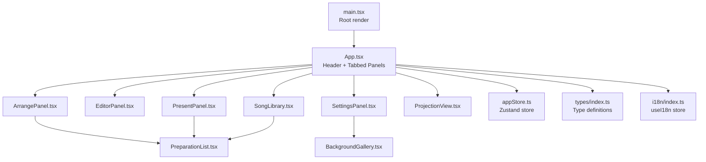
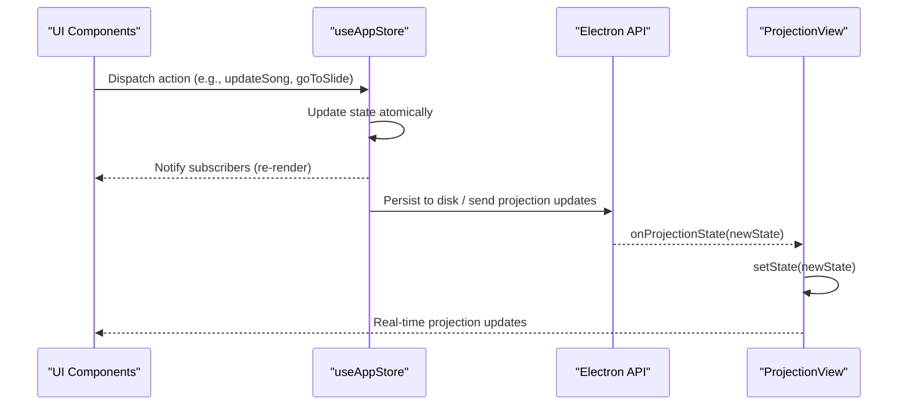
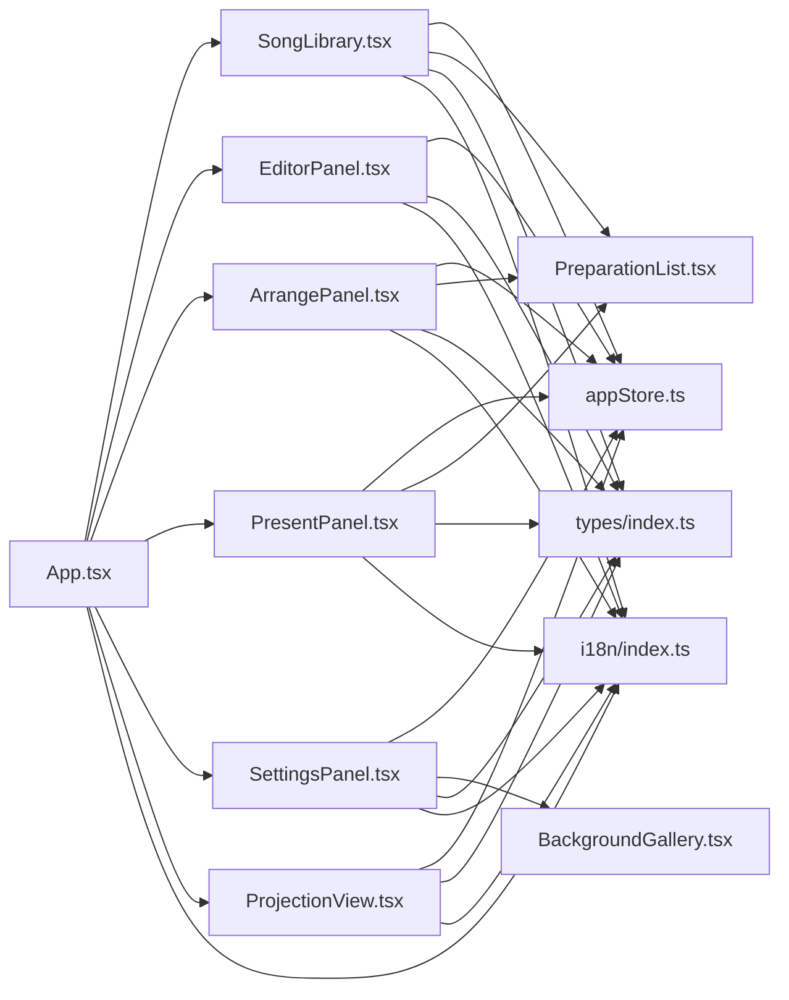
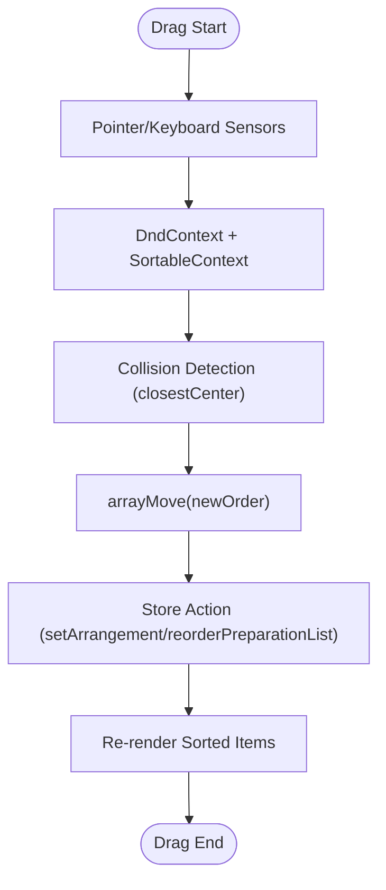
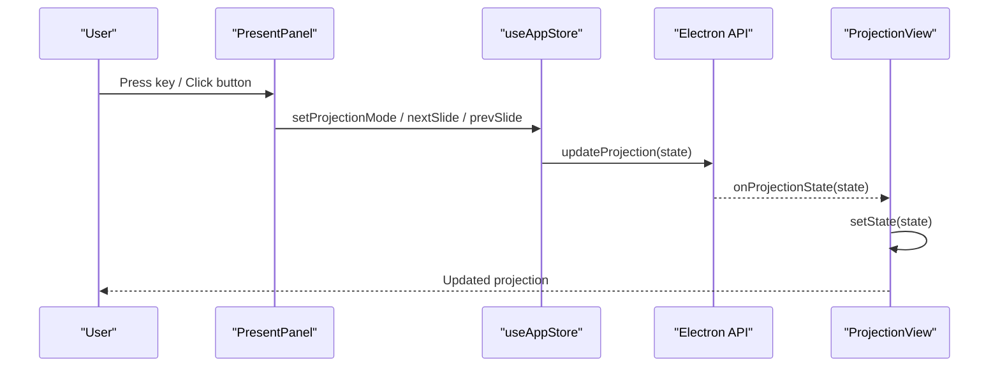

# User Interface Components

<cite>
**Referenced Files in This Document**
- [App.tsx](file://src/App.tsx)
- [SongLibrary.tsx](file://src/components/SongLibrary.tsx)
- [EditorPanel.tsx](file://src/components/EditorPanel.tsx)
- [ArrangePanel.tsx](file://src/components/ArrangePanel.tsx)
- [PresentPanel.tsx](file://src/components/PresentPanel.tsx)
- [SettingsPanel.tsx](file://src/components/SettingsPanel.tsx)
- [ProjectionView.tsx](file://src/components/ProjectionView.tsx)
- [BackgroundGallery.tsx](file://src/components/BackgroundGallery.tsx)
- [PreparationList.tsx](file://src/components/PreparationList.tsx)
- [appStore.ts](file://src/store/appStore.ts)
- [index.ts](file://src/types/index.ts)
- [main.tsx](file://src/main.tsx)
- [package.json](file://package.json)
- [tailwind.config.js](file://tailwind.config.js)
- [en.ts](file://src/i18n/en.ts)
- [index.ts (i18n)](file://src/i18n/index.ts)
</cite>

## Table of Contents
1. [Introduction](#introduction)
2. [Project Structure](#project-structure)
3. [Core Components](#core-components)
4. [Architecture Overview](#architecture-overview)
5. [Detailed Component Analysis](#detailed-component-analysis)
6. [Dependency Analysis](#dependency-analysis)
7. [Performance Considerations](#performance-considerations)
8. [Troubleshooting Guide](#troubleshooting-guide)
9. [Conclusion](#conclusion)
10. [Appendices](#appendices)

## Introduction
This document describes LyricDeck’s React component architecture and UI composition. It focuses on the major panels and views: SongLibrary, EditorPanel, ArrangePanel, PresentPanel, SettingsPanel, ProjectionView, BackgroundGallery, and PreparationList. It explains component hierarchy, props/state/event handling, drag-and-drop interactions using @dnd-kit, real-time state updates via Zustand, styling with Tailwind CSS, animations/transitions, responsive design, accessibility, cross-browser compatibility, and performance optimization.

## Project Structure
LyricDeck is a React + Electron application structured around a central App shell that renders different panels depending on the active tab and whether the projection window is open. State is managed globally with Zustand, and UI text is localized with a small i18n store.

**Diagram sources**
- [main.tsx:1-11](file://src/main.tsx#L1-L11)
- [App.tsx:12-99](file://src/App.tsx#L12-L99)
- [SongLibrary.tsx:8-95](file://src/components/SongLibrary.tsx#L8-L95)
- [EditorPanel.tsx:17-118](file://src/components/EditorPanel.tsx#L17-L118)
- [ArrangePanel.tsx:22-134](file://src/components/ArrangePanel.tsx#L22-L134)
- [PresentPanel.tsx:6-134](file://src/components/PresentPanel.tsx#L6-L134)
- [SettingsPanel.tsx:7-417](file://src/components/SettingsPanel.tsx#L7-L417)
- [ProjectionView.tsx:4-134](file://src/components/ProjectionView.tsx#L4-L134)
- [BackgroundGallery.tsx:9-98](file://src/components/BackgroundGallery.tsx#L9-L98)
- [PreparationList.tsx:25-188](file://src/components/PreparationList.tsx#L25-L188)
- [appStore.ts:98-385](file://src/store/appStore.ts#L98-L385)
- [index.ts:1-89](file://src/types/index.ts#L1-L89)
- [index.ts (i18n):1-43](file://src/i18n/index.ts#L1-L43)

**Section sources**
- [main.tsx:1-11](file://src/main.tsx#L1-L11)
- [App.tsx:12-99](file://src/App.tsx#L12-L99)

## Core Components
- App: Central orchestrator rendering header, tab navigation, and panel content. Handles projection window detection and initial data loading.
- SongLibrary: Song browser with search, sorting, selection, and quick actions (duplicate/delete/add-to-prep).
- EditorPanel: Song metadata and section editor with live preview.
- ArrangePanel: Build and reorder presentation arrangements with drag-and-drop.
- PresentPanel: Live projection controls, keyboard shortcuts, and dual-pane preview.
- SettingsPanel: Per-song presentation settings and global import/export/language.
- ProjectionView: Standalone projection window receiving real-time state updates.
- BackgroundGallery: Local image library for background selection.
- PreparationList: Reorderable queue of songs for arrangement/presentation.

**Section sources**
- [App.tsx:12-99](file://src/App.tsx#L12-L99)
- [SongLibrary.tsx:8-95](file://src/components/SongLibrary.tsx#L8-L95)
- [EditorPanel.tsx:17-118](file://src/components/EditorPanel.tsx#L17-L118)
- [ArrangePanel.tsx:22-134](file://src/components/ArrangePanel.tsx#L22-L134)
- [PresentPanel.tsx:6-134](file://src/components/PresentPanel.tsx#L6-L134)
- [SettingsPanel.tsx:7-417](file://src/components/SettingsPanel.tsx#L7-L417)
- [ProjectionView.tsx:4-134](file://src/components/ProjectionView.tsx#L4-L134)
- [BackgroundGallery.tsx:9-98](file://src/components/BackgroundGallery.tsx#L9-L98)
- [PreparationList.tsx:25-188](file://src/components/PreparationList.tsx#L25-L188)

## Architecture Overview
The UI follows a unidirectional data flow:
- Components read from Zustand store via hooks.
- User interactions trigger actions in the store.
- Store updates propagate to dependent components.
- ProjectionView subscribes to Electron-provided projection state events.

**Diagram sources**
- [appStore.ts:242-249](file://src/store/appStore.ts#L242-L249)
- [appStore.ts:362-383](file://src/store/appStore.ts#L362-L383)
- [ProjectionView.tsx:22-29](file://src/components/ProjectionView.tsx#L22-L29)

## Detailed Component Analysis

### App Shell and Routing
- Renders header with tab buttons and counts songs.
- Conditionally renders ProjectionView when hash indicates projection window.
- Initializes data on startup and listens for projection window close.

Usage example snippet paths:
- [App.tsx:48-53](file://src/App.tsx#L48-L53)
- [App.tsx:55-96](file://src/App.tsx#L55-L96)
- [App.tsx:19-42](file://src/App.tsx#L19-L42)

**Section sources**
- [App.tsx:12-99](file://src/App.tsx#L12-L99)

### SongLibrary
- Props: none (reads from store).
- State: local sort preference.
- Events: search input, sort toggles, item actions (select/double-click/add/remove/duplicate).
- Composition: renders SongItem children with hover actions and preparation indicators.

Usage example snippet paths:
- [SongLibrary.tsx:14-35](file://src/components/SongLibrary.tsx#L14-L35)
- [SongLibrary.tsx:67-84](file://src/components/SongLibrary.tsx#L67-L84)
- [SongLibrary.tsx:118-192](file://src/components/SongLibrary.tsx#L118-L192)

**Section sources**
- [SongLibrary.tsx:8-95](file://src/components/SongLibrary.tsx#L8-L95)

### EditorPanel
- Props: none (reads selected song from store).
- State: local collapse state per section.
- Events: update metadata, add/update/delete sections, live preview generation.
- Composition: SectionEditor and AddSectionButton; SlidePreview renders styled slides.

Usage example snippet paths:
- [EditorPanel.tsx:17-28](file://src/components/EditorPanel.tsx#L17-L28)
- [EditorPanel.tsx:92-107](file://src/components/EditorPanel.tsx#L92-L107)
- [EditorPanel.tsx:120-176](file://src/components/EditorPanel.tsx#L120-L176)
- [EditorPanel.tsx:210-246](file://src/components/EditorPanel.tsx#L210-L246)

**Section sources**
- [EditorPanel.tsx:17-118](file://src/components/EditorPanel.tsx#L17-L118)

### ArrangePanel
- Props: none (reads selected song from store).
- State: none (managed via drag-and-drop).
- Events: drag-and-drop reordering, add/remove from arrangement.
- Composition: DndKit-powered SortableArrangementItem; PreparationList in sidebar.

Usage example snippet paths:
- [ArrangePanel.tsx:22-42](file://src/components/ArrangePanel.tsx#L22-L42)
- [ArrangePanel.tsx:54-63](file://src/components/ArrangePanel.tsx#L54-L63)
- [ArrangePanel.tsx:136-186](file://src/components/ArrangePanel.tsx#L136-L186)

**Section sources**
- [ArrangePanel.tsx:22-134](file://src/components/ArrangePanel.tsx#L22-L134)

### PresentPanel
- Props: none (reads store for song, arrangement, projection state).
- State: local display list selection.
- Events: keyboard shortcuts, projection open/close, mode toggles, line shift buttons.
- Composition: dual preview (current/next), section list, controls, PreparationList.

Usage example snippet paths:
- [PresentPanel.tsx:6-95](file://src/components/PresentPanel.tsx#L6-L95)
- [PresentPanel.tsx:39-84](file://src/components/PresentPanel.tsx#L39-L84)
- [PresentPanel.tsx:109-129](file://src/components/PresentPanel.tsx#L109-L129)
- [PresentPanel.tsx:167-190](file://src/components/PresentPanel.tsx#L167-L190)
- [PresentPanel.tsx:265-297](file://src/components/PresentPanel.tsx#L265-L297)

**Section sources**
- [PresentPanel.tsx:6-134](file://src/components/PresentPanel.tsx#L6-L134)

### SettingsPanel
- Props: none (reads selected song from store).
- State: none (updates store).
- Events: background type/color/gradient/image selection, overlay opacity, text style adjustments, import/export, language change.
- Composition: BackgroundGallery integration; extensive form controls for presentation settings.

Usage example snippet paths:
- [SettingsPanel.tsx:7-24](file://src/components/SettingsPanel.tsx#L7-L24)
- [SettingsPanel.tsx:29-45](file://src/components/SettingsPanel.tsx#L29-L45)
- [SettingsPanel.tsx:47-54](file://src/components/SettingsPanel.tsx#L47-L54)
- [SettingsPanel.tsx:182-187](file://src/components/SettingsPanel.tsx#L182-L187)

**Section sources**
- [SettingsPanel.tsx:7-417](file://src/components/SettingsPanel.tsx#L7-L417)

### ProjectionView
- Props: none (subscribes to Electron-provided state).
- State: local derived styles and layout helpers.
- Events: none (renders received state).
- Composition: Mode-based rendering (black/logo/live/blank/clear); respects margins and line offsets.

Usage example snippet paths:
- [ProjectionView.tsx:4-29](file://src/components/ProjectionView.tsx#L4-L29)
- [ProjectionView.tsx:31-48](file://src/components/ProjectionView.tsx#L31-L48)
- [ProjectionView.tsx:77-132](file://src/components/ProjectionView.tsx#L77-L132)

**Section sources**
- [ProjectionView.tsx:4-134](file://src/components/ProjectionView.tsx#L4-L134)

### BackgroundGallery
- Props: currentValue, onSelect callback.
- State: local image list loaded from Electron.
- Events: add/delete images, selection.
- Composition: Grid of selectable thumbnails with overlay indicators.

Usage example snippet paths:
- [BackgroundGallery.tsx:9-98](file://src/components/BackgroundGallery.tsx#L9-L98)

**Section sources**
- [BackgroundGallery.tsx:9-98](file://src/components/BackgroundGallery.tsx#L9-L98)

### PreparationList
- Props: mode ('arrange' | 'present').
- State: none (managed via drag-and-drop and store).
- Events: drag-and-drop reordering, remove item, clear list, item click (select vs present).
- Composition: DndKit-powered SortablePrepItem; integrates with store actions.

Usage example snippet paths:
- [PreparationList.tsx:25-70](file://src/components/PreparationList.tsx#L25-L70)
- [PreparationList.tsx:47-55](file://src/components/PreparationList.tsx#L47-L55)
- [PreparationList.tsx:125-187](file://src/components/PreparationList.tsx#L125-L187)

**Section sources**
- [PreparationList.tsx:25-188](file://src/components/PreparationList.tsx#L25-L188)

## Dependency Analysis
- Component dependencies:
  - App depends on all panels and the store.
  - Panels depend on the store and i18n.
  - PreparationList is reused by ArrangePanel and PresentPanel.
  - SettingsPanel composes BackgroundGallery.
  - ProjectionView is standalone but receives updates from Electron.
- External libraries:
  - @dnd-kit for drag-and-drop.
  - Tailwind CSS for styling.
  - Zustand for state management.
  - Electron APIs for persistence and projection.

**Diagram sources**
- [App.tsx:4-9](file://src/App.tsx#L4-L9)
- [EditorPanel.tsx:18](file://src/components/EditorPanel.tsx#L18)
- [ArrangePanel.tsx:23](file://src/components/ArrangePanel.tsx#L23)
- [PresentPanel.tsx:19](file://src/components/PresentPanel.tsx#L19)
- [SettingsPanel.tsx:8](file://src/components/SettingsPanel.tsx#L8)
- [ProjectionView.tsx:5](file://src/components/ProjectionView.tsx#L5)
- [BackgroundGallery.tsx:9](file://src/components/BackgroundGallery.tsx#L9)
- [PreparationList.tsx:25](file://src/components/PreparationList.tsx#L25)
- [appStore.ts:98-385](file://src/store/appStore.ts#L98-L385)
- [index.ts:1-89](file://src/types/index.ts#L1-L89)
- [index.ts (i18n):1-43](file://src/i18n/index.ts#L1-L43)

**Section sources**
- [package.json:86-95](file://package.json#L86-L95)
- [tailwind.config.js:1-37](file://tailwind.config.js#L1-L37)

## Performance Considerations
- Minimize re-renders:
  - Keep components pure; avoid unnecessary deep equality checks.
  - Use local state sparingly (e.g., collapse toggles) to limit propagation.
- Virtualization:
  - Consider virtualizing long lists (song list, background gallery) for large datasets.
- Event handlers:
  - Memoize callbacks passed to children to prevent re-renders (e.g., use callbacks bound to stable identities).
- Drag-and-drop:
  - Use minimal state in draggable items; rely on store for heavy data.
- Rendering:
  - Defer expensive computations in render (e.g., preview calculations) to effects or memoized selectors.
- Persistence:
  - Batch store updates and throttle disk writes to reduce I/O overhead.

[No sources needed since this section provides general guidance]

## Troubleshooting Guide
- Projection window does not update:
  - Verify Electron API wiring for projection state updates and that the projection window is open.
  - Confirm store action sends updates to Electron.
  - Check ProjectionView subscription lifecycle.
- Drag-and-drop not working:
  - Ensure DndKit sensors and contexts are configured correctly.
  - Verify item IDs are stable and unique.
- Keyboard shortcuts not responding:
  - Confirm focus is not inside inputs; ensure event handler ignores input/textarea targets.
- Background image not applied:
  - Confirm Electron image selection returns a valid path and store updates accordingly.
- Localization not switching:
  - Ensure locale is persisted in storage and the i18n store updates correctly.

**Section sources**
- [ProjectionView.tsx:22-29](file://src/components/ProjectionView.tsx#L22-L29)
- [appStore.ts:242-249](file://src/store/appStore.ts#L242-L249)
- [PresentPanel.tsx:39-84](file://src/components/PresentPanel.tsx#L39-L84)
- [BackgroundGallery.tsx:17-31](file://src/components/BackgroundGallery.tsx#L17-L31)
- [index.ts (i18n):35-42](file://src/i18n/index.ts#L35-L42)

## Conclusion
LyricDeck’s UI is organized around a clean separation of concerns: a central App shell, reusable panels, and a centralized Zustand store. Drag-and-drop interactions are implemented consistently using @dnd-kit, and real-time projection updates are handled via Electron. Tailwind CSS provides a cohesive design system, while the i18n store enables multi-language support. Following the recommended patterns and performance tips will help maintain a responsive, accessible, and scalable UI.

[No sources needed since this section summarizes without analyzing specific files]

## Appendices

### Props, State, and Events Reference

- SongLibrary
  - Props: none
  - State: sortBy (local)
  - Events: search, sort toggles, item actions
  - Snippet paths:
    - [SongLibrary.tsx:12-12](file://src/components/SongLibrary.tsx#L12-L12)
    - [SongLibrary.tsx:40-47](file://src/components/SongLibrary.tsx#L40-L47)
    - [SongLibrary.tsx:67-79](file://src/components/SongLibrary.tsx#L67-L79)

- EditorPanel
  - Props: none
  - State: section collapse (local)
  - Events: metadata/text updates, add/remove sections
  - Snippet paths:
    - [EditorPanel.tsx:18-20](file://src/components/EditorPanel.tsx#L18-L20)
    - [EditorPanel.tsx:92-107](file://src/components/EditorPanel.tsx#L92-L107)
    - [EditorPanel.tsx:120-176](file://src/components/EditorPanel.tsx#L120-L176)

- ArrangePanel
  - Props: none
  - State: none
  - Events: drag end, add/remove from arrangement
  - Snippet paths:
    - [ArrangePanel.tsx:54-63](file://src/components/ArrangePanel.tsx#L54-L63)
    - [ArrangePanel.tsx:136-186](file://src/components/ArrangePanel.tsx#L136-L186)

- PresentPanel
  - Props: none
  - State: displays, selectedDisplay
  - Events: keyboard shortcuts, projection open/close, mode toggles
  - Snippet paths:
    - [PresentPanel.tsx:26-36](file://src/components/PresentPanel.tsx#L26-L36)
    - [PresentPanel.tsx:39-84](file://src/components/PresentPanel.tsx#L39-L84)
    - [PresentPanel.tsx:109-129](file://src/components/PresentPanel.tsx#L109-L129)

- SettingsPanel
  - Props: none
  - State: none
  - Events: background/text/style changes, import/export, language
  - Snippet paths:
    - [SettingsPanel.tsx:29-45](file://src/components/SettingsPanel.tsx#L29-L45)
    - [SettingsPanel.tsx:47-54](file://src/components/SettingsPanel.tsx#L47-L54)
    - [SettingsPanel.tsx:182-187](file://src/components/SettingsPanel.tsx#L182-L187)

- ProjectionView
  - Props: none
  - State: local derived styles
  - Events: none
  - Snippet paths:
    - [ProjectionView.tsx:22-29](file://src/components/ProjectionView.tsx#L22-L29)
    - [ProjectionView.tsx:31-48](file://src/components/ProjectionView.tsx#L31-L48)

- BackgroundGallery
  - Props: currentValue, onSelect
  - State: images
  - Events: add/delete/select
  - Snippet paths:
    - [BackgroundGallery.tsx:9-98](file://src/components/BackgroundGallery.tsx#L9-L98)

- PreparationList
  - Props: mode
  - State: none
  - Events: drag end, remove, clear, item click
  - Snippet paths:
    - [PreparationList.tsx:25-70](file://src/components/PreparationList.tsx#L25-L70)
    - [PreparationList.tsx:47-55](file://src/components/PreparationList.tsx#L47-L55)

### Drag-and-Drop Patterns with @dnd-kit
- Sensors and contexts are configured in ArrangePanel and PreparationList.
- Sortable items use useSortable for grab handles and dragging visuals.
- Collision detection uses closestCenter; strategy is verticalListSortingStrategy.
- Updates are applied via arrayMove and store actions.

**Diagram sources**
- [ArrangePanel.tsx:28-31](file://src/components/ArrangePanel.tsx#L28-L31)
- [ArrangePanel.tsx:111-126](file://src/components/ArrangePanel.tsx#L111-L126)
- [PreparationList.tsx:38-41](file://src/components/PreparationList.tsx#L38-L41)
- [PreparationList.tsx:101-118](file://src/components/PreparationList.tsx#L101-L118)

### Real-Time State Updates
- PresentPanel manages keyboard shortcuts and projection toggles.
- ProjectionView subscribes to Electron projection state and updates immediately.
- Store actions dispatch to Electron for persistence and broadcast.

**Diagram sources**
- [PresentPanel.tsx:39-84](file://src/components/PresentPanel.tsx#L39-L84)
- [appStore.ts:242-249](file://src/store/appStore.ts#L242-L249)
- [ProjectionView.tsx:22-29](file://src/components/ProjectionView.tsx#L22-L29)

### Styling Strategies with Tailwind CSS
- Semantic color palette:
  - primary (blues) for accents and active states.
  - surface (dark grays) for backgrounds and borders.
- Component-specific classes:
  - Panels use bg-surface-950, borders via bg-surface-700, and hover states for interactivity.
  - Buttons use btn, btn-primary, btn-secondary, btn-ghost variants.
- Typography:
  - Font families configurable per song; sizes and weights controlled via inline styles.
- Responsive layout:
  - Flexbox and gap utilities for dynamic layouts; sidebars and previews adapt to screen size.

**Section sources**
- [tailwind.config.js:1-37](file://tailwind.config.js#L1-L37)
- [App.tsx:56-98](file://src/App.tsx#L56-L98)
- [EditorPanel.tsx:112-116](file://src/components/EditorPanel.tsx#L112-L116)
- [PresentPanel.tsx:134-163](file://src/components/PresentPanel.tsx#L134-L163)
- [SettingsPanel.tsx:70-85](file://src/components/SettingsPanel.tsx#L70-L85)

### Accessibility and Cross-Browser Compatibility
- Accessibility:
  - Use semantic HTML and proper contrast with surface palettes.
  - Ensure keyboard navigation works (focus states, tab order).
  - Provide ARIA-friendly labels for interactive elements.
- Cross-browser compatibility:
  - Tailwind utilities are widely supported; test CSS custom properties and transforms.
  - Electron runtime ensures consistent rendering across platforms.

[No sources needed since this section provides general guidance]

### Component Lifecycle Management
- Mounting:
  - App loads initial data and sets up Electron listeners.
  - Panels mount and subscribe to store updates.
- Updating:
  - Store actions trigger re-renders; avoid excessive updates by batching.
- Unmounting:
  - Remove event listeners (keyboard) and cleanup subscriptions.

**Section sources**
- [App.tsx:19-42](file://src/App.tsx#L19-L42)
- [PresentPanel.tsx:81-84](file://src/components/PresentPanel.tsx#L81-L84)
- [ProjectionView.tsx:22-29](file://src/components/ProjectionView.tsx#L22-L29)